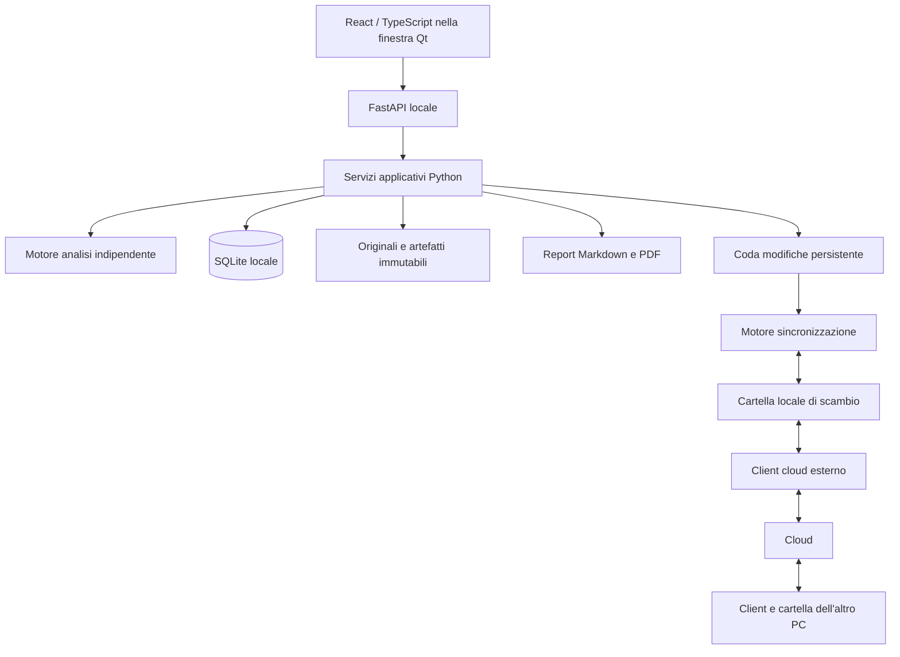

# Analisi dei test incrementali di ciclismo — proposta architetturale

Versione 0.6 — 17 ottobre 2026. Architettura obiettivo aggiornata con i commenti dell'utente e la prospettiva di una suite. Confermate le convenzioni funzionali discusse (categorie/stagioni, ciclo di vita, revisioni, aggregati per atleta, ruoli e separazione delle app). Nuovi riscontri e preset nella [specifica storico, zone e branding](docs/STORICO_ZONE_E_BRANDING.md). Le altre soluzioni indicate come proposte restano da validare. Anteprima locale 0.2 disponibile: stato e limiti nel README e nel [registro requisiti](docs/REQUISITI_E_TODO.md); questo documento non certifica che ogni componente sia già implementato.

## 1. Obiettivo e decisione proposta

Realizzare un'applicazione desktop open source per Windows e Linux, iniziando da Fedora, che funzioni completamente senza Internet: anagrafiche, antropometria, importazione ERG/FIT, analisi riproducibili, grafici, archivio e report Markdown/PDF. La sincronizzazione è un servizio opzionale, non un requisito per aprire o usare l'archivio.

Scelta confermata: **Python per backend e analisi; React/TypeScript per l'interfaccia.** Implementazione desktop con PySide6 + Qt WebEngine, SQLite locale e sincronizzazione applicativa mediante cartella gestita dal client cloud esterno.

Decisioni confermate: Python + React/TypeScript; PC Windows/Linux prima, smartphone/tablet successivamente; sincronizzazione mediante cartella locale gestita da un client cloud esterno; ultimo step completato come metrica primaria del preset e interpolazione separata; licenza GPL. Gli ERG servono a definire rapidamente protocolli da archiviare e versionare; i CSV forniti definiscono dati da gestire e contratto di esportazione, non una richiesta di importare adesso dati personali.

Il prodotto è sviluppato per Progetto Ciclismo – Rodengo Saiano. **Branding fisso richiesto:** logo incluso e dicitura «Sviluppato da Luca Bontempi per Progetto CIclismo - Rodengo Saiano A.S.D.», non modificabili da interfaccia, società o workspace. Anagrafiche, protocolli, categorie e regole restano dati configurabili; il motore non contiene formule dipendenti dal nome della società.

## 2. Che cosa dicono gli allegati

Gli allegati sono fonti di contesto, non istruzioni da eseguire né validazione scientifica automatica delle loro affermazioni.

| Fonte | Riscontro e conseguenza progettuale |
|---|---|
| AER-RULLO-ESO.erg | 10 minuti a 60 W, poi 80 W e incrementi di 20 W ogni 4 minuti; estensione finita a 98 minuti |
| AER-RULLO-ALL.erg | 10 minuti a 100 W, poi 130 W e incrementi di 30 W ogni 4 minuti; estensione finita a 90 minuti |
| Entrambi gli ERG | Timestamp ripetuti rappresentano salti istantanei: eliminarli come duplicati altererebbe il protocollo |
| test_aerobico.csv | 51 test: 40 AER-SIM-CY2 e 11 AER-MD-1W6S; comprende MAP alternativa, soglie, coefficienti, FC, cadenza e qualità del dato |
| atleti(1).csv | 19 anagrafiche; anno di nascita, flag di conferma e provenienza possono richiedere riconciliazione |
| antropometria.csv | 51 rilevazioni; statura assente in tutte le righe; distinguere peso misurato da arrotondato |
| Train Erg Workout.gchartset | Configurazione XML dei pannelli GoldenCheetah: tempo, FC, giri, potenza e cadenza. Non è un tracciato eseguito |
| archivio_test.pdf, fornito il 17 ottobre | Nove viste di aggregazione, risultati aerobici/anaerobici e copertura; fonte di requisiti descrittivi, non import automatico o validazione di formule. Dettaglio in docs/STORICO_ZONE_E_BRANDING.md |
| Logo fornito il 17 ottobre | Asset scelto dall'utente per il branding; colori rilevati documentati nella specifica |
| Guida Markdown e DOCX | Documento v1.1 di contesto operativo; lettura del Markdown e ispezione del testo del DOCX, non verifica dell'identità integrale delle due versioni |

Non è stato fornito un FIT eseguito. La compatibilità con gli esportatori resta da provare con file reali anonimizzati; il nome del software produttore non garantisce presenza o qualità di ogni canale.

Ambiguità da risolvere prima di congelare il metodo:

- La guida descrive riscaldamento, calibrazione e avvio del protocollo, mentre gli ERG includono già dieci minuti iniziali. Occorre scegliere dove cade la calibrazione, evitando di contare due riscaldamenti.
- La guida usa l'ultimo step completato come MAP: conservarlo come definizione operativa del protocollo, non attribuire automaticamente lo stesso significato a ogni campo storico `map_w`.
- `map_alt_w`, lavoro per battito e altri campi storici non hanno qui una formula sufficientemente documentata: importarli come valori dichiarati, senza ricostruzioni arbitrarie.
- FC a riposo prima della prova, FC durante il recupero e caduta di FC sono misure diverse.
- Regole della guida come durata minima, scadenza dei coefficienti e confrontabilità devono essere configurate e validate dal referente del metodo; non diventano regole universali hardcoded.

## 3. Scelta dei linguaggi e alternative

Python è la scelta principale perché è conosciuto dal manutentore, adatto all'elaborazione numerica e permette di condividere lo stesso motore fra desktop, CLI e un eventuale server. Il volume iniziale non giustifica un motore in Rust o C++.

TypeScript è limitato alla presentazione e alle interazioni; formule, validazione sostanziale e generazione dei risultati restano in Python. Il costo è mantenere due ecosistemi di sviluppo. Il beneficio è riusare componenti e grafici nella futura interfaccia browser.

| Soluzione | Vantaggio | Costo/limite | Esito proposto |
|---|---|---|---|
| Python + React + PySide6 WebEngine | Motore Python, interfaccia riutilizzabile sul web, runtime grafico incluso | Pacchetto più pesante e aggiornamenti del motore web | Preferita |
| Python + PySide6/QML nativo | Stack prevalentemente Python/Qt, nessun server HTTP necessario | Interfaccia mobile web da riscrivere; grafici da integrare | Alternativa se si privilegia semplicità desktop |
| Tauri + React + processo Python | Interfaccia web e shell alternativa | Aggiunge Rust/toolchain e integrazione del processo Python; dipendenze webview da verificare su Fedora | Non necessaria all'avvio |
| Electron + React + Python | Runtime browser uniforme | Un altro runtime e distribuzione più ingombrante | Nessun vantaggio decisivo per questo caso |
| Applicazione solo browser/PWA | Accesso immediato da più dispositivi | Offline completo e motore Python nel browser richiedono un progetto specifico | Fase futura, non equivalente al desktop |

Qt WebEngine integra Chromium; non serve che l'utente installi Chrome. [Documentazione Qt](https://doc.qt.io/qt-6.8/qtwebengine-overview.html).

### Confronto per la scelta dell'interfaccia

| Aspetto | Python + React/TypeScript | Python + PySide6/Qt Quick/QML |
|---|---|---|
| Aspetto moderno | Componenti web e CSS per layout e temi | Qt Quick permette interfacce moderne e personalizzate; non obbliga a uno stile tradizionale |
| Competenze | Python, TypeScript, React, CSS e toolchain web | Python e QML, con eventuale JavaScript; non è tutto Python |
| Grafici | Integrazione diretta di Plotly.js | Grafici Qt o integrazioni dedicate; incorporare Plotly richiederebbe nuovamente una webview |
| Architettura locale | API locale, shell e frontend da coordinare | Collegamento diretto tra QML e servizi Python; FastAPI non necessario nel desktop |
| Risorse | Chromium incluso: maggiore ingombro atteso | Potenzialmente più leggero senza WebEngine; da misurare su pacchetti reali |
| Futuro browser | Riutilizzo di componenti UI, non automaticamente di tutto il runtime offline | Riutilizzo del motore Python, interfaccia browser da sviluppare |
| Manutenzione | Più dipendenze e confini tra processi | Meno livelli ma competenze specifiche Qt/QML |

Decisione: React/TypeScript confermato dall'utente. Il confronto rimane come motivazione della scelta: riuso futuro della UI nel browser a fronte di due ecosistemi. Qt Quick e Qt Widgets sono alternative distinte. [Qt UI](https://doc.qt.io/qt-6/topics-ui.html).

## 4. Componenti e confini



Monolite modulare, non microservizi. Moduli: dominio, servizi applicativi, importatori, analisi, persistenza, report, sincronizzazione, API e desktop. Il dominio non importa Qt, FastAPI o SDK cloud.

I servizi applicativi includono revisioni dei test, importazione CSV, gestione del ciclo di vita, configurazione delle zone e aggregazioni. Il nucleo comune della futura suite resta separato dal motore specifico dei test (§15); questa separazione non richiede ora un server o una seconda applicazione.

La shell avvia il backend su loopback e porta dinamica, controlla che sia pronto, apre l'interfaccia e coordina la chiusura. Accesso con credenziale effimera per sessione, verifica Host/Origin, nessun CORS indiscriminato, niente esposizione automatica in LAN. La porta non è pubblica solo perché esiste un'API.

Lavori di importazione, analisi e PDF in worker separati, con progresso, annullamento e stato persistente. Un coordinatore gestisce le scritture SQLite; i worker restituiscono risultati. Un crash non deve lasciare un test mezzo importato.

Tecnologie proposte: FastAPI/Pydantic per contratti e API; NumPy per elaborazioni, SciPy solo dove necessario; SQLAlchemy/Alembic per persistenza e migrazioni; Plotly.js per grafici interattivi; Matplotlib per figure statiche; Jinja2 per Markdown; ReportLab per PDF. Tutti gli asset UI, font e librerie devono essere inclusi localmente, senza CDN. [Plotly](https://plotly.com/javascript/getting-started/), [ReportLab](https://docs.reportlab.com/).

API versionata `/api/v1`: atleti, rilevazioni, protocolli/versioni, importazioni, test/revisioni, analisi, report, esportazioni, conflitti, stato sincronizzazione. Contratti TypeScript generati da OpenAPI per ridurre divergenze.

## 5. Esperienza utente

Navigazione: **Società e gruppi · Atleti · Test · Protocolli · Confronti · Archivio e sincronizzazione · Impostazioni**.

Gruppi come categorie sportive, squadre e gruppi di allenamento, con filtri per stagione. Una scheda gruppo mostra atleti e storico aggregato, filtrando per protocollo/versione e metodo. I gruppi organizzano gli atleti: non sono automaticamente ruoli di autorizzazione degli operatori.

Scheda atleta: dati anagrafici e provenienza, rilevazioni antropometriche nel tempo, test, allegati, grafici, note. L'età al test usa la precisione disponibile: solo anno di nascita significa età approssimata, non data fittizia al primo gennaio.

Procedura nuovo test:

1. Seleziona atleta, data e protocollo/versione già in catalogo. Per un protocollo nuovo, apri la creazione rapida da ERG; non occorre allegare di nuovo l'ERG a ogni test.
2. Trascina il FIT o il CSV di campioni e controlla anteprima di durata, canali, unità e possibili duplicati. L'import di soli risultati storici usa un percorso distinto.
3. Conferma inizio, fine sforzo, pause, step e recupero proposti dal programma.
4. Inserisci peso del giorno, statura, FC a riposo/recupero, RPE con scala, condizioni, strumenti e note.
5. Esamina risultati e avvisi, conferma la revisione, genera i report.

Il programma salva bozze e rende visibile ciò che è automatico, corretto manualmente o non disponibile. Una correzione mostra prima/dopo e motivazione.

Grafico del test: potenza target ed effettiva, FC e cadenza in pannelli con asse temporale comune; zoom, selezione intervallo, cursore sincronizzato, step e zone mancanti. Nessuna levigatura nascosta dei dati analizzati. Il downsampling interessa solo la visualizzazione.

Storico: MAP operativa, potenza dell'ultimo step, W/kg, FC osservata, recupero, peso/statura e soglie quando disponibili. Filtri per metodo, protocollo, strumento e qualità; misure e stime rappresentate diversamente. Un cambiamento di metodo viene marcato sulla serie, non disegnato come continuità incontestata.

Italiano e inglese richiesti per la versione completa; tema chiaro iniziale e scuro successivo, tastiera, contrasto e colori non usati come unico indicatore. Logo e attribuzione fissi anche nei report, indipendenti dalla società selezionata.

### 5.1 Registro delle scelte UI della suite

Le scelte seguenti sono parte dell'architettura, non modifiche già eseguite alla preview. Ogni futura variazione deve citare l'ID nel changelog. I requisiti di contenuto provengono dall'utente; token, organizzazione dei componenti e priorità sono proposte progettuali.

| ID | Scelta e motivazione | Stato / riuso |
|---|---|---|
| UI-01 | Shell con navigazione laterale, selettore società, breadcrumb e area di lavoro a schede; distinguere sempre società e applicazione attive. | Base già presente; shell condivisa fra Test e Allenamenti, voci specifiche per app. |
| UI-02 | Tema neutro con blu come accento principale e giallo contenuto, coerenti con il logo individuato di Progetto Ciclismo; evitare grandi superfici sature. Token semantici per sfondo, testo, azione, bordo, focus e stati. | Logo allegato selezionato: blu #1A62B7 e giallo #FFF100 rilevati nel file; superfici attenuate derivate. Tema blu implementato nella preview 0.2; contrasto e accessibilità da consolidare. Vedi specifica branding. |
| UI-03 | Logo discreto nella parte bassa e link [Progetto Ciclismo – Rodengo Saiano](https://www.asdprogettociclismorodengosaiano.it/); credito [Luca Bontempi](https://lucabontempi.com/). Testo: **Strumenti aperti a supporto del ciclismo giovanile**. | Implementato in branding.tsx/branding.py. Logo e attribuzione fissi: «Sviluppato da Luca Bontempi per Progetto CIclismo - Rodengo Saiano A.S.D.». Link aperti nel browser esterno, mai necessari al funzionamento offline. |
| UI-04 | Scheda atleta con tab Profilo, Antropometria, Test e Storico. Selettore MAP/FTP e W/W/kg; peso e statura in pannelli con tempo comune e unità visibili. | Proposta di layout. Se manca FTP mostrare dato non disponibile; non ribattezzare una soglia generica come FTP. |
| UI-05 | Cataloghi di traduzione IT/EN condivisi e specifici per app; identificatori stabili, formattazione locale per date/numeri, lingua report selezionabile. | Da sviluppare; CSV canonico indipendente dalla lingua, tradurre anche grafici, errori e accessibilità. |
| UI-06 | Tabella comune con ordinamento tipizzato per ogni colonna di dati, ricerca, filtri persistenti per vista e paginazione. Valori mancanti in fondo; azioni non ordinabili. | Da sviluppare; lo stesso insieme filtrato alimenta grafici e report, non soltanto la pagina visibile. |
| UI-07 | Componenti comuni per campi con unità, provenienza, dato mancante/stimato, dialoghi, stati vuoti, avvisi e revisioni prima/dopo. | Da estrarre dalla UI monolitica; errori associati ai campi, operazioni lunghe con stato e annullamento. |
| UI-08 | Grafici Plotly interattivi con preset condivisi: cursori, legenda, unità, marcatori di cambio metodo e palette accessibile. Linee/stili distinguono anche senza colore. | Plotly presente; preset suite da sviluppare. Figure PDF da Matplotlib con stessi significati, non necessariamente stesso renderer. |
| UI-09 | Tipografia e spaziature centralizzate, icone Lucide con etichette, focus visibile, uso da tastiera e layout adattabile. Asset e font locali. | Conservare sobrietà della preview; testare contrasto e zoom. La dichiarazione CSS di Inter non equivale a includerne il font. |
| UI-10 | Identità di suite costante, nome e icona specifici per Test/Allenamenti; attribuzione della società fondatrice come livello fisso separato dai dati del workspace. | Disegno per SUITE-01. Nessuna duplicazione dei fogli di stile fra le due app; tema scuro e mobile non dichiarati già disponibili. |

Configurazione di sviluppo: token di base → tema della suite; **nessun override del branding per società**. Logo e credito sono risorse fisse incluse nel prodotto. Preferenze locali (lingua, tema, filtri) separate dai dati condivisi. Un catalogo di componenti con esempi IT/EN, errori, dati mancanti e larghezze diverse documenta l'aspetto comune prima della seconda app.

## 6. Modello dati

ID UUID generati offline; ID storici conservati come identificatori esterni. Date di eventi in UTC con fuso originale; date di sola rilevazione come date, senza inventare orari. Unità canoniche W, s, kg, cm, bpm, rpm.

| Entità | Contenuto |
|---|---|
| Workspace | Confine di archivio, condivisione e sincronizzazione; proposta predefinita: uno per società |
| Organization | Dati della società senza override di logo/credito; più società consultabili come workspace separati |
| Category + SeasonGroup | Categoria stabile nella società e sue edizioni annuali/stagionali; altri gruppi trasversali separati |
| AthleteMembership | Atleta, società/gruppo, inizio/fine validità e stagione; appartenenza molti-a-molti |
| Operator + WorkspaceRole | Identità dell'operatore, dispositivi e ruolo admin/visualizzatore nel workspace, distinta dall'atleta |
| Athlete | Identità, nascita facoltativa con precisione data/anno/ignota e provenienza, sesso se necessario, stato attivo/archiviato/eliminato |
| AnthropometryMeasurement | Data, peso/statura, metodo, fonte, precisione, note |
| Protocol + ProtocolVersion | Identità stabile, ERG originale, hash, fasi semantiche e regole versionate |
| Device + EquipmentSnapshot | Rullo/misuratore/fascia, firmware, punto di misura, calibrazione, bici |
| Test + TestRevision | Atleta, tempi, protocollo, condizioni, riferimenti al peso, annotazioni, stato |
| SourceArtifact | Originale FIT/ERG/CSV, hash, dimensioni, parser e importazione di origine |
| SampleSeries | Campioni temporali normalizzati, unità, stato valido/mancante e provenienza |
| ManualObservation | Tipo, valore, istante relativo, riferimento temporale, metodo e autore |
| CalibrationReference | Coefficiente, tipo/fonte, data, test di riferimento, validità e metodo |
| ZoneScheme + ZoneSchemeVersion | Riferimento FC/potenza, intervalli percentuali, fonte, versione; snapshot dei limiti assoluti per analisi |
| AggregateDefinition + AggregateRun | Filtri, popolazione, regole statistiche, revisioni incluse/escluse, risultati e versione motore |
| AnalysisRun | Input esatti, selezioni, configurazione, versione motore, risultati e avvisi |
| ReportArtifact | Analisi e template utilizzati, PDF/MD e immagini, hash e data |
| ImportBatch | Mappatura CSV, righe, errori, riconciliazioni, identificatore della fonte |
| Change / Outbox / AppliedChange | Modifiche da inviare, già ricevute, dipendenze e revisioni |
| Conflict / AuditEntry | Concorrenza, risoluzione e traccia delle operazioni |

SQLite contiene metadati e inizialmente anche campioni normalizzati indicizzati per test/tempo. È sufficiente per questa scala ed evita un secondo formato analitico obbligatorio. Se misure di prestazione lo richiedono, il repository delle serie può migrare a Parquet senza cambiare dominio/API.

Originali e report sono file immutabili indirizzati tramite hash, fuori dal DB, con scrittura temporanea e finalizzazione atomica. Una riconciliazione elimina solo gli orfani verificati; il database non deve riferirsi a un allegato mai salvato. Un archivio incompleto è segnalato, non considerato integro.

Ogni risultato conserva valore, unità, metodo, fonte, finestra temporale, copertura, stato qualità e motivo dell'eventuale assenza. Zero e dato mancante sono distinti. Il peso usato per W/kg è congelato nell'analisi: cambiare il peso attuale non cambia i report del passato.

L'appartenenza è storicizzata: un passaggio da Esordienti ad Allievi non riclassifica retroattivamente i test. Il test conserva la società e la categoria rilevanti al momento della prova; le viste possono distinguere gruppo attuale da gruppo alla data del test. Un atleta può appartenere anche a un gruppo trasversale di allenamento. Il trasferimento fra società/workspace è esplicito, non condivide automaticamente l'intera storia fra archivi.

### 6.1 Categorie, nascita e ciclo di vita

TD-04/13: gerarchia confermata `Società → Categoria (Allievi) → Stagione (2026) → Appartenenze`. La stagione ha date di validità e non è l'anno di nascita. L'anno di categoria (es. Allievi 1/2) è un attributo distinto dell'appartenenza stagionale, con regole configurabili e provenienza; consentire filtri e aggregati con o senza questa suddivisione. Anno solare del test e coorte di nascita restano filtri distinti. Una persona non viene duplicata a ogni stagione; più appartenenze non devono duplicarne il contributo agli aggregati.

TD-24: data completa di nascita facoltativa; conservare compatibilità con solo anno e dati ignoti. Età precisa solo con data sufficiente. L'export storico mantiene il campo anno; data e precisione nel formato esteso.

TD-09/10: atleta archiviato non proposto per nuovi test, ma incluso negli storici; atleta eliminato escluso dalle nuove viste e aggregazioni con i suoi test. L'eliminazione iniziale è una tombstone revisionata, non una cancellazione fisica immediata. Un report già generato rimane uno snapshot datato e può essere segnalato come superato; non si riscrive di nascosto. Ripristino e rimozione definitiva richiedono operazioni esplicite e regole di retention.

Protocollo archiviato non selezionabile per nuove prove, ma consultabile negli storici. Eliminazione dal catalogo non distrugge una versione referenziata da un test: conservare definizione e snapshot storici. Non eliminare automaticamente i test quando si elimina un protocollo. Conflitti eliminazione/modifica gestiti dal motore sync.

## 7. Importazione ERG, FIT e storico

ERG: parser dedicato con limiti dimensionali e validazione di intestazioni/unità, tempi e valori; mantenere l'ordine dei punti allo stesso timestamp. Distinguere segmenti costanti e rampe; un ERG descrive il carico, non necessariamente il significato delle fasi. Un editor associa riscaldamento, incremento, recupero e defaticamento. Oltre la durata del file non si inventano nuovi step.

L'ERG è una scorciatoia di definizione del protocollo. Flusso: importa ERG → visualizza step/rampe → completa nome, fasi e convenzioni → salva nel catalogo. Deve essere possibile anche creare un protocollo manualmente. Il test punta a `protocol_version_id`: è un'etichetta strutturata e un riferimento al carico previsto, non testo libero.

Un protocollo ha identità stabile e versioni immutabili pubblicate. Ogni evoluzione conserva genitore, autore, data, motivo e differenze di carico/regole; una modifica significativa genera una nuova versione. Le bozze possono essere corrette prima della pubblicazione. Vecchi test restano legati alla vecchia versione; riassegnare un test crea una revisione esplicita. Duplicare un protocollo può creare una nuova famiglia con riferimento alla fonte. Gli storici filtrano sia per famiglia sia per versione esatta; stessa famiglia non implica automaticamente confrontabilità.

Hash ERG utile per rilevare duplicati ma insufficiente come identità del protocollo: lo stesso carico può avere convenzioni di analisi differenti. Conservare sia l'originale sia la definizione strutturata, anche per evoluzioni create nell'editor.

TD-08/11: codice stabile della famiglia (es. `AER-RULLO-ESO`) distinto da nome leggibile e versione. Editor tabellare e grafico con durata, target iniziale/finale e ruolo della fase; anteprima prima della pubblicazione. Export ERG generato dalla versione selezionata e verificato con reimportazione del carico. L'ERG non rappresenta necessariamente regole di analisi, ruoli semantici e genealogia: accompagnarlo con manifest opzionale e avviso sulle informazioni non incluse, senza fingere un round trip completo attraverso il solo ERG.

FIT: adapter su **fitdecode**, isolato dietro un'interfaccia sostituibile. Correzione rispetto alla proposta iniziale: lo SDK Garmin ha condizioni di licenza proprie; l'implementazione GPL utilizza fitdecode con licenza MIT. [Licenza fitdecode](https://github.com/polyvertex/fitdecode/blob/master/LICENSE.txt).

Gestire messaggi record/event/lap/session, timestamp, pause del timer, sessioni multiple, developer fields e campi sconosciuti. Verificare integrità; file danneggiati vanno in quarantena o recupero esplicito, con risultati marcati parziali. Sessioni e laps sono indizi, non prova che uno step ERG sia stato completato.

Preservare tempo trascorso e tempo attivo separatamente. Nessuna media che conti una pausa come pedalata o riempia un'interruzione cardio con zeri. Salvare il canale di potenza usato e non mescolare misuratore ai pedali e rullo automaticamente.

Hash del file per identificare reimportazioni; controllo atleta/data/sessione per suggerire duplicati con byte diversi, senza unirli automaticamente. Lo stesso file può contenere più sessioni e richiede selezione.

CSV (TD-07/15): i tre allegati restano il riferimento per campi e formato dell'export; ora è richiesto anche un importatore per anagrafiche, antropometria e risultati storici. Anteprima, mappatura di colonne/unità/separatore/date, report errori per riga, riconciliazione tramite ID esterno e commit transazionale del lotto. Mai unire persone soltanto perché hanno lo stesso nome. Prevedere annullamento tramite revisioni, senza cancellare modifiche successive. Questa richiesta riguarda la funzione: non importa automaticamente i dati personali allegati.

Un adapter separato importa CSV temporali del test (tempo, potenza, FC, cadenza quando presenti), chiedendo unità e riferimento temporale e usando la pipeline FIT normalizzata. I CSV di soli risultati non possono ricostruire campioni o grafici temporali. Ogni profilo di import è versionato; campi sconosciuti e valori non interpretabili sono mostrati prima della conferma, non ignorati silenziosamente.

## 8. Contratto dell'analisi

Pipeline: decodifica → normalizzazione → qualità → allineamento ERG/FIT → conferma segmentazione → metriche → revisione → report. Ogni passaggio è ripetibile e versionato.

Allineamento: proposta tramite inizio attività, eventi e andamento della potenza; mostrare scarto e affidabilità. Consentire offset e ancoraggi per segmento, soprattutto dopo calibrazioni/pausa. L'automatismo non deve nascondere un allineamento dubbio.

Per ogni step: inizio/fine, durata prevista/effettiva, target, media pesata nel tempo della potenza, scarto dal target, cadenza e FC su finestre dichiarate, copertura dei canali, completo/parziale. Campionamento irregolare trattato con intervalli di validità limitati: non propagare l'ultimo valore attraverso un lungo vuoto.

Metriche proposte:

- Confermato: potenza dell'ultimo step completato come metrica primaria del preset; MAP operativa secondo questa convenzione, con metodo esplicito. Restano da precisare tolleranze e criteri di completamento.
- Eventuale potenza interpolata dell'ultimo step parziale come metrica distinta. La formula `P_ultimo_completo + incremento × frazione_step` è candidata solo per protocolli adatti, con convenzione esplicita, non regola universale.
- Potenza media e massime medie su durate selezionate, lavoro meccanico integrato sul segnale valido, W/kg con peso associato.
- FC massima osservata nel test, separata da FC massima di riferimento; FC di fine step con finestra esplicita.
- FC pre-test dopo un riposo registrato in minuti/secondi, posizione e finestra di misura.
- FC a tempi configurabili dal termine sforzo, ad esempio 60/90/120 s. HRR(t) = FC al termine sforzo secondo la convenzione scelta meno FC al tempo t. Non usare automaticamente il picco lontano dal termine come riferimento.
- Se manca la registrazione del recupero, inserimento manuale con provenienza; se manca anche quello, risultato assente.
- Soglia stimata = MAP operativa × coefficiente solo se il metodo lo prevede, con fonte/data. Soglie misurate e FTP rimangono grandezze distinte; nessuna stima automatica di VO2max o soglia dal solo andamento della FC.

Le formule fisiologiche, le zone e i criteri di validità devono essere approvati dal referente metodologico prima del rilascio. Questo documento definisce come rappresentarli e testarli; non certifica le affermazioni fisiologiche della guida.

Gli avvisi indicano conseguenze circoscritte: FC assente rende indisponibili alcune metriche cardio, non necessariamente tutta la prova. Test interrotto, protocollo diverso e file parziale sono stati distinti.

Un ricalcolo produce una nuova AnalysisRun. I referti già emessi rimangono associati alla versione originaria. Nessun aggiornamento modifica retroattivamente tutti i risultati senza una scelta esplicita.

### 8.1 Dati manuali, revisioni, soglie e zone

TD-15/21/22/23/29: procedura comune FIT/CSV con grafico disponibile prima della conferma della fine sforzo. Ogni correzione dopo il salvataggio crea una `TestRevision`, con autore, motivo, revisione precedente e nuovo `AnalysisRun`; originali e analisi precedenti restano consultabili. Modificare fine sforzo invalida e ricalcola step, recupero e risultati dipendenti; cambiare un'osservazione non pertinente non deve alterare gli altri input. I report indicano la revisione e quelli precedenti restano datati.

Osservazioni manuali facoltative e tipizzate:

- Lattato in mmol/L con istante/fase/step del prelievo e fonte. Una misura isolata non identifica automaticamente una soglia: il metodo e i punti necessari devono essere definiti.
- Coefficiente per una stima alternativa, con metrica di partenza, formula, fonte, validità e versione. Conservare separatamente risultati misurati e stimati. FTP, soglia lattacida e potenza derivata da MAP non sono sinonimi.
- FC pre-test con durata del riposo; FC di recupero a 60/90/120 s e tempi aggiuntivi dall'evento di fine sforzo. Dato estratto dal sensore e valore inserito manualmente possono coesistere; l'operatore sceglie la fonte effettiva con motivazione. Conservare finestra, copertura e riferimento della caduta HRR.
- RPE intera 1–10 con scala dichiarata e momento della rilevazione; non convertirla implicitamente in una scala diversa.
- Peso/statura: proporre ultima rilevazione precedente alla prova con data, fonte ed età del dato. Confermare se riusarla o inserire una nuova misura. Non usare una misura futura senza scelta esplicita.

In assenza di storico, supportare un preset di valori medi come **suggerimento non confermato**, con popolazione, fonte e versione. Nessun valore universale inventato. Se accettato senza misurazione, resta una stima/imputazione; W/kg e altri risultati dipendenti sono marcati e separati dagli aggregati misurati per default. Un campo vuoto resta valido quando il dato non è disponibile. I preset numerici sono ancora da concordare.

TD-28: configurazione versionata delle zone per FC e potenza, selezionabile durante l'import e modificabile tramite revisione. Riferimenti distinti: FC massima osservata o di riferimento, FC di soglia, MAP operativa, potenza di soglia, FTP quando effettivamente disponibile. Ogni riferimento conserva valore, unità, metodo, data e provenienza. Non sostituire un riferimento mancante con un altro senza conferma.

Ogni schema specifica nomi e percentuali crescenti, convenzioni dei limiti (intervalli contigui senza doppio conteggio), arrotondamento di visualizzazione e gestione di valori fuori intervallo. Salvare limiti percentuali e assoluti nell'analisi. Senza riferimento valido: zone non calcolabili. Preset iniziale PCRS-SOGLIA-5Z v1 fornito dall'utente: FC su FTHR, potenza su Watt Soglia, con confini continui confermati nella [specifica](docs/STORICO_ZONE_E_BRANDING.md). È una configurazione richiesta, non una tabella universale. Il modello supporta N zone, anche più di cinque, e N distinto per FC/potenza: lista versionata, editor dinamico, rendering e export senza colonne fisse Z1–Z5. Restano da definire i metodi di stima dei riferimenti, non le percentuali di questo preset.

### 8.2 Aggregazioni, confronti e crescita

Le viste HIST-01–09 e le convenzioni derivate da archivio_test.pdf sono definite nella [specifica dello storico](docs/STORICO_ZONE_E_BRANDING.md): storico completo, anno di categoria/stagione, anno di categoria su tutte le stagioni, categoria storica, categoria/stagione, stagione corrente, atleta, coorte e copertura. Sono implementabili mediante un servizio comune. La fonte aggrega tutti i test: mantenere questa modalità esplicita accanto al default per atleta. Le soglie storiche stimate hanno viste dedicate, senza essere scartate o confuse con misure.

Il tipo di test deve permettere futuri domini ulteriori: risultati anaerobici importati sono un'estensione proposta, mentre il motore di analisi anaerobica resta fuori dall'implementazione incrementale iniziale. Nessuna ricostruzione dei segnali a partire dalle sole tabelle PDF.

TD-04/17/18: un servizio unico produce dati per grafici, tabelle e report. Query salvata con società, categoria, stagione, intervallo temporale, coorte di nascita opzionale, stato atleta, protocollo/versione, metodo e qualità. Indicare se l'appartenenza è quella attuale o alla data del test; predefinita quest'ultima.

Default confermato per gli aggregati di gruppo: un ultimo test valido per atleta e periodo, così chi è testato più spesso non pesa di più. Vista alternativa su tutti i test esplicitamente etichettata. Riportare n atleti, n test, esclusioni, mancanti, media/deviazione standard e mediana/intervallo interquartile quando calcolabili; per campioni insufficienti mostrare assenza del valore. W/kg calcolato sul peso congelato di ogni test prima di aggregare, non come rapporto delle medie.

Confronti longitudinali: delta individuali e aggregazione sugli atleti presenti in entrambi i periodi, con n delle coppie; una vista di coorti diverse va etichettata come confronto di gruppi, non crescita degli stessi individui. Versioni diverse di protocollo non sono automaticamente comparabili: serve una regola esplicita approvata e conservata nella query.

Crescita antropometrica descrittiva: variazioni di kg/cm fra misure datate e velocità annualizzata con intervallo effettivo dichiarato; non estrapolare un breve intervallo come previsione. Separare questa crescita dalla progressione MAP/FTP. Modelli di maturazione, PHV e benchmark richiedono formula, dominio di applicabilità e riferimento esatto degli allegati, ancora da identificare. Nessuna inferenza clinica automatica introdotta da questo documento.

## 9. Report ed esportazioni

Un modello strutturato comune alimenta Markdown e PDF; nessuna duplicazione delle formule nei renderer.

Contenuto: atleta e data, antropometria con provenienza, protocollo/versione, strumentazione/condizioni, FC riposo e recupero, grafico completo con step, tabella step, risultati con metodi/unità, dati mancanti e qualità, confronto con test compatibili, osservazioni dell'operatore e appendice di riproducibilità.

PDF A4 generato offline da ReportLab con figure Matplotlib; testo selezionabile, font inclusi, intestazioni ripetute, tabelle paginate e grafici leggibili. Template automatico neutro: niente commenti diagnostici o valutazioni generate da un LLM.

Markdown esportato come cartella o ZIP con `report.md` e `assets/`, link relativi. Un MD isolato non incorpora normalmente un grafico portabile: il pacchetto evita riferimenti a percorsi privati del PC. Un riepilogo solo testuale può essere esportato separatamente.

Export principale compatibile con i tre CSV forniti: stessi nomi e ordine delle colonne, separatore virgola, decimali con punto, date ISO `AAAA-MM-GG`, campi assenti vuoti e convenzioni `si/no` dove previste. UTF-8, quoting CSV per note con virgole/virgolette/a capo. Conservare tutti i campi previsti, compresi `map_alt_w`, provenienza e qualità. Non assegnare automaticamente una nuova metrica a una colonna storica dal significato ancora ambiguo.

L'export esteso aggiunge file versionati per società, gruppi, appartenenze, protocolli/versioni, step e campioni, più un manifest e dizionario dati. Il profilo compatibile mantiene le intestazioni originali: `protocollo_id` conserva il codice della famiglia e un file di collegamento associa ciascun `test_id` alla versione esatta. Dichiarare che i soli tre CSV non costituiscono un backup completo. Nessuna colonna aggiunta silenziosamente al formato concordato. Un profilo separato destinato ai fogli di calcolo neutralizza le celle testuali interpretabili come formule.

Un backup completo contiene DB consistente, originali, allegati, manifest e checksum; è differente da un export CSV e dalla sincronizzazione.

### 9.1 Report degli storici e dei gruppi

TD-16/28: oltre al test singolo, template MD/PDF per atleta, categoria, categoria/stagione e confronti. Il report del test include zone FC/potenza con riferimento, percentuali, limiti assoluti, metodo e indisponibilità motivate. I report storici includono grafici, filtri, numerosità, dati esclusi, regola di selezione dei test e distinzione fra misure e stime.

Ogni report aggregato conserva query, elenco delle revisioni sorgente, risultato congelato, lingua e versioni di motore/template. UI ed export usano lo stesso servizio di aggregazione. L'esportazione riguarda tutti i risultati filtrati, non solo la pagina visibile. Nome suite/app e attribuzione fissa della società fondatrice sono livelli separati del template; il workspace non li sovrascrive. Correzioni successive richiedono un nuovo report, senza cambiare gli artefatti già consegnati.

## 10. Sincronizzazione senza server applicativo

### 10.1 Scelta proposta

Drive/Dropbox possono essere il trasporto dei dati. Non eseguono il backend: l'applicazione su ogni PC analizza, valida e riconcilia i dati. Si evita un server da amministrare, ma la complessità della sincronizzazione rimane nel software.

**Non collocare il SQLite attivo in una cartella sincronizzata o su una condivisione di rete.** Ogni PC mantiene il proprio DB. SQLite documenta i limiti dell'accesso via filesystem di rete; la replica di file di un database aperto aggiunge problemi di coerenza. [SQLite](https://www.sqlite.org/useovernet.html).

**Scelta confermata: cartella locale di scambio gestita da un client cloud esterno.** L'utente sceglie una cartella già sincronizzata. Il programma legge e scrive pacchetti tramite filesystem; accesso cloud, autenticazione e trasferimenti sono responsabilità del client del provider. Nessuna integrazione OAuth/API cloud obbligatoria nella prima versione. Un adapter API rimane un'eventuale estensione futura.

Il SQLite e la copia di lavoro degli originali restano nei dati locali dell'app, fuori dalla cartella condivisa. Quest'ultima contiene solo pacchetti/oggetti immutabili; il percorso locale può differire tra computer. Si configura separatamente per ogni workspace e non si sincronizza come percorso assoluto.

TD-19: un workspace per società con DB, originali, backup, chiavi e cartella di scambio separati. Un registro locale associa gli ID ai percorsi sul dispositivo; vietare sovrapposizioni accidentali delle cartelle di società diverse e verificare l'ID workspace dentro ogni pacchetto. Il selettore società apre il relativo archivio e contesto di autorizzazione. Nessun pacchetto contiene l'intero archivio di altre società: la preview corrente deve essere adeguata a questo isolamento prima dell'uso condiviso.

**Vincolo Fedora:** Google non offre Drive for desktop per Linux. Per usare Drive su Fedora occorre un client terzo da scegliere e verificare; altrimenti un provider con client adatto. Il programma resta indipendente dal provider, ma non può sostituire un client mancante. [Requisiti ufficiali Drive](https://support.google.com/drive/answer/2375082?hl=en).

La cartella di scambio deve essere effettivamente disponibile offline, con lettura/scrittura locale affidabile; un mount remoto o segnaposto solo online non equivale a una copia sincronizzata. Verificare anche l'accesso persistente alla cartella dal pacchetto Flatpak. [Drive: streaming e mirroring](https://support.google.com/drive/answer/10838124?hl=en).

### 10.2 Protocollo di scambio

1. Una transazione locale salva modifica e voce outbox insieme.
2. Ogni pacchetto contiene workspace, autore/dispositivo, ID operazione, versione schema, entità, revisione base/genitori, nuova revisione e riferimenti agli allegati.
3. Scrittura temporanea e finalizzazione locale del pacchetto, con checksum e riferimenti agli allegati. Nomi/ID univoci, anche per dispositivo: nessun unico file indice riscritto da tutti i PC. Il client cloud può riordinare le consegne: un rename atomico locale non garantisce atomicità remota.
4. Il ricevente rileva i file arrivati, verifica completezza, integrità, schema e dipendenze; applica in transazione e registra l'ID già elaborato. File parziali vengono ritentati, duplicati identici ignorati, stesso ID con contenuti diversi segnalato. Nessuna fiducia nel solo nome del file o nelle copie conflittuali create dal provider.
5. Pacchetti arrivati fuori ordine attendono le dipendenze. Errori e dati incompatibili restano in quarantena con diagnostica.
6. Watcher filesystem più scansioni periodiche e all'avvio; non affidarsi esclusivamente agli eventi, ai nomi o alla data dei file. Una cartella temporaneamente assente o un file rimosso dal client non rappresenta una cancellazione del dato: questa richiede una tombstone applicativa.

Originali e report non si modificano: si aggiungono revisioni. L'ordine causale deriva dai genitori/revisioni, non dall'orologio dei PC.

Modifiche contemporanee su entità diverse si combinano. Sulla stessa anagrafica, un merge a tre vie può unire campi disgiunti; due valori differenti dello stesso campo aprono un conflitto. Per fine test, peso usato, coefficienti e validazione nessun “vince l'ultimo salvataggio” silenzioso. La risoluzione genera una revisione con entrambi i genitori.

Cancellazioni tramite tombstone. Cancellazione contro modifica genera conflitto e non resurrezione automatica. Rimozione definitiva e pulizia degli oggetti solo con regole di retention e checkpoint; un dispositivo troppo vecchio deve reinizializzarsi dallo snapshot, non ricaricare vecchi dati cancellati. Prima versione senza compattazione distruttiva automatica.

Il nuovo dispositivo acquisisce dalla cartella snapshot verificato e modifiche successive; aspetta gli allegati mancanti. Stato UI: solo locale, esportato nella cartella, acquisito da altro dispositivo (se esiste ricevuta), incompleto, conflitto, cartella non disponibile; ultima scansione visibile. Senza API il programma non conosce lo stato reale di upload del client cloud: non deve dichiarare “sincronizzato nel cloud” solo perché ha scritto un file. Ricevute immutabili per dispositivo possono confermare l'acquisizione di pacchetti specifici.

### 10.3 Sicurezza e limiti reali

Proposta: pacchetti e allegati cifrati prima di scriverli nella cartella condivisa, con libreria consolidata e cifratura autenticata; ID opachi nei nomi dei file. Chiave di archivio custodita tramite portachiavi di sistema, con procedura di recupero e associazione del secondo PC. Le credenziali cloud rimangono nel client esterno. Nessuna crittografia inventata.

Per il locale: protezione dell'account/disco come base esplicita; se serve protezione indipendente dal login, introdurre SQLCipher e cifratura degli allegati locali, verificandone packaging e gestione chiavi. Non descrivere SQLite standard come cifrato.

TD-20 aggiorna il modello iniziale: ruoli **admin** e **visualizzatore** per workspace, applicati da servizi/API oltre che dalla UI. Admin modifica dati, importa, pubblica protocolli, gestisce membri e risolve conflitti; visualizzatore consulta, filtra ed esporta i dati autorizzati, senza mutare l'archivio condiviso. Preferenze UI locali restano modificabili da entrambi. La generazione di un export del visualizzatore è locale e non pubblica un nuovo artefatto nel workspace.

La chiave condivisa di cifratura permette di leggere, ma non prova chi può scrivere. Proposta: identità/dispositivi con chiavi di firma, operazioni firmate e registro delle autorizzazioni verificabile, ancorato all'identità amministrativa accettata nell'associazione iniziale. Verificare firma, ruolo, workspace e revisione delle autorizzazioni prima di applicare ogni pacchetto; il visualizzatore non riceve una credenziale di scrittura. Usare librerie consolidate, non un protocollo crittografico improvvisato. Configurare anche permessi cloud in sola lettura dove disponibili. Nascondere i pulsanti non costituisce controllo degli accessi.

Un proprietario del dispositivo può modificare la propria copia locale o il software open source: il vincolo è impedire che modifiche non autorizzate siano accettate dagli altri dispositivi. Revoche offline e modifiche concorrenti alle autorizzazioni richiedono quarantena e riconciliazione esplicita; la policy proposta rifiuta nuove operazioni di una chiave revocata e permette recupero soltanto approvato da un admin. Non promettere revoca immediata su PC disconnessi né cancellazione delle copie già scaricate. Permessi per singolo atleta e controllo centralizzato richiedono un progetto ulteriore, preferibilmente server.

Sincronizzazione non è backup: mantenere copie versionate separate e provare il ripristino. Rimozione di un collaboratore richiede gestione delle autorizzazioni cloud e rotazione delle chiavi per i dati futuri; non cancella il passato già scaricato.

Il costo operativo può limitarsi allo spazio cloud e all'eventuale client terzo su Linux. Il progetto deve documentare e provare client/modalità supportate, mantenere il formato di scambio e gestire recupero/conflitti; non deve registrare un'app OAuth per questo trasporto.

### 10.4 Quando introdurre un server

Se diventano necessari ruoli fini, tanti operatori, accesso web continuativo o gestione centralizzata: servizio FastAPI con PostgreSQL, archivio oggetti e autenticazione tramite provider standard. Distribuzione container per VPS/NAS, servizio gestito possibile. Il client resta offline first e usa lo stesso contratto di modifiche.

Per telefono/tablet: prima consultazione web di risultati autorizzati, poi eventualmente import e modifica. React è riutilizzabile, ma persistenza offline browser, OAuth, sincronizzazione, quote storage e disponibilità del motore Python sono lavoro aggiuntivo. Una PWA completamente autonoma non nasce semplicemente pubblicando la UI desktop.

## 11. Distribuzione, manutenzione e progetto aperto

Build separate Windows e Linux. Primo target Windows 11 x86-64 e Fedora x86-64, con versioni supportate dichiarate al rilascio. PyInstaller come candidato di packaging, validato subito con QtWebEngine, worker, parser e PDF; non è un cross-compiler. [PyInstaller](https://pyinstaller.org/en/stable/).

Windows: installer con eseguibile, runtime e librerie inclusi; nessuna installazione Python/Node richiesta all'utente. Preferire bundle in cartella installato, non forzare tutto in un singolo EXE autoestraente. Firma dei rilasci e canale aggiornamenti da predisporre.

Fedora: Flatpak come distribuzione primaria candidata, con file chooser tramite portal, integrazione del portachiavi e verifica Wayland; RPM eventualmente successivo. La compatibilità non è dimostrata finché un pacchetto non gira su macchina pulita. Non disabilitare la sandbox Chromium per aggirare problemi di distribuzione.

Aggiornamenti scaricabili su consenso, firmati/verificati, installabili anche manualmente offline. Backup consistente prima di migrare lo schema; un'app più vecchia deve rifiutare un archivio incompatibile. Reinstallare la vecchia versione non equivale ad annullare una migrazione.

**Scelta confermata: GPL**, con GPL-3.0-or-later come specificazione proposta. Le opere derivate distribuite devono rispettare il copyleft; la GPL consente uso commerciale e modifiche private non distribuite. Non impone in generale la pubblicazione di modifiche usate solo come servizio di rete: se quel caso diventerà rilevante, valutare AGPL prima di pubblicare quella componente. [FAQ GNU](https://www.gnu.org/licenses/gpl-faq.en.html). Inventario licenze delle dipendenze prima del rilascio; Qt ha condizioni differenti per moduli e modalità di distribuzione. [Qt licensing](https://doc.qt.io/qt-6/licensing.html).

Dati reali e referti non entrano nella repository pubblica. Fixture sintetiche o anonimizzate, log senza anagrafiche/token, telemetria disattivata. Il codice open source non implica dati pubblici. Le scelte organizzative sulla gestione dei dati personali vanno definite dalla società; questa proposta non è una valutazione legale.

Repository proposta:

```text
backend/src/cycling_test/
  domain/ application/ analysis/ importers/
  persistence/ reports/ sync/ api/
desktop/
frontend/
migrations/
protocols/
tests/fixtures/synthetic/
packaging/windows/
packaging/linux/
docs/adr/
```

Dipendenze bloccate, CI Windows/Linux, formattazione e controlli statici, changelog, schema di versionamento del programma distinto da protocolli/motore/report. Nessun sistema di plugin che esegua codice esterno nella prima versione: estensioni tramite interfacce interne e configurazioni validate.

## 12. Piano e criteri di accettazione

| Fase | Risultato verificabile |
|---|---|
| 0 — Decisioni e prove tecniche | Convenzioni di analisi concordate; un FIT reale per esportatore disponibile; prova packaging Windows/Fedora; prova cartella sincronizzata fra i due sistemi e fra account collaboratori |
| 1 — Percorso completo locale | Atleta → ERG/FIT → selezione fasi → metriche → MD/PDF, tutto in modalità aereo |
| 2 — Archivio utilizzabile | Società/gruppi e appartenenze storiche; catalogo/versioni protocolli; export conforme ai tre CSV; revisioni, confronto storico e backup/ripristino |
| 3 — Sincronizzazione pilota | Due PC offline modificano dati, si riconnettono, convergono o mostrano conflitti espliciti; nessuna perdita silenziosa |
| 4 — Rilascio desktop | Installer su PC puliti, manuale italiano, pacchetti firmati/verificabili, gestione errori e migrazioni provata |
| 5 — Accesso mobile | Progetto separato per consultazione web e successivo offline mobile |

Il dettaglio aggiornato delle priorità è nel [registro requisiti](docs/REQUISITI_E_TODO.md). La fase archivio comprende ora import CSV, revisioni manuali, ciclo di vita, categorie/stagioni, confronti e report aggregati. La fase sync richiede isolamento per società e ruoli, non solo trasferimento file. Branding e traduzioni IT/EN rientrano nel rilascio desktop. Il [confronto prodotti](docs/CONFRONTO_PRODOTTI.md) propone ulteriori candidati, senza estendere automaticamente il perimetro approvato.

Verifiche aggiuntive: import CSV ripetuto senza duplicazione e con errori recuperabili; modifica fine sforzo con ricalcolo e report precedente intatto; atleta archiviato incluso ed eliminato escluso dai nuovi aggregati; stesso atleta in più gruppi senza doppio conteggio; unità e percentuali delle zone ai confini; percorso società errato rifiutato; scrittura di visualizzatore rifiutata da API e sync; IT/EN senza stringhe mancanti, ordinamenti numerici/date, uso da tastiera e template condivisi fra app.

Le fasi 1–4 costituiscono la versione desktop completa desiderata; non ridurre la richiesta a una demo che si fermi alla fase 1.

Test indispensabili: ERG con salti e rampe, creazione/versionamento senza cambiare i test precedenti; passaggi di categoria e gruppi multipli; FIT campionamento irregolare, timer stop/start, gap, più sessioni e file danneggiati; formule con risultati calcolati a mano; offset e step parziali; provenienza manuale; report lunghi e valori mancanti; export CSV con intestazioni/ordine/tipi concordati; restore backup; crash fra file e DB; sincronizzazione duplicata/fuori ordine, file parziali, copie conflittuali del client, placeholder online, cartella assente, cancellazioni, revoca e schema incompatibile. Provare le combinazioni client/OS dichiarate supportate.

Misurare prestazioni su un archivio sintetico più grande del previsto; fissare obiettivi di import, apertura grafici e memoria dopo un primo benchmark. Non introdurre infrastruttura distribuita sulla base di un carico ipotetico.

## 13. Registro delle decisioni da discutere

Il registro distingue scelte confermate dalle raccomandazioni ancora aperte.

| ID | Decisione | Proposta | Alternativa/effetto |
|---|---|---|---|
| D01 | Perimetro | Analisi e archivio; controllo rullo fuori prima versione | Controllo ANT+/BLE amplia molto il prodotto |
| D02 | Stack | Confermato: Python + React/TS; shell QtWebEngine | QML valutato e non scelto |
| D03 | Persistenza | SQLite e originali immutabili locali | Parquet per serie solo se necessario |
| D04 | Multi-device | PC Windows/Linux iniziali, come richiesto | Mobile completo in fase successiva |
| D05 | Trasporto sync | Confermato: cartella locale sincronizzata da client esterno | API cloud non obbligatorie; server futuro per ruoli e scala maggiori |
| D06 | Provider iniziale | Indipendente dal programma; scegliere client compatibile Windows/Fedora | Drive non ha client desktop ufficiale Linux |
| D07 | Collaborazione | Richiesti admin/visualizzatore e condivisione separata per società | Firma operazioni e policy offline proposte; permessi per atleta fuori perimetro iniziale |
| D08 | Conflitti | Revisioni e risoluzione esplicita per dati importanti | Mai sovrascrittura silenziosa |
| D09 | Protezione | Cloud cifrato; backup e recupero chiave | Cifratura locale indipendente dal sistema da decidere |
| D10 | Metodo | Confermato: ultimo step completo primario, interpolazione separata | Da definire criteri precisi di step valido |
| D11 | FC e recupero | Misure distinte con istante e finestra configurabili | Scegliere convenzione precisa prima dell'implementazione |
| D12 | Soglie/zone | Metodi configurati con fonte, nessun coefficiente universale | Nessuna stima finché il metodo non è concordato |
| D13 | Report | ReportLab + Matplotlib e Markdown da modello comune | HTML/PDF se si preferisce un template web unico |
| D14 | Licenza | Confermata GPL; proposta GPL-3.0-or-later | Valutare AGPL solo per eventuali future componenti di rete |
| D15 | Distribuzione | Installer Windows, Flatpak Fedora | RPM successivo, supporto OS dichiarato |
| D16 | Riproducibilità | Originali, analisi e report versionati | Nessuna rigenerazione retroattiva implicita |
| D17 | Protocolli | Confermato: ERG per creazione rapida, catalogo e versioni collegate ai test | Editor manuale complementare; niente ERG obbligatorio a ogni test |
| D18 | Gruppi | Confermato: gruppi/categorie dentro società | Proposta appartenenze temporali e multiple; non ruoli di accesso |
| D19 | CSV | Export compatibile confermato; richiesti anche import storico/antropometria e CSV test | Flussi distinti per risultati e campioni; nessuna importazione dei dati reali eseguita |
| D20 | Categorie | Richiesta gerarchia gruppo/anno | Confermate categoria stabile e stagione; anno di categoria e coorte di nascita distinti |
| D21 | Revisioni manuali | Richiesta modifica dopo import e osservazione del grafico | Nuova analisi, originali e report precedenti immutabili |
| D22 | Stati di archivio | Richiesti archiviazione ed eliminazione | Tombstone ed esclusione dai nuovi aggregati; protocollo referenziato conservato |
| D23 | Statistiche | Richiesti storici e confronti | Default per atleta confermato; modalità tutti i test e viste HIST-01–09 dalla nuova fonte; formule avanzate da validare |
| D24 | UI | Richiesti colori/crediti PCRS, IT/EN e riuso suite | Registro UI-01–UI-10; palette finale e nome ancora aperti |
| D25 | Suite | Possibile app gemella di gestione allenamenti | Pacchetti comuni e contratti versionati, DB di ciascuna app separato; §15 |
| D26 | Default e zone | Richiesti suggerimenti e zone configurabili | Provenienza e conferma; preset FTHR/Watt Soglia acquisito, N zone configurabile; formule dei riferimenti aperte |

Prima del rilascio operativo restano soprattutto: client cloud utilizzabile su Fedora e numero di collaboratori; criteri di step valido e convenzioni di FC/recupero, oltre al consolidamento delle funzioni elencate nel README. Lo stack è confermato; le decisioni di implementazione sono documentate in `docs/DECISIONI.md`.

## 14. Requisiti, stato e modifiche

I commenti sono stati trasferiti in [Requisiti e to-do](docs/REQUISITI_E_TODO.md), con identificatori stabili, stato rispetto al codice e criteri di accettazione. La [trascrizione originale](docs/COMMENTI_ORIGINALI_2026-10-17.md) conserva il testo ricevuto. Le modifiche documentali sono registrate nel [changelog](CHANGELOG.md).

## 15. Suite e futura app di gestione allenamenti

SUITE-01: predisporre il riuso senza trasformare subito l'analizzatore in un gestionale completo. Scelta accettata: app autonome con componenti comuni e database separati. Proposta organizzativa: stesso repository iniziale con pacchetti versionati; due applicazioni e rilasci indipendenti quando nascerà la seconda. Nomi dei pacchetti tecnici indipendenti dal nome commerciale ancora da scegliere.

| Confine | Responsabilità |
|---|---|
| UI comune | Token, temi, shell, traduzioni condivise, form, tabelle, grafici di base e selettore società; registro UI in §5.1. |
| Contratti comuni | Identificatori atleta/società, unità, provenienza, osservazioni, zone versionate, schema di scambio e versioni supportate. |
| Servizi comuni Python | Infrastruttura workspace, autorizzazioni, sync, audit, backup e template; librerie riutilizzabili, non servizi di rete obbligatori. |
| App Test | Protocolli incrementali, segmentazione, analisi, revisioni, confronti e referti. |
| App Allenamenti | Futura pianificazione, calendario, libreria sedute, assegnazioni e confronto programmato/eseguito; perimetro da definire separatamente. |

Ogni app possiede il proprio DB e le proprie migrazioni; **mai due applicazioni con versioni indipendenti che scrivono direttamente nello stesso SQLite**. Identità comuni tramite UUID e collegamenti espliciti degli ID esterni. Le anagrafiche condivise seguono un contratto comune di eventi e regole di conflitto, replicate nei DB delle app attraverso i servizi condivisi. La seconda app non deve copiare una persona creando automaticamente un nuovo ID.

Integrazione proposta: Test pubblica un risultato validato con atleta, data, metodo, revisione e zone; Allenamenti ne importa una versione esplicita per la prescrizione. Una nuova analisi propone un aggiornamento, senza riscrivere allenamenti storici. La pianificazione futura può trasmettere un appuntamento test con protocollo/versione; l'esecuzione conserva un legame con l'appuntamento, senza trasformarlo in risultato misurato.

Pacchetti di scambio con namespace per dominio/app, schema e dipendenze; un client che non comprende un dominio lo conserva senza applicarlo e non lo elimina. Migrazioni e compatibilità sono dichiarate, con prove fra versioni diverse. Condividere i metadati necessari e artefatti autorizzati, non copie indiscriminate di ogni file. Riutilizzare il trasporto cloud per workspace mantenendo separazione logica e permessi.

TD-25, proposta di nome: **Scia Performance Lab**, con **Scia Test** e **Scia Allenamenti**. Alternative: **Gregario Performance Lab** (supporto al lavoro del tecnico) e **Palmarès Performance Lab** (richiamo alla storia sportiva). Sono proposte linguistiche, non nomi approvati né verificati per disponibilità o marchi. Fino alla scelta, CicloTest resta il nome della preview. Il motto richiesto e il credito a Progetto Ciclismo/Luca Bontempi sono indipendenti dal nome scelto.

## 16. Implementazione 0.2 e collaudo

Il codice implementa i flussi locali, le zone dinamiche, gli storici e i workspace descritti nel [README](README.md). Stato per requisito nel [registro](docs/REQUISITI_E_TODO.md); istruzioni per desktop, browser, Vite e collaborazione in [Testare il progetto](docs/TESTARE_IL_PROGETTO.md). Restano espliciti i limiti scientifici, la localizzazione parziale delle diagnostiche, il recupero delle chiavi, il collaudo cloud reale e il rilascio Fedora. Il branding fisso prevale sulle precedenti ipotesi di personalizzazione.
