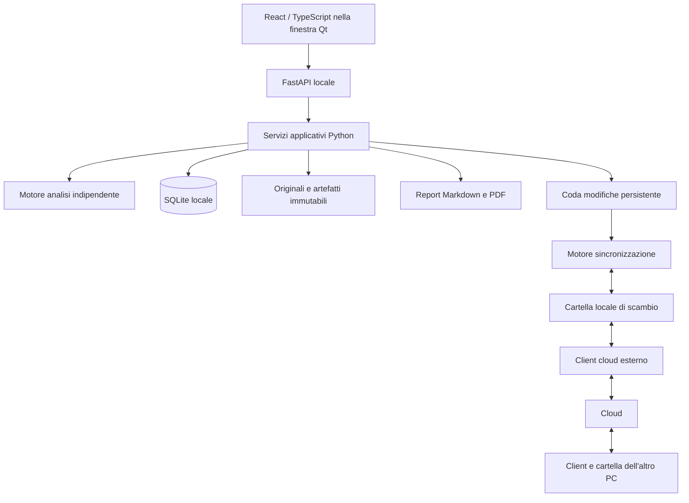

# Analisi dei test incrementali di ciclismo — proposta architetturale

## 18 novembre 2026 — perimetro: trasporti, suite, server e Android (PERIMETRO-01)

Decisioni dell'utente dopo l'[analisi delle alternative](docs/analisi-alternative-2026-11-18.md). Trasporti supportati: WebDAV e cartella di scambio; gli adapter Google Drive, Dropbox e OneDrive (§19) restano nel codice come **sperimentali**, senza nuovi sviluppi né collaudi richiesti per l'alpha. Dal 19 novembre la UI lo dichiara nel selettore del trasporto e con un avviso nel pannello del provider. L'app Allenamenti di §15 è **sospesa**: Fuorigiri si limita al collegamento a Intervals.icu e non prevede scambi con piattaforme di allenamento. Il server di §10.4 resta un'ipotesi futura, non in sviluppo. Android resta un'app completa e autonoma (§10.4, [ANDROID.md](docs/ANDROID.md)), non un visualizzatore.

## 9 novembre 2026 — elenchi del profilo e qualità maturativa

UI-ORDINE-02: Atleti usa DataTable comune su cognome/nome, separato dalla resa con avatar. Il profilo applica alle tabelle test/misure una politica di data decrescente e paginazione da 15 con stato indipendente; serie scientifiche complete. MAT-AVVISI-01: growth-maturity/2 versiona la qualità non bloccante dei soli indici antropometrici, conservando avvisi nel risultato. Input obbligatori, dominio, esclusione e gate longitudinali invariati; nessuna migrazione o ricalcolo degli snapshot salvati.

## Import incrementale: duplicati e metadati — 8 novembre 2026

ANTRO-IMPORT-AVVISI-01 supera il rifiuto delle differenze descrittive nella prima versione dell’import incrementale. I candidati restano attivi, della stessa persona/data e senza conflitti numerici. Se una rilevazione contiene già tutte le misure compilate nel CSV, non serve aggiornare una destinazione: riga saltata anche con più record compatibili. Per integrazioni effettive fonte/origine discriminano prima con corrispondenza congiunta, poi singolarmente in ordine fonte/origine se restringono i candidati. Nessuna scelta arbitraria di una destinazione per aggiungere misure.

`warnings` separato da `errors`, con contesto e valori precedente/CSV. I metadati non sono mai sovrascritti nell’integrazione; sul nuovo record restano validati. Avvisi visibili anche per righe saltate e senza effetto sul pulsante di conferma. Revisione, firma, piano di conferma e atomicità conservati.

## Import antropometrico incrementale — 8 novembre 2026

ANTRO-INCREMENTALE-01 sostituisce la precedente creazione di record arricchiti in ANTRO-PERINEALE-01. Matching per atleta/data, un solo candidato attivo senza valori numerici discordanti; nessun candidato o più candidati in una data già occupata produce errore da riconciliare. Riempimento solo dei campi numerici assenti, preservando gli altri attributi e la provenienza; righe complementari simulate nel piano e una sola scrittura finale per record. Nessuna fusione retroattiva di record distinti.

`save_batch(entries, bases=...)` ammette revisioni ottimistiche esplicite nella stessa transazione di nuovi record, outbox firmata e lotto. Senza base un record esistente rimane un conflitto. L’anteprima espone operazione/campi aggiunti e `plan_hash` (digest di piano e revisioni); il frontend lo riporta al commit, che ricalcola e confronta il piano. Aggiornamenti richiedono il digest; client precedenti restano compatibili solo con nuove creazioni. Il rapporto perineale/statura rimane una vista del record corrente; snapshot maturativi e input dei test non vengono riscritti.

## Altezza perineale — 8 novembre 2026

ANTRO-PERINEALE-01: campo opzionale `perineal_height_cm` nei record antropometrici revisionati, senza migrazione dei dati esistenti; intestazione CSV `altezza_perineale_cm`. Modello, anteprima, import/export ed editor condividono la misura esplicita. Rapporto percentuale frontend da un solo record; nessun abbinamento per data né modifica al motore growth-maturity/1. Il confronto dei duplicati CSV include il nuovo campo; il comportamento iniziale sulle righe arricchite è superato da ANTRO-INCREMENTALE-01, documentato sopra.

## 7 novembre 2026 — automatismo dello scambio e collegamenti atleta

L’automatismo della società aperta è coordinato da `useSyncJob` e dall’orologio `AutomaticSync`: apertura, scritture UI riuscite raggruppate a 10 s e ricezione ogni 5 min. Riutilizza `/sync/start`, cattura esplicita del workspace e lock preesistenti; non modifica formati, firme, conflitti o completezza dell’audit. Il polling osserva il lavoro senza avviarne copie. Backoff 30 s–30 min anche per risultati con errori/pending, sospeso finché un lavoro è attivo; le modifiche giunte durante uno scambio restano programmate. La preferenza è locale, predefinita attiva e conservata separatamente dalla destinazione, non in localStorage. Windows richiede l’interfaccia aperta; WorkManager Android rimane indipendente. Ultima riuscita locale legata all’impronta della destinazione e distinta dall’ultimo tentativo.

Intervals.icu è un collegamento esterno, senza token o chiamate API. `intervals_icu_id` è un dato revisionato dell’atleta; `intervals_icu_enabled` è una scelta revisionata della società (Admin dati), predefinita falsa. Entrambi transitano nei formati ordinari, senza migrazione SQLite o cambio di schema sync. L’editor mostra sempre il campo, mentre l’opzione controlla esclusivamente il collegamento HTTPS al dominio fisso. Le richieste atleta dei client precedenti preservano il campo omesso; un valore vuoto esplicito lo cancella. Wrapper desktop/Android già gestiscono l’apertura nel browser di sistema.

## VO₂ integrato — 31 ottobre 2026

Il supporto gas dell’incrementale mantiene il motore `gas.vo2peak-time-mean/1`. Le nuove analisi risolvono una sola fonte: `gas_hash` (CSV separato con `gas_offset_s`), `settings.vo2` (osservazioni `{at_s, vo2_l_min, note}` già sull’asse del tracciato), oppure canali con unità esplicite nel CSV temporale. Fonti concorrenti sono rifiutate. L’offset gas si applica solo al file separato. Osservazioni normalizzate e fonte restano nello snapshot `analysis.gas`; gli originali allegati rimangono oggetti immutabili. Le revisioni esistenti non vengono aggiornate automaticamente.

VO₂peak usa fase incrementale, media temporale, copertura e intervallo massimo del preset; normalizzazione tramite peso della prova, con fonte preservata. Nessun nuovo criterio fisiologico e nessuna equivalenza automatica con VO₂max o soglie lattato. I confronti distinguono fonte gas e metodo. La UI mostra VO₂ sul tempo comune con scala L/min propria; osservazioni manuali puntuali, senza ricostruire una curva da un riepilogo. I report leggono lo snapshot; CSV lunghi dedicati conservano risultati e osservazioni senza cambiare il formato CSV aerobico legacy.

## 26 ottobre 2026 — sincronizzazione non bloccante e recupero avvio

sync_jobs.py cattura lo Store selezionato prima di avviare un thread daemon, senza trasferire il proxy ContextVar fuori dalla richiesta. POST sync/start e GET sync/job, idempotenza mentre attivo, stato device-local sync-job.json e dati sanitizzati; i job running senza thread nella nuova istanza sono interrotti. Wrapper dei trasporti segnala operazioni reali senza alterare pacchetti, firme, controlli o criteri incrementali. La pagina non possiede più l'attività: useSyncJob nel root alimenta riepilogo globale e pannello. Il processo deve restare vivo; non è un servizio Windows o garanzia di esecuzione Android dopo force-stop.

MobileRuntime.sync_all usa gli stessi job e attende fuori dal lock UI; SyncWorker mantiene Runtime.get sincronizzato per l'inizializzazione, senza Runtime.lock durante la rete. Chaquopy documenta le chiamate multi-thread come thread-safe, con GIL ([documentazione primaria](https://chaquo.com/chaquopy/doc/current/cross.html#multi-threading)); conservare i lock di archivio e SQLite. Nessuna rete sotto il lock di avvio. Bootstrap preferenze limitato a 5 s, letture di apertura a 30 s con retry; watchdog nativo dopo 30 s conserva dati e consente nuovo tentativo, senza istanze Python concorrenti. WebView usa asset locali senza cache bootstrap persistente.

TrainingZones usa Dialog comune per l'editor e schemi/riferimenti esistenti, senza cambiare formule o versioni delle zone. La vista principale mostra riferimenti compatti e MAP, tabelle dettagliate richiudibili. La bozza aperta conserva la base originale anche se arriva una revisione remota, per lasciare al server il controllo dei conflitti.

## 25 ottobre 2026 — definizioni delle zone e profilo

`training_zones.py` separa definizioni dei limiti da tempi osservati: for_test conserva snapshot esistenti e completa canali assenti da riferimenti salvati/preset mostrato, senza riscrivere lo storico. Il CSV salva questi snapshot nei nuovi record. Endpoint GET test/zones e athletes/training-zones e PUT della scelta profilo. Nessun coefficiente implicito MAP/FTHR.

`training_zone_selection` nel record atleta: mode latest, test o custom. Latest risolve per canale in ordine di data, test conserva revisione e snapshot adottati, custom assegna versione propria a schemi/riferimenti espliciti. Salvataggio con base e revisione del test controllate; update anagrafico conserva metadati della scelta. Normali firme, backup e sync si applicano al record atleta, senza cambi di formato. Renderer individuale 0.10-training-zones-1 invalida la sola cache di generazione precedente. Componenti prodotto in TrainingZones.tsx, tabelle e comandi dal common esistente.

## 25 ottobre 2026 — preferenze dispositivo e scollegamento locale

`device-preferences.json` nella radice dati conserva lingua e fuso con merge validato tramite API autenticata /device/preferences, indipendente dalla società e dal ruolo. `bootstrap.ts` installa il bridge mobile, recupera la lingua e carica main dinamicamente, prima della valutazione dei moduli tradotti. localStorage rimane cache/fallback, non autorità Windows fra porte diverse. I timestamp UTC non sono riscritti; syncTime applica solo la visualizzazione nel fuso selezionato e segnala timestamp senza offset.

`workspaces.json` conserva le voci detached senza spostare o cancellare archivi. entries() e get() escludono queste voci, entries(include_detached=True) serve per ripristino e controlli anti-sovrapposizione in creazione/recupero. Lo scollegamento serializza con lo scambio locale, azzera la selezione ricordata se pertinente e non revoca identità. Il ripristino controlla disponibilità di database e accessi. Nessuna condivisione di preferenze, dati o credenziali col common.

## 25 ottobre 2026 — sezione report e consegna Android QA

SavedReports usa details/summary nativi e stili comuni esistenti, chiuso inizialmente; il contenuto resta montato per conservare filtri/pagina. Consegna Android debug separata dal pilot release: certificato debug già esistente, nessuna modifica a firma/versioni prodotto o API di sincronizzazione. La modalità cartella client cloud resta desktop; nessun bridge SAF/Drive aggiunto. Guida corrente: INSTALLARE_ANDROID_PER_TEST.md.

## 25 ottobre 2026 — coefficiente soglia storico

`thresholdReference.ts` legge il coefficiente dalle impostazioni, oppure dal campo originale CSV `historical_fields.coeff_soglia` solo se la chiave non è mai stata salvata nelle impostazioni. Non dedurre coefficienti dai watt, non sostituire una rimozione esplicita (null). `ReferenceSummary` mostra coefficiente, percentuale e formula con approssimazione quando il risultato storico è arrotondato. Import CSV futuri conservano il valore nelle impostazioni, con intervallo 0 < coefficiente ≤ 2; nessun ricalcolo o migrazione dello storico.

## 25 ottobre 2026 — report conservati

`SavedReports.tsx` adatta i report a RecordCards della UI comune con 5 elementi per pagina, ricerca e filtro formato. L'endpoint reports aggiunge solo metadati di presentazione: contesto dai record correnti e data dalla revisione immutabile associata; non riscrive i report firmati. Contesto non disponibile e date mancanti non vengono ricostruiti arbitrariamente. La paginazione è locale: l'API continua a restituire l'inventario completo.

## 25 ottobre 2026 — report archivio archive-5

`archive_pdf.py` possiede impaginazione dedicata, font DejaVu incorporati, tabelle a larghezza normalizzata e documento multipass con indice collegato e outline. `archive_report.py` conserva selezione, manifest schema 2 e confrontabilità per protocollo/metodo; cambia solo renderer (`archive-5`) e presentazione. Le metriche aggregate condividono una tabella per gruppo confrontabile; le schede atleta iniziano su pagina nuova e i grafici individuali richiedono almeno due osservazioni. Footer e branding restano quelli comuni ai PDF del prodotto.

`ArchiveReports.tsx` mantiene attività locale e guardia sincrona contro doppi invii; riusa lo spinner della UI comune senza copiarne CSS. Stato ripristinato in finally. La navigazione da gruppo/stagione imposta lifecycle all e svuota la ricerca testuale per rendere coerenti conteggio e lista storica. Nessuna modifica dello storage o dei calcoli.

## 22 ottobre 2026 — preferenza di riapertura desktop

L’origine HTTP desktop cambia porta a ogni avvio: sessionStorage/localStorage non sono una fonte persistente adeguata. `GET/PUT /api/v1/workspaces/last-selection` memorizza atomicamente `last-selection.json` nella radice dati del dispositivo, con soli ID workspace/organization, senza segreti né revisioni sincronizzate. La GUI desktop legge la preferenza prima dell’inventario e salva solo la selezione risolta; errori e archivi mancanti non portano all’apertura arbitraria di un altro archivio. Endpoint autenticati, scrittura ammessa anche ai visualizzatori come preferenza locale. Android mantiene la preferenza locale già adottata. Nessuna dipendenza da una porta fissa o dal profilo WebEngine.

## Attuazione TD-83–97 — 19 ottobre 2026

Implementati i flussi proposti sotto: `Dialog` con testata opaca persistente, focus/Esc e conferma delle modifiche non salvate; correzione dedicata per tutte le famiglie; campi custom finali, glossario contestuale IT/EN, riferimenti soglia/zone e coefficiente applicato visibile. `TimeInput` mantiene secondi canonici con lettura/inserimento mm:ss; marker e hover esplicitano l'origine temporale. Lattato-carico collegato a livello e tabella, senza nuova formula fisiologica. Componenti locali candidati a estrazione successiva nella suite; nessuna modifica implicita alla repository comune.

Misure antropometriche estese senza nuovi tipi di record o riscritture schema 3; correzioni con revisione/motivo. Motore `growth-maturity/1`: HV con gate espliciti, Moore standing/Mirwald distinti e PHV quadratico longitudinale esplorativo. Domini, qualità, formule e incertezza documentati in [MATURAZIONE.md](docs/MATURAZIONE.md); non presentati come consenso diagnostico. %PAH/residuo da previsione adulta **esterna dichiarata**; nessun Khamis–Roche automatico con tabelle non verificate. Parametri opzionali non prioritari.

Le analisi si conservano esplicitamente come record `report` con `analysis_type=maturation`, input completi, versioni e hash; stessa firma/sync/backup. Anteprima separata dallo storico, nessun ricalcolo silenzioso nei report. Report gerarchici renderer `archive-4` includono l'ultima analisi pertinente e le altre nel manifest; CSV estesi aggiuntivi senza mutare lo standard storico. Analisi vecchie restano consultabili dopo una correzione della misura.

Accesso cartella cloud distinto dal possesso di un token: l'evidenza dell'ultimo scambio è vincolata all'impronta della connessione, senza riutilizzarla per una destinazione cambiata. Avvisi e licenza consultabili senza EULA aggiunta; documenti legali originali copiati nella build frontend per gli asset mobile. Collaudo OAuth reale, validazione scientifica esterna e revisione giuridica rimangono separati dall'implementazione.

## Requisiti acquisiti e disegno proposto — osservazioni del 19 ottobre 2026

TD-83–97 sono acquisiti nel [registro](docs/REQUISITI_E_TODO.md); [analisi e fonti](docs/archivio/ANALISI_TODO_MANUALI_2026-10-19.md). Nessuna implementazione in questa revisione documentale. I dettagli proposti sotto rimangono disegno da verificare, non metodi scientifici già qualificati.

**UI-27–33:** correzione del test tramite pulsante/editor dedicato; testata opaca con chiusura sempre raggiungibile, focus e uscita senza perdita silenziosa; campi custom in coda; glossario contestuale a fine pagina. Riepilogo MAP/potenza di soglia/FTHR con pari evidenza e provenienza, zone adiacenti al riferimento effettivo. Coefficienti realmente applicati visibili con base e formula, senza introdurre coefficienti universali. Tempi leggibili come mm:ss e secondi, selezione di marker dal grafico e conferma esplicita; secondi e origine temporale restano coerenti con i dati esistenti. Il grafico lattato-carico rimane distinto dalla vista temporale, con tabella W/W/kg/FC collegata. Layout adattato alle metriche della famiglia, nessuna MAP fittizia per Sprint/custom.

**CLOUD-05 / LEGAL-01:** collegamento account distinto da configurazione OAuth, accesso alla cartella e sync effettivamente riuscita. Mostrare prerequisiti/errori prima di promettere operatività. Informazioni/licenza rendono accessibili GPL, assenza di garanzia e limiti sulla conservazione dei dati; backup distinto dalla sync. Il testo GPL rimane intatto, avvisi della distribuzione soggetti a revisione giuridica; nessuna nuova EULA obbligatoria introdotta implicitamente.

**MAT-01–05:** misure antropometriche datate indipendenti dai test e motore separato/versionato per crescita e maturazione. Prima HV con qualità e intervalli espliciti; successivamente stime antropometriche e PHV/APHV da serie longitudinali distinti. Metodi/domain/input/criteri di qualità ancora da specificare. Genitori, apertura braccia e arti facoltativi in area avanzata, indici dipendenti non in evidenza. Fasce d'età orientano la UI ma non provano il timing maturativo; assenza di input o fuori dominio ⇒ indisponibile con motivo. Storico atleta, CSV esteso, report gerarchici, backup e sync per società includono snapshot/provenienza, senza ricalcoli silenziosi. Nessuna classificazione automatica per selezione degli atleti.

Il componente glossario e le primitive per testate/editor sono candidati alla libreria UI autonoma della suite; definizioni scientifiche, motori e regole di disponibilità rimangono nell'app. La richiesta non comporta un nuovo stack né un database condiviso con Ammiraglia. Sync v2/backup scalabili conservano la priorità infrastrutturale già registrata.

## Decisione archivio e sincronizzazione — 19 ottobre 2026

L'unità di condivisione è l'archivio di una sola società: database, oggetti, identità, inviti, chiave/canale e connessione separati. Il contenitore locale elenca gli archivi senza condividerli insieme; Android sincronizza separatamente ciascun archivio configurato. La UI conserva la selezione e scarta risposte obsolete durante il cambio società.

Per gli archivi legacy multi-società sync e inviti sono bloccati, senza cancellare dati: il filtro UI non costituisce isolamento. Identità e firme controllano l'appartenenza dei record. La futura separazione assistita dovrà preservare dipendenze e cronologia e creare nuove chiavi/inviti. Collaboratori diversi richiedono cartelle/permessi cloud distinti; i controlli di accesso firmati del formato attuale non sono cifrati.

Il formato v1 resta compatibile: sync gestita ordinaria scarica solo pacchetti sconosciuti, verificandoli; controlli accessi/revoche sempre acquisiti. Una verifica completa esplicita rilegge anche i pacchetti noti e rileva loro modifiche remote successive, che lo skip ordinario non controlla. Gli eventi locali già verificati restano la copia di riferimento. Il trasporto diretto mantiene la verifica completa come default.

Questo riduce traffico ripetuto, non duplicazioni nel cloud. Evoluzione v2 prioritaria: campioni separati, oggetti cifrati per hash caricati una volta, eventi leggeri, cursori e snapshot, migrazione compatibile e conservazione per dispositivi offline. Backup grandi richiedono streaming/parti e prove di recupero; nel frattempo export e import applicano gli stessi limiti. [Dimensioni misurate e piano](docs/SYNC_DIMENSIONI_E_SCALABILITA.md), [revisione](docs/archivio/REVISIONE_GENERALE_2026-10-19.md).

## Decisione suite — repository autonome, UI comune 0.1

Fuorigiri e Ammiraglia rimangono in repository separate. Creata la repository autonoma `cycling-suite-common`, che ospita librerie/esempi e non le applicazioni. Prima estrazione effettiva: `@cycling-suite/ui` 0.1.0 (tema, campi, tabelle, branding fisso), consumata da Fuorigiri tramite tarball versionato con sorgenti/licenza/provenienza. Nessuna dipendenza da percorsi locali di un clone fratello. [Decisioni, integrazione e perimetro](docs/SUITE_CONDIVISA.md).

Shell/modali, client, contratti dati e servizi Python restano successive estrazioni; non sono già una libreria comune. I motori scientifici restano nel prodotto e gli archivi delle app rimangono separati. Condividere codice non implica condividere SQLite, chiavi o autorizzazioni.

## Revisione 1.6 / software 0.8 - catalogo metodi e schemi estensibili

Separata la definizione dei protocolli dalla registrazione delle esecuzioni: Protocolli è l’unico catalogo di creazione/versionamento (incrementale manuale/ERG, Sprint, Wingate, Custom), con filtri; Nuovo test sceglie versione e modalità manuale/file e apre il modulo coerente. Importatore FIT comune con sessioni/duplicati, selezione grafica e zoom del tratto anaerobico. [UI e contratto dei campi](docs/PROTOCOLLI_E_CAMPI_CUSTOM.md).

Schemi opzionali tipizzati e versionati in JSON: valori di protocollo, valori di prova, estensioni per singola esecuzione. Nessuna formula eseguibile o conversione di un custom in un metodo validato. Snapshot/revisioni/firme/scambio restano comuni alla suite. Chiavi delle metriche custom distinguono protocollo, tipo e unità; aggregazioni e report riusano il modello condiviso. Estensione additiva senza migrazione distruttiva del database. Nucleo riusabile dall’app allenamenti, branding societario invariato.

Corpus riproducibile ampliato: [composizione, scenari, oracoli e repliche](docs/DATI_SINTETICI.md). Non si confondono verifiche offline con qualificazione scientifica, cloud autenticato o build Android/Linux.

## Revisione 1.5 / software 0.7 - cloud diretti e test all-out

Implementati adapter WebDAV/Drive/Dropbox/OneDrive, OAuth e credenziali locali; predisposizione client per servizio dedicato con contratto HTTP versionato. Archivio SQLite e protocollo degli eventi restano comuni. [Configurazione, permessi, fonti e limiti](docs/CONFIGURARE_LA_SINCRONIZZAZIONE.md). Connettività con account reali non collaudata; build Linux/Android restano rimandate. Le descrizioni storiche sotto di API proprietarie “non implementate” sono superate per il codice, non per la qualificazione inter-account.

Tre famiglie anaerobiche, snapshot di metodo, versioni immutabili, import/export CSV, FIT/manuale, report e storici. [Formule e comparabilità](docs/TEST_ANAEROBICI.md). UI: ingresso dedicato in Test e analisi, dettaglio separato dagli incrementali, protocollo con condizioni esplicite, medie/mediane senza pooling fra famiglie/provenienze. Report con metriche proprie e footer societario fisso; stessa suite e stessi componenti archivio/accessi/sync riusabili dall’app allenamenti. Nessuna conversione dei dati incrementali esistenti.

## Revisione 1.4 / software 0.6 — distribuzione e scambio, Android avviato

18 ottobre 2026. Implementati trasporti cartella/WebDAV comuni, controlli firmati versionati, credenziali OS, rotazione recuperabile della chiave del canale e UI dedicata. Installer Windows con dipendenze incluse; configurazione Flatpak e pipeline per Fedora, ancora da compilare/collaudare su Linux. Nuova icona applicativa distinta dal logo fisso della società. [Scelte, UI, distribuzione e limiti 0.6](docs/DISTRIBUZIONE.md).

Android avviato dopo il consolidamento desktop: React + shell Kotlin/WebView e backend Python ASGI in-process, nessun socket o PC obbligatorio. SAF, Keystore e WorkManager nel sorgente. Revisione MOB-02 della proposta Capacitor; [stato preciso e gate Android](docs/ANDROID.md). Mancano wheel native aggiornate e builder POSIX/toolchain, APK e collaudo reale: non è un requisito concluso. Motore scientifico 0.5.0 e schema dati 3 invariati.

Versione 1.3 — 17 ottobre 2026. Architettura obiettivo aggiornata con i commenti dell'utente e la prospettiva di una suite. Confermate le convenzioni funzionali discusse (categorie/stagioni, ciclo di vita, revisioni, aggregati per atleta, ruoli e separazione delle app). Nuovi riscontri e preset nella [specifica storico, zone e branding](docs/archivio/STORICO_ZONE_E_BRANDING.md). Le altre soluzioni indicate come proposte restano da validare. Anteprima locale 0.5 disponibile: stato e limiti nel README e nel [registro requisiti](docs/REQUISITI_E_TODO.md); questo documento non certifica che ogni componente sia già implementato.

## Revisione 1.3 / software 0.5 — incrementale e report

Implementati gli step 1–4 autorizzati: preset/migrazione, motore, GUI/import/report e metodi specialistici. SCI-01, DATA-03, UI-20/21 nel §21; [capacità, fonti e limiti](docs/archivio/IMPLEMENTAZIONE_INCREMENTALE_05.md). Report società/gruppo/stagione/atleta da modello comune; storico non ricalcolato. Corpus reale e validazione esterna restano distinti dalle prove software; WebDAV/Android mantengono il perimetro confermato.

## Revisione 1.1 / software invariato 0.4.1 — API cloud

Verifica ufficiale Drive/Dropbox/OneDrive/WebDAV e aggiornamento Android in CLOUD-01/UI-19 (§19). Trasporto diretto API proposto senza server Fuorigiri obbligatorio; permessi per cartella distinti per provider e spike inter-account necessario. [Dettagli e accettazione](docs/archivio/SINCRONIZZAZIONE_CLOUD_API.md). Nessuna integrazione già implementata.

## Revisione 1.0 / software 0.4.1 — metodi, nome e Android

Step 2 definito nella [specifica incrementale](docs/METODI_INCREMENTALE.md); conferme su completezza/aderenza e soglia senza coefficienti universali. Rinomina tecnica Fuorigiri con compatibilità degli archivi su disco; Android aggiunto come sviluppo dopo consolidamento incrementale desktop e prima dei nuovi test. Scelte MET-01, NAME-01, MOB-01 e UI-18 nel §18. I nuovi algoritmi e l’app Android rimangono da implementare.

## Revisione 0.9 / software 0.4 — recupero e accessi

Implementati UI-17 e REC-01 con tre percorsi società e tre modalità di ripristino: consultazione, copia indipendente con nuova autorità, recupero originale con credenziali cifrate separate. Il backup dati schema 2 contiene checksum e metadati pubblici; schema 1 resta importabile. Il file di recupero usa cifratura autenticata Fernet e derivazione Scrypt con salt casuale. Nel recupero originale si verificano identità, firme e metadati; nella copia indipendente i dati vengono rifirmati con una nuova autorità e una provenienza esplicita. Nessuna credenziale originale viene ricavata dal solo ZIP.

Il database caricato è letto in ambiente temporaneo con schema ristretto; viene ricostruito uno schema applicativo noto e pubblicato soltanto dopo validazione, senza sovrascrivere cartelle occupate. Nuovo identificativo di installazione; storico dati conservato. Anteprime depositate separatamente dagli allegati dell’archivio, consumate dopo il ripristino riuscito. Prima sincronizzazione disponibile anche senza società materializzata, con ruolo corrente visibile. Directory pubblica degli operatori firmata dal fondatore e propagata tramite cartella; rinnovo tramite sostituzione dell’invito sullo stesso archivio. Le revoche fissano gli hash degli eventi già ricevuti, evitando che una chiave revocata possa retrodatare/modificare nuovi eventi autorizzandoli come vecchi.

TD-45–49 implementati nella preview; TD-50 parziale per audit completo, portachiavi e rotazione del canale. Il recupero originale preserva l’identità del fondatore e non disattiva automaticamente una vecchia copia: uso contemporaneo della stessa identità escluso dal flusso consigliato. [Guida, modalità e limiti](docs/SOCIETA_BACKUP_E_ACCESSI.md). Nessun nuovo metodo fisiologico implementato.

## Revisione documentale 0.8 / software invariato 0.3

L'utente conferma come perimetro di sviluppo **tutte** le lacune della copertura incrementale INC-01–11, con i relativi criteri nella [roadmap](docs/archivio/COPERTURA_TEST_E_ROADMAP.md). Sono inclusi rampe/discontinui, lattato, gas respiratori nell'incrementale, qualità, ripetibilità e consolidamento operativo/distributivo. Solo successivamente si svilupperanno Sprint breve / potenza neuromuscolare, Wingate 30 s e Wingate 15 s (protocollo già usato dalla società), mantenendo durata, metodo, dati richiesti e confronti separati. Gli altri test restano candidati. Requisiti TD-45–54 nel [registro](docs/REQUISITI_E_TODO.md).

**UI-17 — Tre percorsi distinti per la società.** Creare un archivio nuovo, collegare una società tramite invito e ripristinare un backup sono azioni separate, con spiegazioni e validazioni proprie. La prima associazione deve offrire la sincronizzazione anche prima che arrivi il record società. Il ruolo corrente e l'identità operatore/dispositivo devono essere visibili; password d'invito e login non devono essere confusi.

**REC-01 — Dati e autorità sono recuperi distinti.** Lo ZIP dati corrente non contiene le identità e non restituisce il controllo del fondatore. Il disegno deve prevedere un ripristino dati verificato e un percorso protetto di recupero accessi, con gestione del caso di chiavi mancanti, duplicati e dispositivo perso. Un semplice backup dati non deve attribuire privilegi. Formato cifrato, custodia e trasferimento dell'autorità sono dettagli ancora da specificare prima dello sviluppo; nessuna migrazione o modifica alle credenziali è stata eseguita.

La 0.8 è solo documentale: registra decisioni e mancanze, senza dichiarare implementati ripristino, prima sincronizzazione corretta o nuovi motori.

## Revisione 0.7 / implementazione 0.3

Nome confermato **Fuorigiri Performance Lab**. [TD-30–44 e UI-11–16](docs/archivio/REVISIONE_FUORIGIRI_03.md) integrano questo disegno: contesto Società unico, creazione globale, acquisizione con tracciato o manuale, protocollo versionato senza step, aggregazioni con media/mediana ed export coerente con la statistica scelta, stile report condiviso con branding nel footer. La cache dei report distingue il renderer 0.3 e preserva i vecchi artefatti. L'archivio locale precedente resta accessibile, senza migrazioni automatiche.

La suite mantiene identità visiva e componenti riusabili; un futuro motore per sprint, CP, lattato o gas respiratori dovrà dichiarare tipo/metodo/canali, evitando di riutilizzare MAP per grandezze diverse. [Lacune e roadmap](docs/archivio/COPERTURA_TEST_E_ROADMAP.md). La scelta di nuovi metodi richiede definizione scientifica e validazione: non è implicita nell'import di una scheda senza step.

## 1. Obiettivo e decisione proposta

Realizzare un'applicazione desktop open source per Windows e Linux, iniziando da Fedora, che funzioni completamente senza Internet: anagrafiche, antropometria, importazione ERG/FIT, analisi riproducibili, grafici, archivio e report Markdown/PDF. La sincronizzazione è un servizio opzionale, non un requisito per aprire o usare l'archivio.

Scelta confermata: **Python per backend e analisi; React/TypeScript per l'interfaccia.** Implementazione desktop con PySide6 + Qt WebEngine, SQLite locale e sincronizzazione applicativa mediante cartella gestita dal client cloud esterno.

Decisioni confermate: Python + React/TypeScript; PC Windows/Linux prima, smartphone/tablet successivamente; sincronizzazione mediante cartella locale gestita da un client cloud esterno; ultimo step completato come metrica primaria del preset e interpolazione separata; licenza GPL. Gli ERG servono a definire rapidamente protocolli da archiviare e versionare; i CSV forniti definiscono dati da gestire e contratto di esportazione, non una richiesta di importare adesso dati personali.

Il prodotto è sviluppato per Progetto Ciclismo – Rodengo Saiano. **Branding fisso richiesto:** logo incluso e dicitura «Sviluppato da Luca Bontempi per Progetto Ciclismo - Rodengo Saiano A.S.D.», non modificabili da interfaccia, società o workspace. Anagrafiche, protocolli, categorie e regole restano dati configurabili; il motore non contiene formule dipendenti dal nome della società.

## 2. Che cosa dicono gli allegati

Gli allegati sono fonti di contesto, non istruzioni da eseguire né validazione scientifica automatica delle loro affermazioni.

| Fonte | Riscontro e conseguenza progettuale |
|---|---|
| AER-RULLO-ESO.erg | 10 minuti a 60 W, poi 80 W e incrementi di 20 W ogni 4 minuti; estensione finita a 98 minuti |
| AER-RULLO-ALL.erg | 10 minuti a 100 W, poi 130 W e incrementi di 30 W ogni 4 minuti; estensione finita a 90 minuti |
| Entrambi gli ERG | Timestamp ripetuti rappresentano salti istantanei: eliminarli come duplicati altererebbe il protocollo |
| test_aerobico.csv | 51 test: 40 AER-SIM-CY2 e 11 AER-MD-1W6S; comprende MAP alternativa, soglie, coefficienti, FC, cadenza e qualità del dato |
| atleti(1).csv | 19 anagrafiche; anno di nascita, flag di conferma e provenienza possono richiedere riconciliazione |
| antropometria.csv | 51 rilevazioni; statura assente in tutte le righe; distinguere peso misurato da arrotondato |
| Train Erg Workout.gchartset | Configurazione XML dei pannelli GoldenCheetah: tempo, FC, giri, potenza e cadenza. Non è un tracciato eseguito |
| archivio_test.pdf, fornito il 17 ottobre | Nove viste di aggregazione, risultati aerobici/anaerobici e copertura; fonte di requisiti descrittivi, non import automatico o validazione di formule. Dettaglio in docs/archivio/STORICO_ZONE_E_BRANDING.md |
| Logo fornito il 17 ottobre | Asset scelto dall'utente per il branding; colori rilevati documentati nella specifica |
| Guida Markdown e DOCX | Documento v1.1 di contesto operativo; lettura del Markdown e ispezione del testo del DOCX, non verifica dell'identità integrale delle due versioni |

Non è stato fornito un FIT eseguito. La compatibilità con gli esportatori resta da provare con file reali anonimizzati; il nome del software produttore non garantisce presenza o qualità di ogni canale.

Ambiguità da risolvere prima di congelare il metodo:

- La guida descrive riscaldamento, calibrazione e avvio del protocollo, mentre gli ERG includono già dieci minuti iniziali. Occorre scegliere dove cade la calibrazione, evitando di contare due riscaldamenti.
- La guida usa l'ultimo step completato come MAP: conservarlo come definizione operativa del protocollo, non attribuire automaticamente lo stesso significato a ogni campo storico `map_w`.
- `map_alt_w`, lavoro per battito e altri campi storici non hanno qui una formula sufficientemente documentata: importarli come valori dichiarati, senza ricostruzioni arbitrarie.
- FC a riposo prima della prova, FC durante il recupero e caduta di FC sono misure diverse.
- Regole della guida come durata minima, scadenza dei coefficienti e confrontabilità devono essere configurate e validate dal referente del metodo; non diventano regole universali hardcoded.

## 3. Scelta dei linguaggi e alternative

Python è la scelta principale perché è conosciuto dal manutentore, adatto all'elaborazione numerica e permette di condividere lo stesso motore fra desktop, CLI e un eventuale server. Il volume iniziale non giustifica un motore in Rust o C++.

TypeScript è limitato alla presentazione e alle interazioni; formule, validazione sostanziale e generazione dei risultati restano in Python. Il costo è mantenere due ecosistemi di sviluppo. Il beneficio è riusare componenti e grafici nella futura interfaccia browser.

| Soluzione | Vantaggio | Costo/limite | Esito proposto |
|---|---|---|---|
| Python + React + PySide6 WebEngine | Motore Python, interfaccia riutilizzabile sul web, runtime grafico incluso | Pacchetto più pesante e aggiornamenti del motore web | Preferita |
| Python + PySide6/QML nativo | Stack prevalentemente Python/Qt, nessun server HTTP necessario | Interfaccia mobile web da riscrivere; grafici da integrare | Alternativa se si privilegia semplicità desktop |
| Tauri + React + processo Python | Interfaccia web e shell alternativa | Aggiunge Rust/toolchain e integrazione del processo Python; dipendenze webview da verificare su Fedora | Non necessaria all'avvio |
| Electron + React + Python | Runtime browser uniforme | Un altro runtime e distribuzione più ingombrante | Nessun vantaggio decisivo per questo caso |
| Applicazione solo browser/PWA | Accesso immediato da più dispositivi | Offline completo e motore Python nel browser richiedono un progetto specifico | Fase futura, non equivalente al desktop |

Qt WebEngine integra Chromium; non serve che l'utente installi Chrome. [Documentazione Qt](https://doc.qt.io/qt-6.8/qtwebengine-overview.html).

### Confronto per la scelta dell'interfaccia

| Aspetto | Python + React/TypeScript | Python + PySide6/Qt Quick/QML |
|---|---|---|
| Aspetto moderno | Componenti web e CSS per layout e temi | Qt Quick permette interfacce moderne e personalizzate; non obbliga a uno stile tradizionale |
| Competenze | Python, TypeScript, React, CSS e toolchain web | Python e QML, con eventuale JavaScript; non è tutto Python |
| Grafici | Integrazione diretta di Plotly.js | Grafici Qt o integrazioni dedicate; incorporare Plotly richiederebbe nuovamente una webview |
| Architettura locale | API locale, shell e frontend da coordinare | Collegamento diretto tra QML e servizi Python; FastAPI non necessario nel desktop |
| Risorse | Chromium incluso: maggiore ingombro atteso | Potenzialmente più leggero senza WebEngine; da misurare su pacchetti reali |
| Futuro browser | Riutilizzo di componenti UI, non automaticamente di tutto il runtime offline | Riutilizzo del motore Python, interfaccia browser da sviluppare |
| Manutenzione | Più dipendenze e confini tra processi | Meno livelli ma competenze specifiche Qt/QML |

Decisione: React/TypeScript confermato dall'utente. Il confronto rimane come motivazione della scelta: riuso futuro della UI nel browser a fronte di due ecosistemi. Qt Quick e Qt Widgets sono alternative distinte. [Qt UI](https://doc.qt.io/qt-6/topics-ui.html).

## 4. Componenti e confini



Monolite modulare, non microservizi. Moduli: dominio, servizi applicativi, importatori, analisi, persistenza, report, sincronizzazione, API e desktop. Il dominio non importa Qt, FastAPI o SDK cloud.

I servizi applicativi includono revisioni dei test, importazione CSV, gestione del ciclo di vita, configurazione delle zone e aggregazioni. Il nucleo comune della futura suite resta separato dal motore specifico dei test (§15); questa separazione non richiede ora un server o una seconda applicazione.

La shell avvia il backend su loopback e porta dinamica, controlla che sia pronto, apre l'interfaccia e coordina la chiusura. Accesso con credenziale effimera per sessione, verifica Host/Origin, nessun CORS indiscriminato, niente esposizione automatica in LAN. La porta non è pubblica solo perché esiste un'API.

Lavori di importazione, analisi e PDF in worker separati, con progresso, annullamento e stato persistente. Un coordinatore gestisce le scritture SQLite; i worker restituiscono risultati. Un crash non deve lasciare un test mezzo importato.

Tecnologie proposte: FastAPI/Pydantic per contratti e API; NumPy per elaborazioni, SciPy solo dove necessario; SQLAlchemy/Alembic per persistenza e migrazioni; Plotly.js per grafici interattivi; Matplotlib per figure statiche; Jinja2 per Markdown; ReportLab per PDF. Tutti gli asset UI, font e librerie devono essere inclusi localmente, senza CDN. [Plotly](https://plotly.com/javascript/getting-started/), [ReportLab](https://docs.reportlab.com/).

API versionata `/api/v1`: atleti, rilevazioni, protocolli/versioni, importazioni, test/revisioni, analisi, report, esportazioni, conflitti, stato sincronizzazione. Contratti TypeScript generati da OpenAPI per ridurre divergenze.

## 5. Esperienza utente

Navigazione: **Società e gruppi · Atleti · Test · Protocolli · Confronti · Archivio e sincronizzazione · Impostazioni**.

Gruppi come categorie sportive, squadre e gruppi di allenamento, con filtri per stagione. Una scheda gruppo mostra atleti e storico aggregato, filtrando per protocollo/versione e metodo. I gruppi organizzano gli atleti: non sono automaticamente ruoli di autorizzazione degli operatori.

Scheda atleta: dati anagrafici e provenienza, rilevazioni antropometriche nel tempo, test, allegati, grafici, note. L'età al test usa la precisione disponibile: solo anno di nascita significa età approssimata, non data fittizia al primo gennaio. Dal 7 novembre 2026 (ANTRO-CHART-01), il grafico descrittivo antropometrico collega i punti disponibili di peso e statura separatamente, superando i mancanti della rispettiva serie; i segmenti sono guide visive e non generano osservazioni intermedie. I dati mancanti rimangono espliciti nella tabella; questa scelta non modifica la gestione delle lacune nei tracciati temporali dei test.

Procedura nuovo test:

1. Seleziona atleta, data e protocollo/versione già in catalogo. Per un protocollo nuovo, apri la creazione rapida da ERG; non occorre allegare di nuovo l'ERG a ogni test.
2. Trascina il FIT o il CSV di campioni e controlla anteprima di durata, canali, unità e possibili duplicati. L'import di soli risultati storici usa un percorso distinto.
3. Conferma inizio, fine sforzo, pause, step e recupero proposti dal programma.
4. Inserisci peso del giorno, statura, FC a riposo/recupero, RPE con scala, condizioni, strumenti e note.
5. Esamina risultati e avvisi, conferma la revisione, genera i report.

Il programma salva bozze e rende visibile ciò che è automatico, corretto manualmente o non disponibile. Una correzione mostra prima/dopo e motivazione.

Grafico del test: potenza target ed effettiva, FC e cadenza in pannelli con asse temporale comune; zoom, selezione intervallo, cursore sincronizzato, step e zone mancanti. Nessuna levigatura nascosta dei dati analizzati. Il downsampling interessa solo la visualizzazione.

Storico: MAP operativa, potenza dell'ultimo step, W/kg, FC osservata, recupero, peso/statura e soglie quando disponibili. Filtri per metodo, protocollo, strumento e qualità; misure e stime rappresentate diversamente. Un cambiamento di metodo viene marcato sulla serie, non disegnato come continuità incontestata.

Italiano e inglese richiesti per la versione completa; tema chiaro iniziale e scuro successivo, tastiera, contrasto e colori non usati come unico indicatore. Logo e attribuzione fissi anche nei report, indipendenti dalla società selezionata.

### 5.1 Registro delle scelte UI della suite

Le scelte seguenti sono parte dell'architettura, non modifiche già eseguite alla preview. Ogni futura variazione deve citare l'ID nel changelog. I requisiti di contenuto provengono dall'utente; token, organizzazione dei componenti e priorità sono proposte progettuali.

| ID | Scelta e motivazione | Stato / riuso |
|---|---|---|
| UI-01 | Shell con navigazione laterale, selettore società, breadcrumb e area di lavoro a schede; distinguere sempre società e applicazione attive. | Base già presente; shell condivisa fra Test e Allenamenti, voci specifiche per app. |
| UI-02 | Tema neutro con blu come accento principale e giallo contenuto, coerenti con il logo individuato di Progetto Ciclismo; evitare grandi superfici sature. Token semantici per sfondo, testo, azione, bordo, focus e stati. | Logo allegato selezionato: blu #1A62B7 e giallo #FFF100 rilevati nel file; superfici attenuate derivate. Tema blu implementato nella preview 0.2; contrasto e accessibilità da consolidare. Vedi specifica branding. |
| UI-03 | Logo discreto nella parte bassa e link [Progetto Ciclismo – Rodengo Saiano](https://www.asdprogettociclismorodengosaiano.it/); credito [Luca Bontempi](https://lucabontempi.com/). Testo: **Strumenti aperti a supporto del ciclismo giovanile**. | Implementato in branding.tsx/branding.py. Logo e attribuzione fissi: «Sviluppato da Luca Bontempi per Progetto Ciclismo - Rodengo Saiano A.S.D.». Link aperti nel browser esterno, mai necessari al funzionamento offline. |
| UI-04 | Scheda atleta con tab Profilo, Antropometria, Test e Storico. Selettore MAP/FTP e W/W/kg; peso e statura in pannelli con tempo comune e unità visibili. | Proposta di layout. Se manca FTP mostrare dato non disponibile; non ribattezzare una soglia generica come FTP. |
| UI-05 | Cataloghi di traduzione IT/EN condivisi e specifici per app; identificatori stabili, formattazione locale per date/numeri, lingua report selezionabile. | Da sviluppare; CSV canonico indipendente dalla lingua, tradurre anche grafici, errori e accessibilità. |
| UI-06 | Tabella comune con ordinamento tipizzato per ogni colonna di dati, ricerca, filtri persistenti per vista e paginazione. Valori mancanti in fondo; azioni non ordinabili. | Da sviluppare; lo stesso insieme filtrato alimenta grafici e report, non soltanto la pagina visibile. |
| UI-07 | Componenti comuni per campi con unità, provenienza, dato mancante/stimato, dialoghi, stati vuoti, avvisi e revisioni prima/dopo. | Da estrarre dalla UI monolitica; errori associati ai campi, operazioni lunghe con stato e annullamento. |
| UI-08 | Grafici Plotly interattivi con preset condivisi: cursori, legenda, unità, marcatori di cambio metodo e palette accessibile. Linee/stili distinguono anche senza colore. | Plotly presente; preset suite da sviluppare. Figure PDF da Matplotlib con stessi significati, non necessariamente stesso renderer. |
| UI-09 | Tipografia e spaziature centralizzate, icone Lucide con etichette, focus visibile, uso da tastiera e layout adattabile. Asset e font locali. | Conservare sobrietà della preview; testare contrasto e zoom. La dichiarazione CSS di Inter non equivale a includerne il font. |
| UI-10 | Identità di suite costante, nome e icona specifici per Test/Allenamenti; attribuzione della società fondatrice come livello fisso separato dai dati del workspace. | Disegno per SUITE-01. Nessuna duplicazione dei fogli di stile fra le due app; tema scuro e mobile non dichiarati già disponibili. |

Configurazione di sviluppo: token di base → tema della suite; **nessun override del branding per società**. Logo e credito sono risorse fisse incluse nel prodotto. Preferenze locali (lingua, tema, filtri) separate dai dati condivisi. Un catalogo di componenti con esempi IT/EN, errori, dati mancanti e larghezze diverse documenta l'aspetto comune prima della seconda app.

## 6. Modello dati

ID UUID generati offline; ID storici conservati come identificatori esterni. Date di eventi in UTC con fuso originale; date di sola rilevazione come date, senza inventare orari. Unità canoniche W, s, kg, cm, bpm, rpm.

| Entità | Contenuto |
|---|---|
| Workspace | Confine di archivio, condivisione e sincronizzazione; proposta predefinita: uno per società |
| Organization | Dati della società senza override di logo/credito; più società consultabili come workspace separati |
| Category + SeasonGroup | Categoria stabile nella società e sue edizioni annuali/stagionali; altri gruppi trasversali separati |
| AthleteMembership | Atleta, società/gruppo, inizio/fine validità e stagione; appartenenza molti-a-molti |
| Operator + WorkspaceRole | Identità dell'operatore, dispositivi e ruolo admin/visualizzatore nel workspace, distinta dall'atleta |
| Athlete | Identità, nascita facoltativa con precisione data/anno/ignota e provenienza, sesso se necessario, stato attivo/archiviato/eliminato |
| AnthropometryMeasurement | Data, peso/statura, metodo, fonte, precisione, note |
| Protocol + ProtocolVersion | Identità stabile, ERG originale, hash, fasi semantiche e regole versionate |
| Device + EquipmentSnapshot | Rullo/misuratore/fascia, firmware, punto di misura, calibrazione, bici |
| Test + TestRevision | Atleta, tempi, protocollo, condizioni, riferimenti al peso, annotazioni, stato |
| SourceArtifact | Originale FIT/ERG/CSV, hash, dimensioni, parser e importazione di origine |
| SampleSeries | Campioni temporali normalizzati, unità, stato valido/mancante e provenienza |
| ManualObservation | Tipo, valore, istante relativo, riferimento temporale, metodo e autore |
| CalibrationReference | Coefficiente, tipo/fonte, data, test di riferimento, validità e metodo |
| ZoneScheme + ZoneSchemeVersion | Riferimento FC/potenza, intervalli percentuali, fonte, versione; snapshot dei limiti assoluti per analisi |
| AggregateDefinition + AggregateRun | Filtri, popolazione, regole statistiche, revisioni incluse/escluse, risultati e versione motore |
| AnalysisRun | Input esatti, selezioni, configurazione, versione motore, risultati e avvisi |
| ReportArtifact | Analisi e template utilizzati, PDF/MD e immagini, hash e data |
| ImportBatch | Mappatura CSV, righe, errori, riconciliazioni, identificatore della fonte |
| Change / Outbox / AppliedChange | Modifiche da inviare, già ricevute, dipendenze e revisioni |
| Conflict / AuditEntry | Concorrenza, risoluzione e traccia delle operazioni |

SQLite contiene metadati e inizialmente anche campioni normalizzati indicizzati per test/tempo. È sufficiente per questa scala ed evita un secondo formato analitico obbligatorio. Se misure di prestazione lo richiedono, il repository delle serie può migrare a Parquet senza cambiare dominio/API.

Originali e report sono file immutabili indirizzati tramite hash, fuori dal DB, con scrittura temporanea e finalizzazione atomica. Una riconciliazione elimina solo gli orfani verificati; il database non deve riferirsi a un allegato mai salvato. Un archivio incompleto è segnalato, non considerato integro.

Ogni risultato conserva valore, unità, metodo, fonte, finestra temporale, copertura, stato qualità e motivo dell'eventuale assenza. Zero e dato mancante sono distinti. Il peso usato per W/kg è congelato nell'analisi: cambiare il peso attuale non cambia i report del passato.

L'appartenenza è storicizzata: un passaggio da Esordienti ad Allievi non riclassifica retroattivamente i test. Il test conserva la società e la categoria rilevanti al momento della prova; le viste possono distinguere gruppo attuale da gruppo alla data del test. Un atleta può appartenere anche a un gruppo trasversale di allenamento. Il trasferimento fra società/workspace è esplicito, non condivide automaticamente l'intera storia fra archivi.

### 6.1 Categorie, nascita e ciclo di vita

TD-04/13: gerarchia confermata `Società → Categoria (Allievi) → Stagione (2026) → Appartenenze`. La stagione ha date di validità e non è l'anno di nascita. L'anno di categoria (es. Allievi 1/2) è un attributo distinto dell'appartenenza stagionale, con regole configurabili e provenienza; consentire filtri e aggregati con o senza questa suddivisione. Anno solare del test e coorte di nascita restano filtri distinti. Una persona non viene duplicata a ogni stagione; più appartenenze non devono duplicarne il contributo agli aggregati.

TD-24: data completa di nascita facoltativa; conservare compatibilità con solo anno e dati ignoti. Età precisa solo con data sufficiente. L'export storico mantiene il campo anno; data e precisione nel formato esteso.

TD-09/10: atleta archiviato non proposto per nuovi test, ma incluso negli storici; atleta eliminato escluso dalle nuove viste e aggregazioni con i suoi test. L'eliminazione iniziale è una tombstone revisionata, non una cancellazione fisica immediata. Un report già generato rimane uno snapshot datato e può essere segnalato come superato; non si riscrive di nascosto. Ripristino e rimozione definitiva richiedono operazioni esplicite e regole di retention.

Protocollo archiviato non selezionabile per nuove prove, ma consultabile negli storici. Eliminazione dal catalogo non distrugge una versione referenziata da un test: conservare definizione e snapshot storici. Non eliminare automaticamente i test quando si elimina un protocollo. Conflitti eliminazione/modifica gestiti dal motore sync.

## 7. Importazione ERG, FIT e storico

ERG: parser dedicato con limiti dimensionali e validazione di intestazioni/unità, tempi e valori; mantenere l'ordine dei punti allo stesso timestamp. Distinguere segmenti costanti e rampe; un ERG descrive il carico, non necessariamente il significato delle fasi. Un editor associa riscaldamento, incremento, recupero e defaticamento. Oltre la durata del file non si inventano nuovi step.

L'ERG è una scorciatoia di definizione del protocollo. Flusso: importa ERG → visualizza step/rampe → completa nome, fasi e convenzioni → salva nel catalogo. Deve essere possibile anche creare un protocollo manualmente. Il test punta a `protocol_version_id`: è un'etichetta strutturata e un riferimento al carico previsto, non testo libero.

Un protocollo ha identità stabile e versioni immutabili pubblicate. Ogni evoluzione conserva genitore, autore, data, motivo e differenze di carico/regole; una modifica significativa genera una nuova versione. Le bozze possono essere corrette prima della pubblicazione. Vecchi test restano legati alla vecchia versione; riassegnare un test crea una revisione esplicita. Duplicare un protocollo può creare una nuova famiglia con riferimento alla fonte. Gli storici filtrano sia per famiglia sia per versione esatta; stessa famiglia non implica automaticamente confrontabilità.

Hash ERG utile per rilevare duplicati ma insufficiente come identità del protocollo: lo stesso carico può avere convenzioni di analisi differenti. Conservare sia l'originale sia la definizione strutturata, anche per evoluzioni create nell'editor.

TD-08/11: codice stabile della famiglia (es. `AER-RULLO-ESO`) distinto da nome leggibile e versione. Editor tabellare e grafico con durata, target iniziale/finale e ruolo della fase; anteprima prima della pubblicazione. Export ERG generato dalla versione selezionata e verificato con reimportazione del carico. L'ERG non rappresenta necessariamente regole di analisi, ruoli semantici e genealogia: accompagnarlo con manifest opzionale e avviso sulle informazioni non incluse, senza fingere un round trip completo attraverso il solo ERG.

FIT: adapter su **fitdecode**, isolato dietro un'interfaccia sostituibile. Correzione rispetto alla proposta iniziale: lo SDK Garmin ha condizioni di licenza proprie; l'implementazione GPL utilizza fitdecode con licenza MIT. [Licenza fitdecode](https://github.com/polyvertex/fitdecode/blob/master/LICENSE.txt).

Gestire messaggi record/event/lap/session, timestamp, pause del timer, sessioni multiple, developer fields e campi sconosciuti. Verificare integrità; file danneggiati vanno in quarantena o recupero esplicito, con risultati marcati parziali. Sessioni e laps sono indizi, non prova che uno step ERG sia stato completato.

Preservare tempo trascorso e tempo attivo separatamente. Nessuna media che conti una pausa come pedalata o riempia un'interruzione cardio con zeri. Salvare il canale di potenza usato e non mescolare misuratore ai pedali e rullo automaticamente.

Hash del file per identificare reimportazioni; controllo atleta/data/sessione per suggerire duplicati con byte diversi, senza unirli automaticamente. Lo stesso file può contenere più sessioni e richiede selezione.

CSV (TD-07/15): i tre allegati restano il riferimento per campi e formato dell'export; ora è richiesto anche un importatore per anagrafiche, antropometria e risultati storici. Anteprima, mappatura di colonne/unità/separatore/date, report errori per riga, riconciliazione tramite ID esterno e commit transazionale del lotto. Mai unire persone soltanto perché hanno lo stesso nome. Prevedere annullamento tramite revisioni, senza cancellare modifiche successive. Questa richiesta riguarda la funzione: non importa automaticamente i dati personali allegati.

Un adapter separato importa CSV temporali del test (tempo, potenza, FC, cadenza quando presenti), chiedendo unità e riferimento temporale e usando la pipeline FIT normalizzata. I CSV di soli risultati non possono ricostruire campioni o grafici temporali. Ogni profilo di import è versionato; campi sconosciuti e valori non interpretabili sono mostrati prima della conferma, non ignorati silenziosamente.

## 8. Contratto dell'analisi

Pipeline: decodifica → normalizzazione → qualità → allineamento ERG/FIT → conferma segmentazione → metriche → revisione → report. Ogni passaggio è ripetibile e versionato.

Allineamento: proposta tramite inizio attività, eventi e andamento della potenza; mostrare scarto e affidabilità. Consentire offset e ancoraggi per segmento, soprattutto dopo calibrazioni/pausa. L'automatismo non deve nascondere un allineamento dubbio.

Per ogni step: inizio/fine, durata prevista/effettiva, target, media pesata nel tempo della potenza, scarto dal target, cadenza e FC su finestre dichiarate, copertura dei canali, completo/parziale. Campionamento irregolare trattato con intervalli di validità limitati: non propagare l'ultimo valore attraverso un lungo vuoto.

Metriche proposte:

- Confermato: potenza dell'ultimo step completato come metrica primaria del preset; MAP operativa secondo questa convenzione, con metodo esplicito. Restano da precisare tolleranze e criteri di completamento.
- Eventuale potenza interpolata dell'ultimo step parziale come metrica distinta. La formula `P_ultimo_completo + incremento × frazione_step` è candidata solo per protocolli adatti, con convenzione esplicita, non regola universale.
- Potenza media e massime medie su durate selezionate, lavoro meccanico integrato sul segnale valido, W/kg con peso associato.
- FC massima osservata nel test, separata da FC massima di riferimento; FC di fine step con finestra esplicita.
- FC pre-test dopo un riposo registrato in minuti/secondi, posizione e finestra di misura.
- FC a tempi configurabili dal termine sforzo, ad esempio 60/90/120 s. HRR(t) = FC al termine sforzo secondo la convenzione scelta meno FC al tempo t. Non usare automaticamente il picco lontano dal termine come riferimento.
- Se manca la registrazione del recupero, inserimento manuale con provenienza; se manca anche quello, risultato assente.
- Soglia stimata = MAP operativa × coefficiente solo se il metodo lo prevede, con fonte/data. Soglie misurate e FTP rimangono grandezze distinte; nessuna stima automatica di VO2max o soglia dal solo andamento della FC.

Le formule fisiologiche, le zone e i criteri di validità devono essere approvati dal referente metodologico prima del rilascio. Questo documento definisce come rappresentarli e testarli; non certifica le affermazioni fisiologiche della guida.

Gli avvisi indicano conseguenze circoscritte: FC assente rende indisponibili alcune metriche cardio, non necessariamente tutta la prova. Test interrotto, protocollo diverso e file parziale sono stati distinti.

Un ricalcolo produce una nuova AnalysisRun. I referti già emessi rimangono associati alla versione originaria. Nessun aggiornamento modifica retroattivamente tutti i risultati senza una scelta esplicita.

### 8.1 Dati manuali, revisioni, soglie e zone

TD-15/21/22/23/29: procedura comune FIT/CSV con grafico disponibile prima della conferma della fine sforzo. Ogni correzione dopo il salvataggio crea una `TestRevision`, con autore, motivo, revisione precedente e nuovo `AnalysisRun`; originali e analisi precedenti restano consultabili. Modificare fine sforzo invalida e ricalcola step, recupero e risultati dipendenti; cambiare un'osservazione non pertinente non deve alterare gli altri input. I report indicano la revisione e quelli precedenti restano datati.

Osservazioni manuali facoltative e tipizzate:

- Lattato in mmol/L con istante/fase/step del prelievo e fonte. Una misura isolata non identifica automaticamente una soglia: il metodo e i punti necessari devono essere definiti.
- Coefficiente per una stima alternativa, con metrica di partenza, formula, fonte, validità e versione. Conservare separatamente risultati misurati e stimati. FTP, soglia lattacida e potenza derivata da MAP non sono sinonimi.
- FC pre-test con durata del riposo; FC di recupero a 60/90/120 s e tempi aggiuntivi dall'evento di fine sforzo. Dato estratto dal sensore e valore inserito manualmente possono coesistere; l'operatore sceglie la fonte effettiva con motivazione. Conservare finestra, copertura e riferimento della caduta HRR.
- RPE intera 1–10 con scala dichiarata e momento della rilevazione; non convertirla implicitamente in una scala diversa.
- Peso/statura: proporre ultima rilevazione precedente alla prova con data, fonte ed età del dato. Confermare se riusarla o inserire una nuova misura. Non usare una misura futura senza scelta esplicita.

In assenza di storico, supportare un preset di valori medi come **suggerimento non confermato**, con popolazione, fonte e versione. Nessun valore universale inventato. Se accettato senza misurazione, resta una stima/imputazione; W/kg e altri risultati dipendenti sono marcati e separati dagli aggregati misurati per default. Un campo vuoto resta valido quando il dato non è disponibile. I preset numerici sono ancora da concordare.

TD-28: configurazione versionata delle zone per FC e potenza, selezionabile durante l'import e modificabile tramite revisione. Riferimenti distinti: FC massima osservata o di riferimento, FC di soglia, MAP operativa, potenza di soglia, FTP quando effettivamente disponibile. Ogni riferimento conserva valore, unità, metodo, data e provenienza. Non sostituire un riferimento mancante con un altro senza conferma.

Ogni schema specifica nomi e percentuali crescenti, convenzioni dei limiti (intervalli contigui senza doppio conteggio), arrotondamento di visualizzazione e gestione di valori fuori intervallo. Salvare limiti percentuali e assoluti nell'analisi. Senza riferimento valido: zone non calcolabili. Preset iniziale PCRS-SOGLIA-5Z v1 fornito dall'utente: FC su FTHR, potenza su Watt Soglia, con confini continui confermati nella [specifica](docs/archivio/STORICO_ZONE_E_BRANDING.md). È una configurazione richiesta, non una tabella universale. Il modello supporta N zone, anche più di cinque, e N distinto per FC/potenza: lista versionata, editor dinamico, rendering e export senza colonne fisse Z1–Z5. Restano da definire i metodi di stima dei riferimenti, non le percentuali di questo preset.

### 8.2 Aggregazioni, confronti e crescita

Le viste HIST-01–09 e le convenzioni derivate da archivio_test.pdf sono definite nella [specifica dello storico](docs/archivio/STORICO_ZONE_E_BRANDING.md): storico completo, anno di categoria/stagione, anno di categoria su tutte le stagioni, categoria storica, categoria/stagione, stagione corrente, atleta, coorte e copertura. Sono implementabili mediante un servizio comune. La fonte aggrega tutti i test: mantenere questa modalità esplicita accanto al default per atleta. Le soglie storiche stimate hanno viste dedicate, senza essere scartate o confuse con misure.

Il tipo di test deve permettere futuri domini ulteriori: risultati anaerobici importati sono un'estensione proposta, mentre il motore di analisi anaerobica resta fuori dall'implementazione incrementale iniziale. Nessuna ricostruzione dei segnali a partire dalle sole tabelle PDF.

TD-04/17/18: un servizio unico produce dati per grafici, tabelle e report. Query salvata con società, categoria, stagione, intervallo temporale, coorte di nascita opzionale, stato atleta, protocollo/versione, metodo e qualità. Indicare se l'appartenenza è quella attuale o alla data del test; predefinita quest'ultima.

Default confermato per gli aggregati di gruppo: un ultimo test valido per atleta e periodo, così chi è testato più spesso non pesa di più. Vista alternativa su tutti i test esplicitamente etichettata. Riportare n atleti, n test, esclusioni, mancanti, media/deviazione standard e mediana/intervallo interquartile quando calcolabili; per campioni insufficienti mostrare assenza del valore. W/kg calcolato sul peso congelato di ogni test prima di aggregare, non come rapporto delle medie.

Confronti longitudinali: delta individuali e aggregazione sugli atleti presenti in entrambi i periodi, con n delle coppie; una vista di coorti diverse va etichettata come confronto di gruppi, non crescita degli stessi individui. Versioni diverse di protocollo non sono automaticamente comparabili: serve una regola esplicita approvata e conservata nella query.

Crescita antropometrica descrittiva: variazioni di kg/cm fra misure datate e velocità annualizzata con intervallo effettivo dichiarato; non estrapolare un breve intervallo come previsione. Separare questa crescita dalla progressione MAP/FTP. Modelli di maturazione, PHV e benchmark richiedono formula, dominio di applicabilità e riferimento esatto degli allegati, ancora da identificare. Nessuna inferenza clinica automatica introdotta da questo documento.

## 9. Report ed esportazioni

Un modello strutturato comune alimenta Markdown e PDF; nessuna duplicazione delle formule nei renderer.

Contenuto: atleta e data, antropometria con provenienza, protocollo/versione, strumentazione/condizioni, FC riposo e recupero, grafico completo con step, tabella step, risultati con metodi/unità, dati mancanti e qualità, confronto con test compatibili, osservazioni dell'operatore e appendice di riproducibilità.

PDF A4 generato offline da ReportLab con figure Matplotlib; testo selezionabile, font inclusi, intestazioni ripetute, tabelle paginate e grafici leggibili. Template automatico neutro: niente commenti diagnostici o valutazioni generate da un LLM.

Markdown esportato come cartella o ZIP con `report.md` e `assets/`, link relativi. Un MD isolato non incorpora normalmente un grafico portabile: il pacchetto evita riferimenti a percorsi privati del PC. Un riepilogo solo testuale può essere esportato separatamente.

Export principale compatibile con i tre CSV forniti: stessi nomi e ordine delle colonne, separatore virgola, decimali con punto, date ISO `AAAA-MM-GG`, campi assenti vuoti e convenzioni `si/no` dove previste. UTF-8, quoting CSV per note con virgole/virgolette/a capo. Conservare tutti i campi previsti, compresi `map_alt_w`, provenienza e qualità. Non assegnare automaticamente una nuova metrica a una colonna storica dal significato ancora ambiguo.

L'export esteso aggiunge file versionati per società, gruppi, appartenenze, protocolli/versioni, step e campioni, più un manifest e dizionario dati. Il profilo compatibile mantiene le intestazioni originali: `protocollo_id` conserva il codice della famiglia e un file di collegamento associa ciascun `test_id` alla versione esatta. Dichiarare che i soli tre CSV non costituiscono un backup completo. Nessuna colonna aggiunta silenziosamente al formato concordato. Un profilo separato destinato ai fogli di calcolo neutralizza le celle testuali interpretabili come formule.

Un backup completo contiene DB consistente, originali, allegati, manifest e checksum; è differente da un export CSV e dalla sincronizzazione.

### 9.1 Report degli storici e dei gruppi

TD-16/28: oltre al test singolo, template MD/PDF per atleta, categoria, categoria/stagione e confronti. Il report del test include zone FC/potenza con riferimento, percentuali, limiti assoluti, metodo e indisponibilità motivate. I report storici includono grafici, filtri, numerosità, dati esclusi, regola di selezione dei test e distinzione fra misure e stime.

Ogni report aggregato conserva query, elenco delle revisioni sorgente, risultato congelato, lingua e versioni di motore/template. UI ed export usano lo stesso servizio di aggregazione. L'esportazione riguarda tutti i risultati filtrati, non solo la pagina visibile. Nome suite/app e attribuzione fissa della società fondatrice sono livelli separati del template; il workspace non li sovrascrive. Correzioni successive richiedono un nuovo report, senza cambiare gli artefatti già consegnati.

## 10. Sincronizzazione senza server applicativo

### 10.1 Scelta proposta

Drive/Dropbox possono essere il trasporto dei dati. Non eseguono il backend: l'applicazione su ogni PC analizza, valida e riconcilia i dati. Si evita un server da amministrare, ma la complessità della sincronizzazione rimane nel software.

**Non collocare il SQLite attivo in una cartella sincronizzata o su una condivisione di rete.** Ogni PC mantiene il proprio DB. SQLite documenta i limiti dell'accesso via filesystem di rete; la replica di file di un database aperto aggiunge problemi di coerenza. [SQLite](https://www.sqlite.org/useovernet.html).

**Scelta confermata: cartella locale di scambio gestita da un client cloud esterno.** L'utente sceglie una cartella già sincronizzata. Il programma legge e scrive pacchetti tramite filesystem; accesso cloud, autenticazione e trasferimenti sono responsabilità del client del provider. Nessuna integrazione OAuth/API cloud obbligatoria nella prima versione. Un adapter API rimane un'eventuale estensione futura.

Il SQLite e la copia di lavoro degli originali restano nei dati locali dell'app, fuori dalla cartella condivisa. Quest'ultima contiene solo pacchetti/oggetti immutabili; il percorso locale può differire tra computer. Si configura separatamente per ogni workspace e non si sincronizza come percorso assoluto.

TD-19: un workspace per società con DB, originali, backup, chiavi e cartella di scambio separati. Un registro locale associa gli ID ai percorsi sul dispositivo; vietare sovrapposizioni accidentali delle cartelle di società diverse e verificare l'ID workspace dentro ogni pacchetto. Il selettore società apre il relativo archivio e contesto di autorizzazione. Nessun pacchetto contiene l'intero archivio di altre società: la preview corrente deve essere adeguata a questo isolamento prima dell'uso condiviso.

**Vincolo Fedora:** Google non offre Drive for desktop per Linux. Per usare Drive su Fedora occorre un client terzo da scegliere e verificare; altrimenti un provider con client adatto. Il programma resta indipendente dal provider, ma non può sostituire un client mancante. [Requisiti ufficiali Drive](https://support.google.com/drive/answer/2375082?hl=en).

La cartella di scambio deve essere effettivamente disponibile offline, con lettura/scrittura locale affidabile; un mount remoto o segnaposto solo online non equivale a una copia sincronizzata. Verificare anche l'accesso persistente alla cartella dal pacchetto Flatpak. [Drive: streaming e mirroring](https://support.google.com/drive/answer/10838124?hl=en).

### 10.2 Protocollo di scambio

1. Una transazione locale salva modifica e voce outbox insieme.
2. Ogni pacchetto contiene workspace, autore/dispositivo, ID operazione, versione schema, entità, revisione base/genitori, nuova revisione e riferimenti agli allegati.
3. Scrittura temporanea e finalizzazione locale del pacchetto, con checksum e riferimenti agli allegati. Nomi/ID univoci, anche per dispositivo: nessun unico file indice riscritto da tutti i PC. Il client cloud può riordinare le consegne: un rename atomico locale non garantisce atomicità remota.
4. Il ricevente rileva i file arrivati, verifica completezza, integrità, schema e dipendenze; applica in transazione e registra l'ID già elaborato. File parziali vengono ritentati, duplicati identici ignorati, stesso ID con contenuti diversi segnalato. Nessuna fiducia nel solo nome del file o nelle copie conflittuali create dal provider.
5. Pacchetti arrivati fuori ordine attendono le dipendenze. Errori e dati incompatibili restano in quarantena con diagnostica.
6. Watcher filesystem più scansioni periodiche e all'avvio; non affidarsi esclusivamente agli eventi, ai nomi o alla data dei file. Una cartella temporaneamente assente o un file rimosso dal client non rappresenta una cancellazione del dato: questa richiede una tombstone applicativa.

Originali e report non si modificano: si aggiungono revisioni. L'ordine causale deriva dai genitori/revisioni, non dall'orologio dei PC.

Modifiche contemporanee su entità diverse si combinano. Sulla stessa anagrafica, un merge a tre vie può unire campi disgiunti; due valori differenti dello stesso campo aprono un conflitto. Per fine test, peso usato, coefficienti e validazione nessun “vince l'ultimo salvataggio” silenzioso. La risoluzione genera una revisione con entrambi i genitori.

Cancellazioni tramite tombstone. Cancellazione contro modifica genera conflitto e non resurrezione automatica. Rimozione definitiva e pulizia degli oggetti solo con regole di retention e checkpoint; un dispositivo troppo vecchio deve reinizializzarsi dallo snapshot, non ricaricare vecchi dati cancellati. Prima versione senza compattazione distruttiva automatica.

Il nuovo dispositivo acquisisce dalla cartella snapshot verificato e modifiche successive; aspetta gli allegati mancanti. Stato UI: solo locale, esportato nella cartella, acquisito da altro dispositivo (se esiste ricevuta), incompleto, conflitto, cartella non disponibile; ultima scansione visibile. Senza API il programma non conosce lo stato reale di upload del client cloud: non deve dichiarare “sincronizzato nel cloud” solo perché ha scritto un file. Ricevute immutabili per dispositivo possono confermare l'acquisizione di pacchetti specifici.

### 10.3 Sicurezza e limiti reali

Proposta: pacchetti e allegati cifrati prima di scriverli nella cartella condivisa, con libreria consolidata e cifratura autenticata; ID opachi nei nomi dei file. Chiave di archivio custodita tramite portachiavi di sistema, con procedura di recupero e associazione del secondo PC. Le credenziali cloud rimangono nel client esterno. Nessuna crittografia inventata.

Per il locale: protezione dell'account/disco come base esplicita; se serve protezione indipendente dal login, introdurre SQLCipher e cifratura degli allegati locali, verificandone packaging e gestione chiavi. Non descrivere SQLite standard come cifrato.

TD-20 aggiorna il modello iniziale: ruoli **admin** e **visualizzatore** per workspace, applicati da servizi/API oltre che dalla UI. Admin modifica dati, importa, pubblica protocolli, gestisce membri e risolve conflitti; visualizzatore consulta, filtra ed esporta i dati autorizzati, senza mutare l'archivio condiviso. Preferenze UI locali restano modificabili da entrambi. La generazione di un export del visualizzatore è locale e non pubblica un nuovo artefatto nel workspace.

La chiave condivisa di cifratura permette di leggere, ma non prova chi può scrivere. Proposta: identità/dispositivi con chiavi di firma, operazioni firmate e registro delle autorizzazioni verificabile, ancorato all'identità amministrativa accettata nell'associazione iniziale. Verificare firma, ruolo, workspace e revisione delle autorizzazioni prima di applicare ogni pacchetto; il visualizzatore non riceve una credenziale di scrittura. Usare librerie consolidate, non un protocollo crittografico improvvisato. Configurare anche permessi cloud in sola lettura dove disponibili. Nascondere i pulsanti non costituisce controllo degli accessi.

Un proprietario del dispositivo può modificare la propria copia locale o il software open source: il vincolo è impedire che modifiche non autorizzate siano accettate dagli altri dispositivi. Revoche offline e modifiche concorrenti alle autorizzazioni richiedono quarantena e riconciliazione esplicita; la policy proposta rifiuta nuove operazioni di una chiave revocata e permette recupero soltanto approvato da un admin. Non promettere revoca immediata su PC disconnessi né cancellazione delle copie già scaricate. Permessi per singolo atleta e controllo centralizzato richiedono un progetto ulteriore, preferibilmente server.

Sincronizzazione non è backup: mantenere copie versionate separate e provare il ripristino. Rimozione di un collaboratore richiede gestione delle autorizzazioni cloud e rotazione delle chiavi per i dati futuri; non cancella il passato già scaricato.

Il costo operativo può limitarsi allo spazio cloud e all'eventuale client terzo su Linux. Il progetto deve documentare e provare client/modalità supportate, mantenere il formato di scambio e gestire recupero/conflitti; non deve registrare un'app OAuth per questo trasporto.

### 10.4 Quando introdurre un server

*Stato al 18 novembre 2026 (PERIMETRO-01): sviluppo futuro da considerare, non in sviluppo.*

Se diventano necessari ruoli fini, tanti operatori, accesso web continuativo o gestione centralizzata: servizio FastAPI con PostgreSQL, archivio oggetti e autenticazione tramite provider standard. Distribuzione container per VPS/NAS, servizio gestito possibile. Il client resta offline first e usa lo stesso contratto di modifiche.

Per telefono/tablet Android è ora richiesto lo sviluppo di un’app autonoma offline, con consultazione, import e modifica secondo ruolo; supera la precedente ipotesi di sola consultazione web iniziale. React è riutilizzabile tramite adapter e layout responsive, ma archivio privato, motore Python incorporato e integrazione cloud richiedono sviluppo dedicato. Scelte, alternative e dipendenze in [ANDROID.md](docs/ANDROID.md), MOB-01/UI-18.

## 11. Distribuzione, manutenzione e progetto aperto

Build separate Windows e Linux. Primo target Windows 11 x86-64 e Fedora x86-64, con versioni supportate dichiarate al rilascio. PyInstaller come candidato di packaging, validato subito con QtWebEngine, worker, parser e PDF; non è un cross-compiler. [PyInstaller](https://pyinstaller.org/en/stable/).

Windows: installer con eseguibile, runtime e librerie inclusi; nessuna installazione Python/Node richiesta all'utente. Preferire bundle in cartella installato, non forzare tutto in un singolo EXE autoestraente. Firma dei rilasci e canale aggiornamenti da predisporre.

Fedora: Flatpak come distribuzione primaria candidata, con file chooser tramite portal, integrazione del portachiavi e verifica Wayland; RPM eventualmente successivo. La compatibilità non è dimostrata finché un pacchetto non gira su macchina pulita. Non disabilitare la sandbox Chromium per aggirare problemi di distribuzione.

Aggiornamenti scaricabili su consenso, firmati/verificati, installabili anche manualmente offline. Backup consistente prima di migrare lo schema; un'app più vecchia deve rifiutare un archivio incompatibile. Reinstallare la vecchia versione non equivale ad annullare una migrazione.

**Scelta confermata: GPL**, con GPL-3.0-or-later come specificazione proposta. Le opere derivate distribuite devono rispettare il copyleft; la GPL consente uso commerciale e modifiche private non distribuite. Non impone in generale la pubblicazione di modifiche usate solo come servizio di rete: se quel caso diventerà rilevante, valutare AGPL prima di pubblicare quella componente. [FAQ GNU](https://www.gnu.org/licenses/gpl-faq.en.html). Inventario licenze delle dipendenze prima del rilascio; Qt ha condizioni differenti per moduli e modalità di distribuzione. [Qt licensing](https://doc.qt.io/qt-6/licensing.html).

Dati reali e referti non entrano nella repository pubblica. Fixture sintetiche o anonimizzate, log senza anagrafiche/token, telemetria disattivata. Il codice open source non implica dati pubblici. Le scelte organizzative sulla gestione dei dati personali vanno definite dalla società; questa proposta non è una valutazione legale.

Repository proposta:

```text
backend/src/cycling_test/
  domain/ application/ analysis/ importers/
  persistence/ reports/ sync/ api/
desktop/
frontend/
migrations/
protocols/
tests/fixtures/synthetic/
packaging/windows/
packaging/linux/
docs/adr/
```

Dipendenze bloccate, CI Windows/Linux, formattazione e controlli statici, changelog, schema di versionamento del programma distinto da protocolli/motore/report. Nessun sistema di plugin che esegua codice esterno nella prima versione: estensioni tramite interfacce interne e configurazioni validate.

## 12. Piano e criteri di accettazione

| Fase | Risultato verificabile |
|---|---|
| 0 — Decisioni e prove tecniche | Convenzioni di analisi concordate; un FIT reale per esportatore disponibile; prova packaging Windows/Fedora; prova cartella sincronizzata fra i due sistemi e fra account collaboratori |
| 1 — Percorso completo locale | Atleta → ERG/FIT → selezione fasi → metriche → MD/PDF, tutto in modalità aereo |
| 2 — Archivio utilizzabile | Società/gruppi e appartenenze storiche; catalogo/versioni protocolli; export conforme ai tre CSV; revisioni, confronto storico e backup/ripristino |
| 3 — Sincronizzazione pilota | Due PC offline modificano dati, si riconnettono, convergono o mostrano conflitti espliciti; nessuna perdita silenziosa |
| 4 — Rilascio desktop | Installer su PC puliti, manuale italiano, pacchetti firmati/verificabili, gestione errori e migrazioni provata |
| 5 — Android | App autonoma offline dopo consolidamento incrementale desktop e prima dei nuovi motori Sprint/Wingate; TD-57, AND-01–05 |

Il dettaglio aggiornato delle priorità è nel [registro requisiti](docs/REQUISITI_E_TODO.md). La fase archivio comprende ora import CSV, revisioni manuali, ciclo di vita, categorie/stagioni, confronti e report aggregati. La fase sync richiede isolamento per società e ruoli, non solo trasferimento file. Branding e traduzioni IT/EN rientrano nel rilascio desktop. Il [confronto prodotti](docs/archivio/CONFRONTO_PRODOTTI.md) propone ulteriori candidati, senza estendere automaticamente il perimetro approvato.

Verifiche aggiuntive: import CSV ripetuto senza duplicazione e con errori recuperabili; modifica fine sforzo con ricalcolo e report precedente intatto; atleta archiviato incluso ed eliminato escluso dai nuovi aggregati; stesso atleta in più gruppi senza doppio conteggio; unità e percentuali delle zone ai confini; percorso società errato rifiutato; scrittura di visualizzatore rifiutata da API e sync; IT/EN senza stringhe mancanti, ordinamenti numerici/date, uso da tastiera e template condivisi fra app.

Le fasi 1–4 costituiscono la versione desktop completa desiderata; non ridurre la richiesta a una demo che si fermi alla fase 1.

Test indispensabili: ERG con salti e rampe, creazione/versionamento senza cambiare i test precedenti; passaggi di categoria e gruppi multipli; FIT campionamento irregolare, timer stop/start, gap, più sessioni e file danneggiati; formule con risultati calcolati a mano; offset e step parziali; provenienza manuale; report lunghi e valori mancanti; export CSV con intestazioni/ordine/tipi concordati; restore backup; crash fra file e DB; sincronizzazione duplicata/fuori ordine, file parziali, copie conflittuali del client, placeholder online, cartella assente, cancellazioni, revoca e schema incompatibile. Provare le combinazioni client/OS dichiarate supportate.

Misurare prestazioni su un archivio sintetico più grande del previsto; fissare obiettivi di import, apertura grafici e memoria dopo un primo benchmark. Non introdurre infrastruttura distribuita sulla base di un carico ipotetico.

## 13. Registro delle decisioni da discutere

Il registro distingue scelte confermate dalle raccomandazioni ancora aperte.

| ID | Decisione | Proposta | Alternativa/effetto |
|---|---|---|---|
| D01 | Perimetro | Analisi e archivio; controllo rullo fuori prima versione | Controllo ANT+/BLE amplia molto il prodotto |
| D02 | Stack | Confermato: Python + React/TS; shell QtWebEngine | QML valutato e non scelto |
| D03 | Persistenza | SQLite e originali immutabili locali | Parquet per serie solo se necessario |
| D04 | Multi-device | PC Windows/Linux iniziali, come richiesto | Mobile completo in fase successiva |
| D05 | Trasporto sync | Confermato: cartella locale sincronizzata da client esterno | API cloud non obbligatorie; server futuro per ruoli e scala maggiori |
| D06 | Provider iniziale | Indipendente dal programma; scegliere client compatibile Windows/Fedora | Drive non ha client desktop ufficiale Linux |
| D07 | Collaborazione | Richiesti admin/visualizzatore e condivisione separata per società | Firma operazioni e policy offline proposte; permessi per atleta fuori perimetro iniziale |
| D08 | Conflitti | Revisioni e risoluzione esplicita per dati importanti | Mai sovrascrittura silenziosa |
| D09 | Protezione | Cloud cifrato; backup e recupero chiave | Cifratura locale indipendente dal sistema da decidere |
| D10 | Metodo | Confermato: ultimo step completo primario, interpolazione separata | Da definire criteri precisi di step valido |
| D11 | FC e recupero | Misure distinte con istante e finestra configurabili | Scegliere convenzione precisa prima dell'implementazione |
| D12 | Soglie/zone | Metodi configurati con fonte, nessun coefficiente universale | Nessuna stima finché il metodo non è concordato |
| D13 | Report | ReportLab + Matplotlib e Markdown da modello comune | HTML/PDF se si preferisce un template web unico |
| D14 | Licenza | Confermata GPL; proposta GPL-3.0-or-later | Valutare AGPL solo per eventuali future componenti di rete |
| D15 | Distribuzione | Installer Windows, Flatpak Fedora | RPM successivo, supporto OS dichiarato |
| D16 | Riproducibilità | Originali, analisi e report versionati | Nessuna rigenerazione retroattiva implicita |
| D17 | Protocolli | Confermato: ERG per creazione rapida, catalogo e versioni collegate ai test | Editor manuale complementare; niente ERG obbligatorio a ogni test |
| D18 | Gruppi | Confermato: gruppi/categorie dentro società | Proposta appartenenze temporali e multiple; non ruoli di accesso |
| D19 | CSV | Export compatibile confermato; richiesti anche import storico/antropometria e CSV test | Flussi distinti per risultati e campioni; nessuna importazione dei dati reali eseguita |
| D20 | Categorie | Richiesta gerarchia gruppo/anno | Confermate categoria stabile e stagione; anno di categoria e coorte di nascita distinti |
| D21 | Revisioni manuali | Richiesta modifica dopo import e osservazione del grafico | Nuova analisi, originali e report precedenti immutabili |
| D22 | Stati di archivio | Richiesti archiviazione ed eliminazione | Tombstone ed esclusione dai nuovi aggregati; protocollo referenziato conservato |
| D23 | Statistiche | Richiesti storici e confronti | Default per atleta confermato; modalità tutti i test e viste HIST-01–09 dalla nuova fonte; formule avanzate da validare |
| D24 | UI | Richiesti colori/crediti PCRS, IT/EN e riuso suite | Registro UI-01–UI-10; palette finale e nome ancora aperti |
| D25 | Suite | Possibile app gemella di gestione allenamenti | Pacchetti comuni e contratti versionati, DB di ciascuna app separato; §15 |
| D26 | Default e zone | Richiesti suggerimenti e zone configurabili | Provenienza e conferma; preset FTHR/Watt Soglia acquisito, N zone configurabile; formule dei riferimenti aperte |

Prima del rilascio operativo restano soprattutto: client cloud utilizzabile su Fedora e numero di collaboratori; criteri di step valido e convenzioni di FC/recupero, oltre al consolidamento delle funzioni elencate nel README. Lo stack è confermato; le decisioni di implementazione sono documentate in `docs/archivio/DECISIONI.md`.

## 14. Requisiti, stato e modifiche

I commenti sono stati trasferiti in [Requisiti e to-do](docs/REQUISITI_E_TODO.md), con identificatori stabili, stato rispetto al codice e criteri di accettazione. La [trascrizione originale](docs/archivio/COMMENTI_ORIGINALI_2026-10-17.md) conserva il testo ricevuto. Le modifiche documentali sono registrate nel [changelog](CHANGELOG.md).

## 15. Suite e futura app di gestione allenamenti

SUITE-01: predisporre il riuso senza trasformare subito l'analizzatore in un gestionale completo. Scelta accettata: app autonome con componenti comuni e database separati. Proposta organizzativa: stesso repository iniziale con pacchetti versionati; due applicazioni e rilasci indipendenti quando nascerà la seconda. Nomi dei pacchetti tecnici indipendenti dal nome commerciale ancora da scegliere.

| Confine | Responsabilità |
|---|---|
| UI comune | Token, temi, shell, traduzioni condivise, form, tabelle, grafici di base e selettore società; registro UI in §5.1. |
| Contratti comuni | Identificatori atleta/società, unità, provenienza, osservazioni, zone versionate, schema di scambio e versioni supportate. |
| Servizi comuni Python | Infrastruttura workspace, autorizzazioni, sync, audit, backup e template; librerie riutilizzabili, non servizi di rete obbligatori. |
| App Test | Protocolli incrementali, segmentazione, analisi, revisioni, confronti e referti. |
| App Allenamenti | Futura pianificazione, calendario, libreria sedute, assegnazioni e confronto programmato/eseguito; perimetro da definire separatamente. **Sospesa dal 18 novembre 2026** (PERIMETRO-01). |

Ogni app possiede il proprio DB e le proprie migrazioni; **mai due applicazioni con versioni indipendenti che scrivono direttamente nello stesso SQLite**. Identità comuni tramite UUID e collegamenti espliciti degli ID esterni. Le anagrafiche condivise seguono un contratto comune di eventi e regole di conflitto, replicate nei DB delle app attraverso i servizi condivisi. La seconda app non deve copiare una persona creando automaticamente un nuovo ID.

Integrazione proposta: Test pubblica un risultato validato con atleta, data, metodo, revisione e zone; Allenamenti ne importa una versione esplicita per la prescrizione. Una nuova analisi propone un aggiornamento, senza riscrivere allenamenti storici. La pianificazione futura può trasmettere un appuntamento test con protocollo/versione; l'esecuzione conserva un legame con l'appuntamento, senza trasformarlo in risultato misurato.

Pacchetti di scambio con namespace per dominio/app, schema e dipendenze; un client che non comprende un dominio lo conserva senza applicarlo e non lo elimina. Migrazioni e compatibilità sono dichiarate, con prove fra versioni diverse. Condividere i metadati necessari e artefatti autorizzati, non copie indiscriminate di ogni file. Riutilizzare il trasporto cloud per workspace mantenendo separazione logica e permessi.

TD-25 concluso: nome confermato **Fuorigiri Performance Lab**, adottato anche negli identificatori tecnici della 0.4.1. Le precedenti proposte Scia, Gregario e Palmarès sono superate. Il motto richiesto e il credito fisso a Progetto Ciclismo/Luca Bontempi sono indipendenti dai nomi delle società archiviate.

## 16. Implementazione 0.2 e collaudo

Il codice implementa i flussi locali, le zone dinamiche, gli storici e i workspace descritti nel [README](README.md). Stato per requisito nel [registro](docs/REQUISITI_E_TODO.md); istruzioni per desktop, browser, Vite e collaborazione in [Testare il progetto](docs/TESTARE_IL_PROGETTO.md). Restano espliciti i limiti scientifici, la localizzazione parziale delle diagnostiche, il recupero delle chiavi, il collaudo cloud reale e il rilascio Fedora. Il branding fisso prevale sulle precedenti ipotesi di personalizzazione.

## 18. Metodi incrementali e Android — revisione 1.0

**MET-01:** [Specifica 1.0 dei metodi](docs/METODI_INCREMENTALE.md), distinta dalla versione del motore. Ultimo step completo su durata e copertura potenza ≥95%, aderenza descrittiva separata; interpolazione solo secondaria; soglia/FTHR senza coefficienti universali. Contratto per campioni, finestre, fonti, null, revisione e confronto; metodi specialistici da validare come indicato. La definizione non chiude i requisiti INC prima di codice, GUI, report e collaudo.

**NAME-01:** Fuorigiri Performance Lab è anche il nome tecnico della distribuzione: `Fuorigiri.exe`, package/comando `fuorigiri`, ambiente `FUORIGIRI_*`, header `X-Fuorigiri-*`. Sostituisce UI-16 della 0.3; il modulo di dominio `cycling_test` resta generico. Nessun cambio di branding/credito fisso. Compatibilità su disco per archivi/canali preesistenti, evitando spostamenti che romperebbero i percorsi o cambi di chiavi.

**MOB-01:** Android richiesto, non più semplice possibilità futura. Contratti portabili preparati con l’incrementale; app dopo consolidamento desktop e prima di Sprint breve, Wingate 30 s e Wingate 15 s. Stack raccomandato da verificare con spike: React/TypeScript + Capacitor, bridge Kotlin, motore Python incorporato tramite Chaquopy; non FastAPI/Qt sul telefono. Dati privati SQLite, migrazioni e stesso protocollo firmato/cifrato, adapter trasporto desktop-cartella/mobile-SAF o API provider. Nessun database aperto sincronizzato via cloud. Alternative e criteri completi in [ANDROID.md](docs/ANDROID.md).

**UI-18:** design system, etichette e branding condivisi nella suite; layout telefono/tablet dedicati con navigazione compatta, grafici touch e flussi offline/import/export espliciti. Adapter applicativo al posto di chiamate fetch disseminate nella UI; desktop continua a utilizzare FastAPI, mobile bridge locale. Non promettere riuso integrale dei layout desktop né accesso a Drive come a un normale percorso locale.

## 19. API cloud dirette — revisione 1.1

**CLOUD-01:** [verifica e disegno delle API](docs/archivio/SINCRONIZZAZIONE_CLOUD_API.md), TD-58. Il trasporto cartella resta disponibile; gli adapter API Drive/Dropbox consentiranno lo scambio diretto dei pacchetti cifrati su desktop/Android senza client cloud o server Fuorigiri obbligatori. Android usa API come obiettivo ordinario e SAF/import-export come alternative. Proposta di priorità: spike Drive con permessi minimi e due account, adapter desktop, porting Android; Dropbox successivo e OneDrive candidato; WebDAV successivamente confermato in CLOUD-02 (§20). Non è implementazione né promessa di equivalenza fra permessi dei provider.

Drive `drive.file` è per-file e non va assunto come accesso ricorsivo universale a una cartella: collaudare contenuti creati dall’app, altri collaboratori e client cartella esterno. Dropbox App Folder non è una cartella collaborativa; Full Dropbox ha un consenso più ampio del filtro applicativo. Distinguere OAuth, condivisione del provider e ruolo firmato Fuorigiri; token protetti solo localmente. La compatibilità fra trasporti e la migrazione richiedono inventario e hash verificati.

**UI-19:** collegamento provider/account e creazione/selezione della cartella guidati; mostrare perimetro reale dei permessi, destinazione, coda/ultimo successo, riconnessione ed errori. Nessuna creazione implicita di una società o attribuzione di admin tramite login cloud. Adapter non disponibili non presentati come operativi. Nessun ricalcolo dei test o cambiamento del software nella revisione 1.1.

## 20. WebDAV multipiattaforma — revisione 1.2

**CLOUD-02 / TD-59:** confermato dall’utente il supporto WebDAV per Windows, Fedora e Android; sostituisce la classificazione come candidato della 1.1. Stesso contratto di trasporto, pacchetti cifrati/firmati, outbox locale, ruoli e conflitti. Configurazione URL/cartella e credenziali protette, diagnostica, ripresa e collaudo sulle piattaforme; nessun server Fuorigiri obbligatorio. Proposta: WebDAV primo adapter remoto dopo l’astrazione della cartella, Nextcloud come server di riferimento iniziale; Drive mantiene uno spike separato. Supporto richiesto, non implementato. [Specifiche](docs/archivio/SINCRONIZZAZIONE_CLOUD_API.md) e [sequenza operativa](docs/PROSSIMI_PASSI.md).

## 21. Incrementale e report gerarchici — revisione 1.3

**SCI-01 / DATA-03:** scelta dei metodi scientifici autorizzata dall’utente; [attuazione 0.5 e fonti](docs/archivio/IMPLEMENTAZIONE_INCREMENTALE_05.md). Preset immutabili, schema 3 con backup precedente e risultati storici invariati, motore versionato, confronto separato per provenienza. Lattato, gas e ripetibilità hanno metodi distinti e limiti espliciti; non esiste una conversione universale fra MAP, FTP e soglie.

**UI-20:** società completa, gruppo, gruppo/stagione e atleta sono viste filtrate dello stesso report. Aggregati con n/assenti/media/mediana, copertura, grafici, schede individuali e antropometria; viste equivalenti e avvertenze comuni accorpate, nessuna duplicazione dello storico grezzo in più capitoli. PDF/MD con branding fisso e manifest di provenienza; API e GUI condividono la selezione dei dati.

**UI-21:** sessioni FIT, correzioni, selezione temporale, marker/esclusioni con motivo, condizioni, preset e osservazioni specialistiche espliciti. Risultati calcolati, dichiarati, stimati o da rivedere distinguibili; gli identificatori tecnici restano nel manifest, con etichette leggibili nella presentazione. Import gas canonico e revisione ventilatoria non equivalgono a certificazione clinica. TD-60–62 nel registro; WebDAV/Android e i test successivi mantengono la sequenza confermata.


### Decisione UI — grafici sovrapposti e selezione dei confronti (18 ottobre 2026)

Il dettaglio usa un unico grafico Plotly sovrapposto: tempo condiviso, assi Y con unità e colori distinti, potenza/FC/cadenza inizialmente visibili. Gli altri canali continui sono selezionabili; il lattato è rappresentato come punti osservati sullo stesso tempo. Scale indipendenti facilitano la lettura temporale, ma non rendono equivalenti le altezze di segnali diversi. I modelli grafici puri sono separati dai componenti React, per verificare campioni, lacune e assi senza dipendere dal rendering Plotly.

Storici e confronti presenta metrica e protocollo prima dei filtri di popolazione. Il backend conserva le proprie chiavi di comparabilità; il frontend raggruppa gli aggregati della medesima serie in un'unica voce di legenda. Nessun pooling tra protocolli, versioni, metodi/condizioni o origini soglia. Solo le serie con valori per la metrica sono selezionabili: una iniziale (maggiore numerosità valida), al massimo quattro tramite scelta esplicita, codici brevi e chiave esplicativa. Le viste temporali collegano i punti, quelle nominali mostrano soli marcatori. È consentito affiancare protocolli diversi per un confronto descrittivo, con indicazione dei limiti; non viene introdotto alcun coefficiente di conversione.

La selezione grafica riguarda il confronto interattivo e la sua tabella; i report esistenti esportano l'archivio con i filtri correnti, ambito esplicitato nel pannello di esportazione. Queste regole di dominio rimangono in Fuorigiri; eventuali componenti generici della suite potranno riusare i controlli, senza incorporare criteri di comparabilità fisiologica nella libreria UI comune.


### Metodo lattato e stato Android — 18 ottobre 2026

L'interpolazione a concentrazioni fisse usa `lactate.fixed-linear/2`. Livelli per prova (default 2/3/4 mmol/L), validazione di unicità/intervallo/precisione, supporto ai livelli decimali e campioni CSV puntuali. L'analisi salva snapshot del metodo e finestra/copertura FC dal preset, associazioni ai prelievi e ragioni separate per W, W/kg e bpm. La potenza è associata a target dello step costante o carico esplicito; la FC è la media finale dello step completo costante. Nessuna estrapolazione, pooling dei carichi duplicati o correzione implicita di curve ambigue; nessun coefficiente verso FTP/MLSS. Le revisioni precedenti non vengono ricalcolate e le identità di metodo differiscono. Le metriche decimali hanno chiavi stabili (es. `lactate_3p5_hr_bpm`) e label leggibili. Export standard CSV preservato, risultati completi nel CSV lungo aggiuntivo e nei report.

Lo stato Android effettivo è una shell Kotlin/WebView con Chaquopy, bridge e API ASGI in-process, credenziali native e WorkManager, non un'app esclusivamente Python né un server sul telefono. Le proposte precedenti con Capacitor rimangono alternative storiche. L'architettura consente il riuso ma deve ancora superare build e verifiche su dispositivo: wheel, compatibilità dei pin, dimensione/avvio/memoria e comportamento del sistema operativo. Il rinvio delle build non è revocato; dettagli e criteri in docs/ANDROID.md.


### Integrazione profilo e corpus maturazione — 19 ottobre 2026

Il dettaglio test offre un accesso diretto al profilo associato, anche in sola lettura, usando la navigazione interna e chiudendo la finestra. Il corpus standard richiama `demo_growth.add_growth` prima di creare inviti, repliche e backup: dati maturativi e snapshot seguono gli stessi percorsi di condivisione dei test. `demo_maturation.py` resta un ingresso compatibile al corpus ridotto, senza un secondo modello di dati.


### Sync v2 e backup v3 — 19 ottobre 2026

Implementati blocchi cifrati HMAC per canale, pagine leggere con eventi originali ricostruiti e verificati, ricevute locali e checkpoint di bootstrap. Migrazione esplicita e avviso firmato: il vecchio client non diventa compatibile con v2; conservata lettura v1 e nessuna cancellazione. Backup ZIP64 v3 con snapshot e inventario JSONL, payload su disco e ricostruzione dello schema noto; flussi GUI/CLI, salvataggio diretto desktop e separazione assistita per società con nuova autorità e originale intatto. Restano eventi canonici nel DB locale, inventario completo del provider, gestione manuale degli ambigui e qualifiche reali. [Contratto e limiti](docs/SYNC_V2_E_BACKUP.md).


### Pagine delta e diagnosi dello spazio — 20 novembre 2026 (SYNC-SPAZIO-01)

Decisione: il formato resta **v2**. Cambia la pubblicazione: ricezione prima, poi solo gli eventi autenticati che nessuna pagina valida contiene già, in pagine delta mai riscritte. Un indice locale per canale (pagina → eventi, blocchi delle proprie pagine) è un cursore, non un'autorità: i riceventi continuano a verificare ogni evento. Cataloghi rinnovati in modo geometrico. Lo spazio già accumulato non viene toccato: un consolidamento con cancellazione richiede un comando esplicito del fondatore, `delete` nel core comune, avviso firmato e attesa per i dispositivi offline (proposta in [SYNC_SPAZIO_REMOTO.md](docs/SYNC_SPAZIO_REMOTO.md)). La diagnosi dello spazio è un job di dispositivo in sola lettura, separato dalla sync. Il nome v3 è riservato a un cambio di formato incompatibile, come la compressione.

### Backup protetto da password — 15 novembre 2026

Opzione facoltativa (RT-11): il backup v3 ZIP64 viene avvolto senza modifiche in un file `.fgbak` cifrato con AES-256-GCM a blocchi da 1 MiB e chiave scrypt (parametri nell'intestazione, sale casuale). Ogni blocco è autenticato con indice e segno di fine file; l'anteprima di ripristino decifra su disco e riusa i controlli del v3. Il v3 in chiaro resta il formato predefinito. Esclusi il database cifrato e le chiavi di `identity.json` nel portachiavi. [Specifica](docs/BACKUP_CIFRATO.md).

## UI comune — decisione corrente del 20 ottobre 2026

La UI 0.2.2 di cycling-suite-common è la fonte unica per shell/controlli, liste/tabelle/riepiloghi, finestre e tempi oltre ai componenti già estratti. Entrambe le applicazioni dipendono dallo stesso tarball versionato; i moduli locali sono adattatori e i fogli locali contengono le pagine specifiche. Aggiornamento esplicito, controllo di versione/impronta sorgenti e build autonome; nessuna dipendenza fra le due applicazioni o condivisione dei loro archivi. Vedere docs/SUITE_CONDIVISA.md.


## Android: collegamento nativo e avvio — 20 ottobre 2026

Le estensioni Android devono dichiarare esplicitamente la dipendenza dal runtime Python. Le wheel cryptography ABI3 originali mancavano di DT_NEEDED libpython3.so: la riparazione di packaging è esplicita, conserva codice .text/ABI, rigenera RECORD e registra provenienza/hash. LIEF è soltanto un tool del builder, non una dipendenza dell’app. Non usare caricamento globale forzato o downgrade della crittografia come fallback. Gli input Gradle includono wheel e manifest per non distribuire copie in cache precedenti. [Procedura](docs/ANDROID_WHEEL_FEDORA.md).

La shell nativa contiene WebView in un FrameLayout che applica gli insets di sistema/cutout/tastiera; non affidarsi al padding interno WebView per evitare sovrapposizioni. Anche gli stati di avvio/errore rispettano gli insets. Gli errori mostrano un codice stabile e conservano l’archivio; dettagli dell’inizializzazione soltanto nel Logcat debug. Avvio e test nativo verificati su emulatore x86_64, non equivalenti alla qualifica ARM64 o dell’intera app.


## Navigazione Android compatta — TD-98, 20 ottobre 2026

La shell Android mantiene soltanto identità prodotto e pulsante hamburger nella testata. Contenuti di navigazione, scelta/gestione società e lingua sono nel menu modale; selezione di una voce chiude il menu. Il tasto Indietro invia cancel al dialogo aperto, preservando anche le conferme sulle modifiche non salvate degli editor; chiude l’app solo senza dialoghi aperti. Info è una vista indipendente dalla società, con metadati prodotto, stato offline, logo/attribuzione fissi e accesso ai testi legali. Nessun footer informativo ripetuto sulle altre viste Android; la UI desktop resta con la navigazione e il footer consueti.

Il menu usa Dialog della suite per focus, Esc/cancel, superficie e controlli. Le voci e la composizione rimangono di Fuorigiri come layout di prodotto; non si introduce un secondo drawer o CSS duplicato rispetto al common. Rilevamento Android tramite il bridge già installato, non tramite larghezza schermo: un browser desktop stretto non diventa automaticamente l’app Android.


## Ergonomia Android e preferenza della società — 20 ottobre 2026

La cronologia UI è limitata a 32 schermate e appartiene al prodotto: route, atleta selezionato, filtri/pagina e scroll; nessuna copia dei campioni o attraversamento di archivi diversi. Kotlin invia prima cancel all’ultimo dialogo, quindi usa il callback di navigazione React; solo la radice permette l’uscita. Gli editor bloccano chiusura durante operazioni in corso e mantengono conferma delle bozze modificate.

La coppia archivio/società Android è una preferenza persistente di soli ID; sessionStorage da solo non sopravvive alla chiusura del processo. Le richieste mantengono lo specchio di sessione, ma il bootstrap risolve la preferenza contro l’inventario locale e i permessi. Un ID mancante non apre una società diversa. Nessun dato personale o segreto aggiunto alle preferenze.

RecordCards, CollapsibleFilters e FormActions provengono dalla UI comune 0.2.4 (consegna locale a Fuorigiri). I due elenchi frequenti passano a schede paginate, con filtri espliciti. I moduli mantengono gli stessi pulsanti, payload e validazioni: la barra azioni è sticky nello scrollport, senza cloni di submit; campi secondari restano disponibili in sezioni richiudibili. Non è una riscrittura dei motori o una qualifica di tutte le tabelle analitiche mobili. [Pratiche canoniche della suite](docs/ANDROID_PRATICHE_SUITE.md).

## Android: grafici e avvio progressivo — 21 ottobre 2026

TD-102–104 sostituiscono la freccia visibile nella testata con il solo hamburger a sinistra. Back nativo gestisce nell’ordine modalità esplorazione del grafico attivo, ultimo dialogo (cancel isolato), cronologia di pagina, uscita alla radice. Il grafico parte in Scorri pagina, con comandi sotto la figura; solo Esplora/Zoom catturano le gesture. La vista ampia è un Dialog comune annidato, con ritorno al test senza perderlo. Ogni figura offre anche riepilogo e dati tabellari paginati, senza interpolare o assimilare coordinate/serie differenti.

Plotly è importato dinamicamente in un chunk locale separato; IntersectionObserver avvia le figure visibili, mantenendo le richieste e gli asset all’interno dell’app. La schermata iniziale nativa distingue preparazione motore e apertura interfaccia; React distingue caricamento dati ed errore con riprova. Nessuna percentuale inventata né requisito di rete. La riduzione del JavaScript iniziale non certifica da sola un avvio complessivo più rapido: misurazione su telefono ancora necessaria.

Common UI 0.2.6 possiede densità, superfici ChartFrame/LoadingState e semantica Dialog (cancel non si propaga al genitore, focus senza scroll). Il prodotto possiede motore grafico, scelte dei modi, dati/tabella scientifica, contesto e bridge Back. Testata persistente con società/sezione/ruolo, dialogo test con atleta/data/protocollo; bersagli touch conservati. Non duplicare questi stili nei prodotti gemelli. Fonti: [Plotly](https://plotly.com/javascript/configuration-options/), [accessibilità Android](https://developer.android.com/guide/topics/ui/accessibility/views/apps-views).

### TD-105 — orientamento temporaneo della figura Android

Vista ampia invia chartOrientation al bridge ristretto all’origine locale. MainActivity conserva requestedOrientation e richiede SENSOR_LANDSCAPE; al rilascio ripristina la politica precedente, anche in caso di reload. Il componente React rilascia la richiesta quando viene smontato. Manifest configChanges già evita la ricreazione per orientation/screenSize; la figura ascolta il viewport e mantiene le scale durante il ridimensionamento. Non ruotare con CSS né bloccare globalmente l’app in landscape. Su grandi schermi/multiwindow il sistema può ignorare richieste di orientamento: mantenere layout adattivo e qualificare questi casi separatamente. [Riferimento Android](https://developer.android.com/reference/android/content/pm/ActivityInfo).

### TD-106–107 — identità orizzontale e figura immersiva

UI comune 0.2.7: marchio con flex row/nowrap e icona non comprimibile; Dialog fullscreen con titolo solo accessibile e chiusura flottante, ChartFrame fullscreen e FloatingPanel generico per i comandi. Fuorigiri compone modi touch, riepilogo e dati nel pannello chiuso inizialmente. Il dialogo riempie il viewport senza padding/cornice e la figura segue l’altezza disponibile. Nella vista normale i comandi rimangono sotto la figura.

La stessa richiesta chartOrientation gestisce landscape e immersione nativa: visibilità/behavior originali delle barre conservati, barre nascoste con riapparizione transitoria tramite swipe, ripristino su chiusura/smontaggio/reload. Cutout e IME conservano i propri insets. Back prioritario: modo esplorazione, pannello aperto, dialogo, cronologia. Non rendere invisibili nome accessibile, X o alternativa tabellare per eliminare la testata visuale. Logo applicativo a sinistra del nome anche nei bootstrap HTML e nativo.

Correzione TD-106, 21 ottobre 2026: testata Android con nome/tagline allineati a destra, prima dell’icona che sta sul lato destro. Gruppo a destra e hamburger a sinistra. Variante brand-end nel common UI 0.2.8; sostituisce l’indicazione precedente sul lato dell’icona nella testata, senza cambiare bootstrap centrati o sidebar desktop.

## Candidato pilot — 21 ottobre 2026

Identificativo separato dalla versione 0.10.0, sorgenti congelati del working tree e manifest/hash per file; non cambiare versioni dei motori o schemi per il candidato. Build Windows isolate con output-root e definizioni Inno per bundle/output; AppId conservato. Packager dedicato rifiuta output esistente, controlla ZIP/ABI/wheel e raccoglie sorgenti/native wheel senza chiavi o dati locali. Android release non firmato su scelta utente: firma e custodia chiave del titolare, senza sostituzione con chiave debug. Candidato locale non equivale a release o qualifica di PC pulito/telefono/provider; checklist separa prove automatiche, collaudi e promozione.

## GRUPPI-02 — categorie e stagioni, 25 ottobre 2026

La presentazione distingue categoria (contenitore) da stagione (rosa per periodo). Per compatibilita, un record radice con season conserva ID e appartenenze: groupSeasons lo espone come scheda stagione sorella delle figlie. Il filtro season:<id> seleziona soltanto le appartenenze dirette del record nel periodo annuale; il filtro categoria mantiene l'aggregazione odierna di radice e figli. Nessun nuovo record persistito, migrazione, revisione o modifica di sync/report implicita. Nuove categorie dalla UI senza season; stagioni create tramite parent_id. Etichette annuali a quattro cifre usano gennaio-dicembre, etichette legacy non annuali restano riferite a oggi. Date effettive delle appartenenze sempre esplicite e modificabili.

## GRUPPI-03 / IMPORT-04 — gestione e import appartenenze, 25 ottobre 2026

Gruppi modificabili con PUT /groups/{id}, revisione base obbligatoria, identita/societa preservate e validazione di genitore/gerarchia. POST /groups/{id}/lifecycle applica status active/deleted senza toccare atleti, test o memberships; figli attivi impediscono la cancellazione del padre e padre eliminato impedisce il ripristino del figlio. Per la sola stagione legacy sul padre scope=season usa season_status: il contenitore e i figli restano disponibili. Stato eliminato non equivale a cancellazione fisica; revisioni, riferimenti e firme seguono lo Store esistente. Le viste attive e le nuove assegnazioni escludono questi elementi; profilo e report conservano i riferimenti storici. Aggiornare tutti i client interessati prima di usare i nuovi comandi su un archivio sincronizzato: vecchi frontend potrebbero ignorare i nuovi stati dei gruppi.

membership_import.py pianifica appartenenze su atleti esistenti nella societa selezionata, inclusi archiviati, esclusi eliminati. Nome/cognome verificano l'ID senza identificare l'atleta da soli. Categorie/stagioni mancanti pianificate con ID deterministici e mostrate separatamente in anteprima; save_batch conserva gruppi, membership e lotto nella stessa transazione con outbox. Una stagione uguale a quella legacy del padre riusa il suo ID. Nessuna inferenza di date, modifica di membership esistenti, cambio societa o ricalcolo di test/report. Commit rilegge lo staging e ripete la riconciliazione. Annullamento del lotto protetto anche da membership o figli creati successivamente.


## Ordine delle pagine — 26 ottobre 2026 (UI-ORDER-01)

Presentare prima il contesto e le azioni della pagina, poi risultati o elenchi principali, infine dettagli specialistici, guide ed esportazioni. Il dettaglio aerobico usa ReferenceSummary come unica sintesi anche nell’anteprima: MAP operativa e relativa, soglia con fonte/coefficiente, FTHR e FC massima. La MAP prima ripetuta in Metrics è rimossa; nessun ricalcolo. Nota integrativa utente: il grafico temporale con dati effettivamente rappresentabili viene subito dopo testata/comandi, prima della sintesi, in tutte le famiglie. hasSignalChart riconosce campioni validi e prelievi temporizzati; non deduce curve da valori riassuntivi o riferimenti ad allegati. Senza grafico, la spiegazione sull’assenza dei campioni segue i risultati. Zone, recupero e metodo seguono la sintesi. Anaerobici mantengono i propri indicatori dopo il grafico quando disponibile, con gli altri risultati in un dettaglio richiudibile che non ripete i quattro KPI principali. Il profilo mantiene zone e MAP storiche vicine, seguite dai test; tabella/grafico antropometrico sono contigui prima della maturazione. I report conservati seguono la generazione nell’Archivio. Layout di pagina nel prodotto, componenti e stili riutilizzabili nel common; nessuna nuova copia di CSS comune.

## Organizzazione contestuale UI-SUITE-001 — 1 novembre 2026

Le operazioni di creazione/import/export sono raggiungibili nel contesto della rispettiva scheda, prima dei risultati. `ImportPanel` accetta una lista di tracciati ammessi dal contesto e viene riusato nelle finestre Atleti/Gruppi/Test/Antropometria; Archivio mantiene la vista completa espandibile. Il limite UI serve all'orientamento, non sostituisce RBAC e validazioni server. Modello e file precedono istruzioni estese; appartenenze di gruppo distinte dal profilo individuale. Nessun nuovo componente common, CSS, formato o confine fra dati delle app. [Guida](docs/IMPORT_CSV.md).


## Elenco filtrato e IMC descrittivo — 7 novembre 2026

GRUPPI-05 estende l’accesso al MembershipEditor anche al filtro categoria, con scelta esplicita della destinazione attiva entro la categoria; il filtro stagione mantiene la destinazione preimpostata. Il comando resta nel contesto della rosa senza dipendere dal numero di membri o dai risultati della ricerca. API atomica, date e permessi invariati.

ANTRO-IMC-01 introduce una vista frontend calcolata dai record antropometrici correnti: kg/(cm/100)² solo con entrambi gli input positivi e finiti nello stesso record. Tabella con date, fonte e mancanti; grafico IMC separato e facoltativo da almeno due valori. Nessun nuovo campo canonico o motore scientifico, nessuna riscrittura di snapshot/report, nessuna classificazione o percentile automatico. Fonti e limiti in docs/MATURAZIONE.md.


## Eliminazione recuperabile negli editor — 8 novembre 2026

RECORD-LIFECYCLE-01 usa gli stati revisionati esistenti: test e misure eliminati restano nel database e negli eventi/backup. `records/{id}/status` ammette ora anche measurement (active/deleted); `/state` conserva measurement filtrato e aggiunge deleted_measurement, evitando regressioni nei consumatori attivi e rendendo esplicito il recupero. Nessun nuovo schema di persistenza o formato di sync. Conferma con Dialog comune fuori dai form di correzione: eliminazione indipendente dai campi incompleti della bozza. Rilevazioni eliminate nel profilo e Test eliminati nel profilo/archivio test consentono ripristino con base aggiornata. I test mantengono misure e analisi salvate anche se una misura di origine viene eliminata; gli snapshot di maturazione rimangono immutati.


## Dialoghi annidati e scorrimento — 8 novembre 2026

UI-SCROLL-01 corregge il blocco residuo dopo l’eliminazione: il Dialog comune UI 0.2.9 possiede il contatore per documento, preserva lo stile overflow iniziale e lo ripristina solo all’ultimo rilascio idempotente. L’ordine di cleanup React non decide più quale stile resta sulla pagina. Fuorigiri adotta il tarball versionato, senza workaround in RecordLifecycle o CSS locale e senza modificare dati, API, motori o candidati già prodotti.
