# Fuorigiri Performance Lab

Applicazione open source per analizzare, confrontare e archiviare test di ciclismo. Funziona prima di tutto offline, con un archivio locale separato per ogni società e condivisione facoltativa tra collaboratori.

**Sviluppato da Luca Bontempi per Progetto Ciclismo - Rodengo Saiano A.S.D.** Logo e attribuzione della società sono parte fissa del prodotto. Il progetto è generalizzabile a società e gruppi diversi.

> **In English.** Fuorigiri Performance Lab is an open-source (GPL-3.0-or-later), offline-first application for cycling clubs to record, analyse, compare and archive athlete tests: incremental tests from FIT/CSV or manual entry, lactate, VO₂, sprint and Wingate, training zones, growth and maturation indicators, history and comparisons, and PDF/Markdown reports. Each club has its own local archive; data can optionally be shared between collaborators through signed, encrypted exchange via WebDAV or a shared folder. It runs on Windows and Android, with an Italian and English interface. The current release is the **0.10.0-alpha.1** pre-release: see the [Releases](https://github.com/lucabnt/performance-lab/releases) page for downloads, release notes and known limitations. The rest of the documentation is in Italian.

## Prima alpha · 0.10.0

Fuorigiri serve a tecnici e operatori che vogliono conservare misure e confrontare test nel tempo. Per la prima prova crea una società di esempio, aggiungi un atleta e registra un test manuale o importa un file sintetico. Puoi poi aprire il profilo, esportare un report e provare il ripristino su una copia.

| Per iniziare | Percorso |
|---|---|
| Windows 10 (build 19045 o successiva) e Windows 11 x64 | Il candidato prevede un installer per utente e uno ZIP portabile. Per il portabile estrai tutta la cartella e avvia Fuorigiri.exe. Python e Qt sono inclusi. |
| Android 8 o successivo, ARM64 o x86_64 | Per l’installazione serve l’APK release firmato dal titolare. Le prove sul telefono e il supporto per pagine da 16 KB sono ancora incompleti. [Firma e aggiornamento](docs/FIRMA_ANDROID.md) |
| Sorgenti e dati di prova | Segui la [guida di avvio](docs/TESTARE_IL_PROGETTO.md) e usa il [corpus sintetico](docs/DATI_SINTETICI.md). Il pacchetto Linux è rinviato. |

**Stato della pre-release.** La pre-release `v0.10.0-alpha.1` corrisponde al candidato `rc-20261120-02`; download e note nella pagina [Releases](https://github.com/lucabnt/performance-lab/releases). La [guida alla distribuzione](docs/DISTRIBUZIONE.md) elenca allegati e condizioni per la pubblicazione. Restano aperti il collaudo su Windows pulito con Defender attivo, la condivisione WebDAV con due account reali (Google Drive, Dropbox e OneDrive diretti sono sperimentali) e la validazione esterna dei metodi scientifici. Prima di aggiornare un archivio esistente, crea un backup e verifica di poterlo ripristinare. [Registro delle prove](docs/VERIFICA.md)

## Funzionalità

- Profili atleta, società, categorie, gruppi stagionali e appartenenze datate; antropometria e storico individuale.
- Protocolli manuali o da ERG, anche senza step, versioni conservate e campi personalizzati facoltativi; test da FIT/CSV o solo manuali.
- Incrementali: ultimo step completo e aderenza distinti, riferimenti di soglia espliciti, zone configurabili, recupero, lattato e analisi specialistiche con limiti documentati.
- Sprint breve, Wingate 30 s e Wingate 15 s con metodi e confronti separati; importazione dello storico CSV.
- Grafici interattivi con segnali sovrapposti; storici e aggregati con media, mediana, numerosità e gestione dei mancanti.
- Crescita e maturazione: HV, stime Moore/Mirwald, PHV longitudinale esplorativo e analisi conservate. %PAH e residuo richiedono una previsione adulta esterna tracciata.
- Report gerarchici per società, gruppo, stagione e atleta in PDF/Markdown; esportazioni CSV standard ed estese.
- Archivi separati per società, inviti e ruoli, sincronizzazione cifrata v2 con blocchi riutilizzabili, conflitti, backup ZIP64 progressivi e separazione assistita degli archivi legacy. [Attivazione, compatibilità e limiti](docs/SYNC_V2_E_BACKUP.md).

## L’interfaccia in immagini

Schermate reali della versione **0.10.0**, aggiornate il **20 ottobre 2026**, con persone e risultati interamente sintetici. Mostrano l’interfaccia web condivisa con la finestra desktop; non rappresentano un collaudo Android. Cliccare un’immagine per aprirla a dimensione originale.

Aggiornamento del **7 novembre 2026**: [configurazione Intervals.icu](docs/screenshots/intervals-configurazione.png), [pulsante nel profilo](docs/screenshots/intervals-profilo.png) e [ID nell’anagrafica](docs/screenshots/intervals-id.png), catture responsive con soli dati sintetici. [Provenienza e verifiche](docs/screenshots/README.md).

**Atleti e squadra** — profili, ricerca, gruppi e riepilogo dell’archivio della società.

[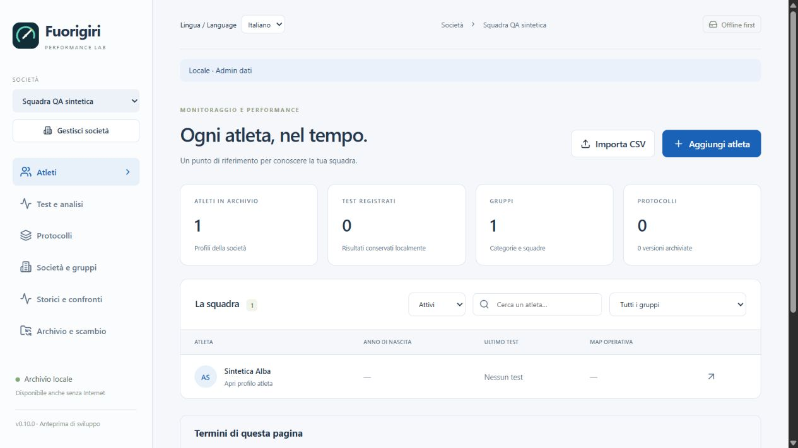](docs/screenshots/ui-coherence-010/atleti.png)

| Protocolli ripetibili | Analisi incrementale |
|---|---|
| [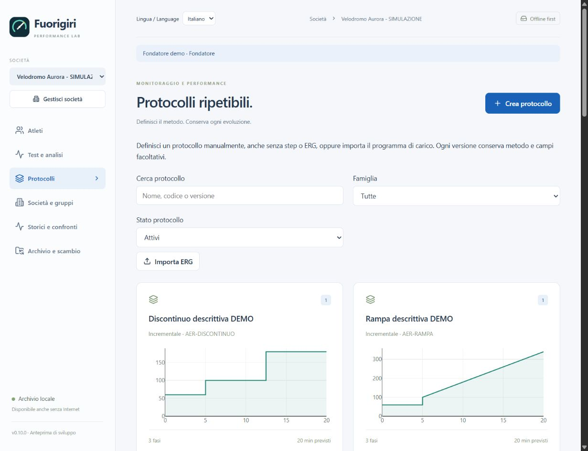](docs/screenshots/protocolli.jpg) | [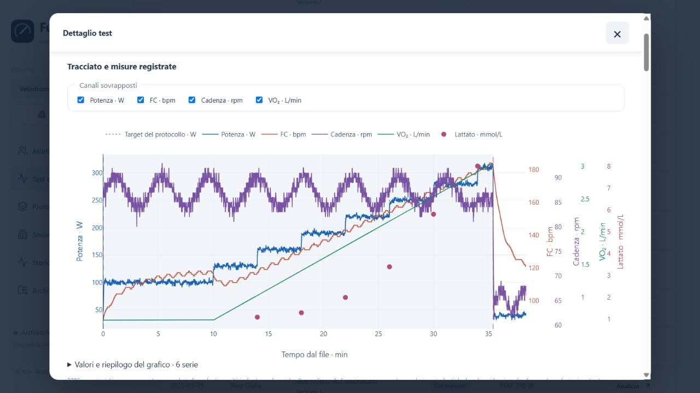](docs/screenshots/test-incrementale.jpg) |
| Creazione manuale o da ERG, famiglie e versioni conservate. | Tracciato unico con scale indipendenti e misure di lattato. |
| **Sprint e Wingate** | **Storici e confronti** |
| [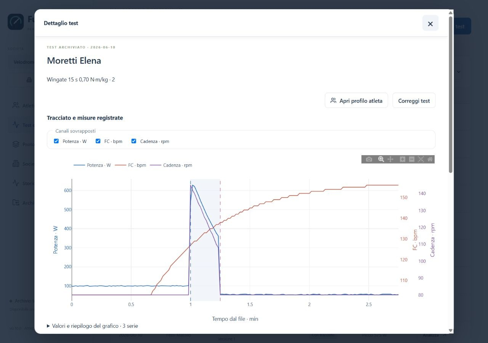](docs/screenshots/test-wingate.jpg) | [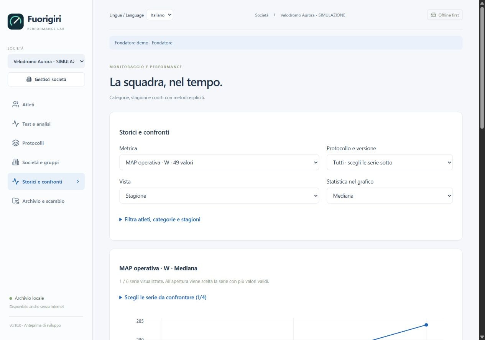](docs/screenshots/storici-confronti.jpg) |
| Esempio Wingate 30 s; metodi e durate rimangono distinti. | Serie selezionate esplicitamente, aggregati e dati mancanti. |
| **Crescita e maturazione** | **Report ed esportazioni** |
| [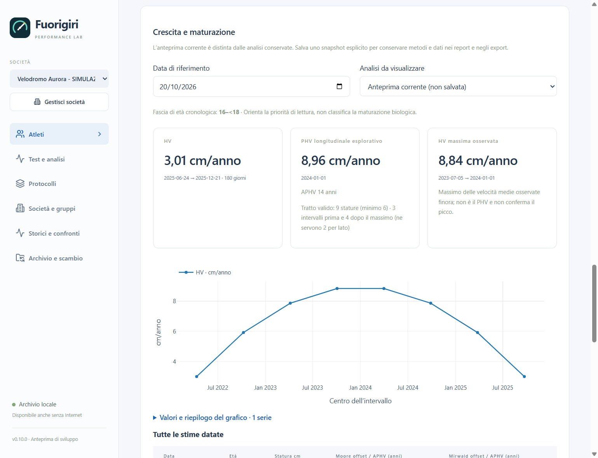](docs/screenshots/crescita-maturazione.jpg) | [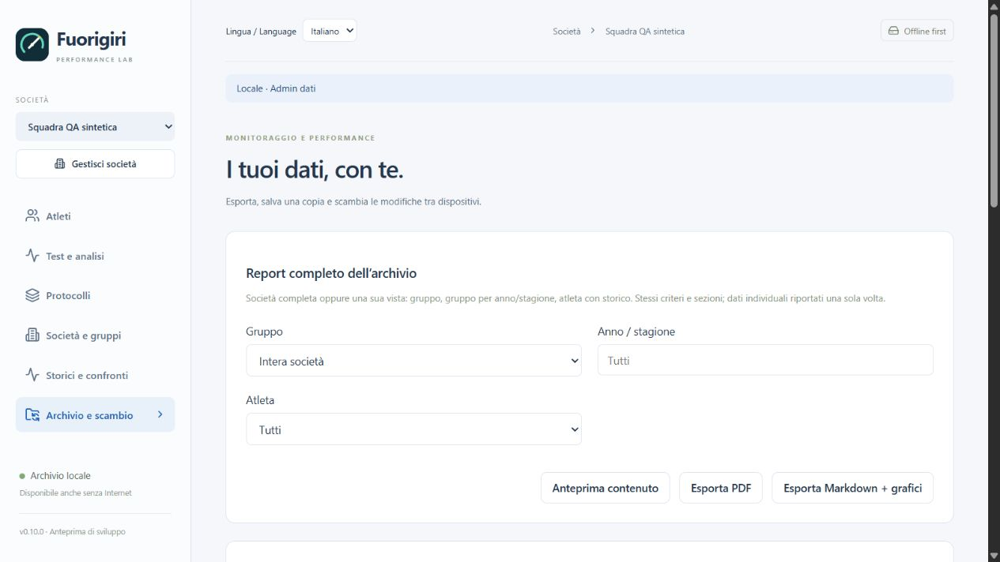](docs/screenshots/ui-coherence-010/archivio.png) |
| HV, analisi conservate e stime con metodo e limiti espliciti. | PDF e Markdown della società o delle sue sottosezioni; scambio CSV. |

### Android: navigazione compatta

Catture reali dell’APK debug su emulatore API 35 x86_64, 21 ottobre 2026, con società sintetica. Menu, Info, elenchi, moduli e grafici adattati al touch; il collaudo sul telefono resta aperto.

| Menu Android | Info |
|---|---|
| <a href="docs/screenshots/android-menu.png">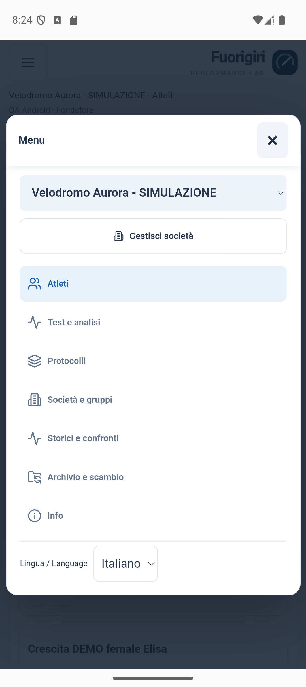</a> | <a href="docs/screenshots/android-info.png">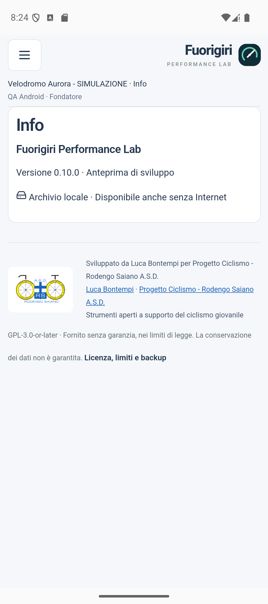</a> |

| Elenco atleti | Modulo con azione persistente |
|---|---|
| <a href="docs/screenshots/android-atleti.png">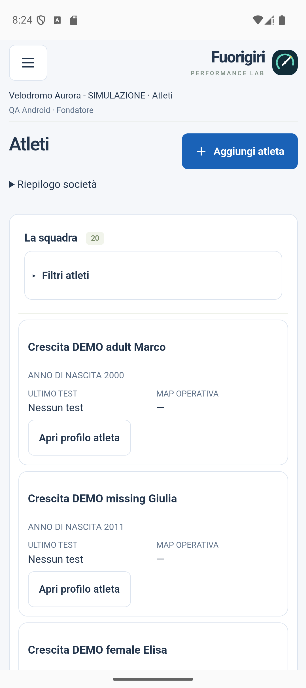</a> | <a href="docs/screenshots/android-modulo.png">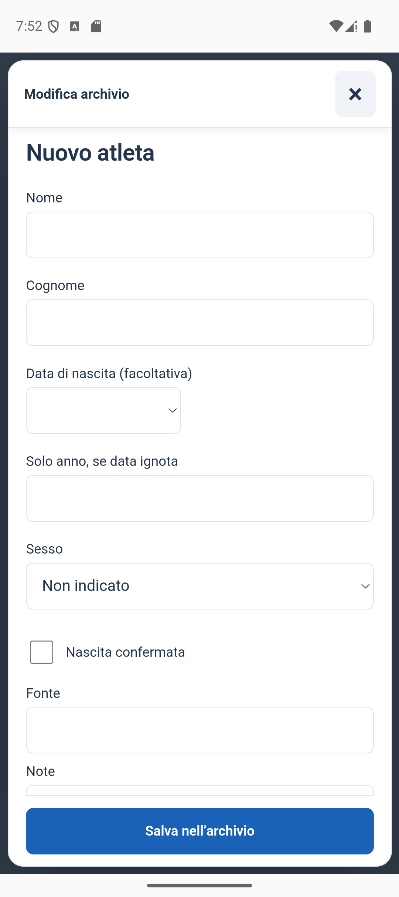</a> |

<a href="docs/screenshots/android-grafico.png">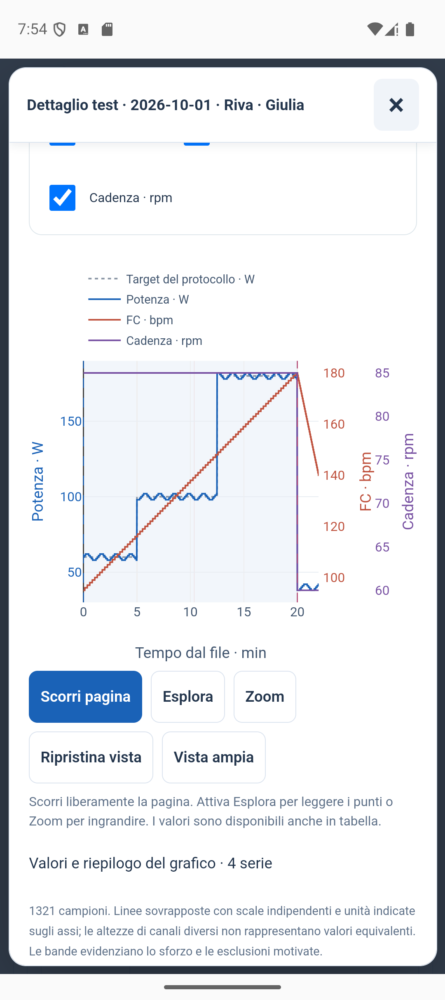</a>

<a href="docs/screenshots/android-grafico-orizzontale.png">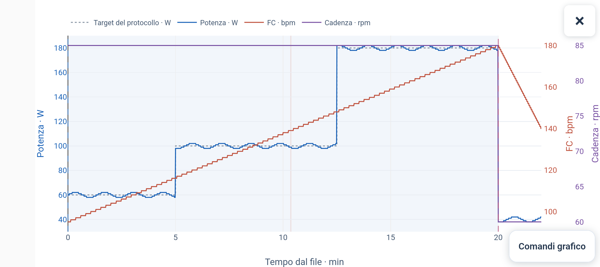</a>

La [guida della galleria](docs/screenshots/README.md) descrive come riprodurre le viste e aggiornare immagini e didascalie insieme alle modifiche dell’interfaccia.

## Provare l’interfaccia

La [guida di avvio e collaudo](docs/TESTARE_IL_PROGETTO.md) descrive installazione delle dipendenze di sviluppo, finestra desktop, browser e rigenerazione conservativa delle demo. Da un ambiente di sviluppo già predisposto, nella radice:

```powershell
npm --prefix frontend run build
.venv/Scripts/python.exe scripts/demo_suite.py --data .local/demo-nuova
.venv/Scripts/python.exe scripts/serve.py --data .local/demo-nuova --port 8766
```

Aprire l’URL completo stampato, incluso il token. Attendere il riepilogo finale del generatore prima di avviare il server; la preparazione delle repliche può richiedere alcuni minuti. Per una demo ridotta aggiungere `--small`. Su Linux usare `.venv/bin/python`.

Il generatore include test, crescita/maturazione, repliche admin/visualizzatore e backup con dati interamente fittizi. Rifiuta destinazioni esistenti: per rigenerarle conservando la copia precedente seguire la [procedura di reset](docs/TESTARE_IL_PROGETTO.md). Nessun dato personale degli allegati è incluso.

## Documentazione

L’[indice completo](docs/README.md) distingue guide attuali, specifiche e documenti storici.

| Per fare cosa | Documento |
|---|---|
| Avviare e collaudare app e interfaccia | [Guida di test](docs/TESTARE_IL_PROGETTO.md) · [Dati sintetici](docs/DATI_SINTETICI.md) |
| Gestire società, inviti, ruoli e ripristino | [Società, backup e accessi](docs/SOCIETA_BACKUP_E_ACCESSI.md) |
| Collegare cartella, WebDAV o cloud | [Configurazione sincronizzazione](docs/CONFIGURARE_LA_SINCRONIZZAZIONE.md) · [Limiti e scalabilità](docs/SYNC_DIMENSIONI_E_SCALABILITA.md) |
| Definire protocolli e campi facoltativi | [Protocolli e campi custom](docs/PROTOCOLLI_E_CAMPI_CUSTOM.md) |
| Conoscere metodi e limiti | [Incrementale](docs/METODI_INCREMENTALE.md) · [Sprint/Wingate](docs/TEST_ANAEROBICI.md) · [Maturazione](docs/MATURAZIONE.md) |
| Preparare distribuzione e mobile | [Distribuzione](docs/DISTRIBUZIONE.md) · [Android](docs/ANDROID.md) |
| Capire struttura e integrazione della suite | [Architettura](ARCHITETTURA_PROPOSTA.md) · [Componenti condivisi](docs/SUITE_CONDIVISA.md) |
| Contribuire e scegliere il prossimo lavoro | [Come contribuire](CONTRIBUTING.md) · [Sicurezza](SECURITY.md) · [Requisiti](docs/REQUISITI_E_TODO.md) · [Prossimi passi](docs/PROSSIMI_PASSI.md) · [Istruzioni repository](AGENTS.md) |
| Verificare ciò che è stato provato | [Registro verifiche](docs/VERIFICA.md) · [Changelog](CHANGELOG.md) |

## Licenza e dati

Codice distribuito sotto [GPL-3.0-or-later](LICENSE), con [avvisi delle dipendenze](THIRD_PARTY.md). Il marchio della società è distinto dalla licenza del codice.

Non pubblicare archivi locali, FIT personali, backup, inviti, token o chiavi. Sincronizzazione e backup hanno scopi distinti; conservare copie di recupero e verificarne il ripristino. Limiti attuali e qualifiche ancora necessarie sono descritti nella documentazione.
