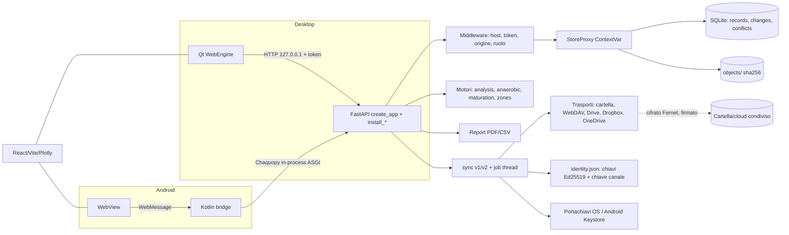
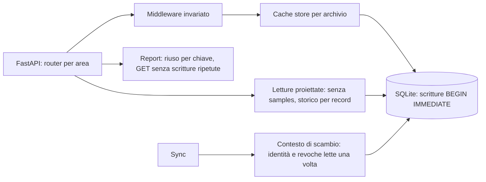

# Revisione tecnica e piano di intervento

Revisione del **14 novembre 2026** sui sorgenti **0.10.0** (commit `9c93172`). Stato: **analisi e piano approvati; blocchi 1–5 implementati nei sorgenti il 14 e 15 novembre 2026** (vedi [Avanzamento](#avanzamento)). Le altre voci restano proposte. L'avanzamento va registrato in [REQUISITI_E_TODO.md](REQUISITI_E_TODO.md), [CHANGELOG.md](../CHANGELOG.md) e [VERIFICA.md](VERIFICA.md) man mano che le voci vengono realizzate.

Gli identificativi `RT-nn` sono propri di questa revisione.

## Metodo e limiti

- Letti per intero: API, store, workspace, sync v1/v2, job di sync, cloud, backup e recupero, core condiviso (`cycling-suite-core` 0.1.2), bridge e manifest Android, workflow CI. Il resto (motori scientifici, report, frontend) è stato esaminato a campione.
- Quattro rilievi sono stati riprodotti con una sonda su archivi temporanei esterni al progetto; nessun archivio dell'utente o demo è stato aperto.
- Non eseguiti: build del frontend e dei pacchetti, collaudo grafico, prove su Android, provider cloud reali, audit delle vulnerabilità note nelle dipendenze.
- I motori scientifici non sono stati rivisti nel merito dei metodi.

**Baseline dei test prima degli interventi**

| Suite | Esito |
|---|---|
| `pytest -q` | 311 superati, 1 saltato, 2 avvisi (3 min 21 s) |
| `npm --prefix frontend run test:signals` | 43 superati su 43 |

## Sintesi

Il progetto è solido sul perimetro di sicurezza e sull'integrità dei dati, più fragile su manutenibilità e controlli automatici. Nessun rilievo critico.

Rischi principali:

1. **Letture con effetti collaterali**: i download dei report scrivono record firmati e sincronizzati e falliscono per un admin revocato (RT-03, RT-04).
2. **Robustezza di sync e scritture concorrenti**: un indice v2 illeggibile blocca lo scambio; il controllo di revisione non è atomico (RT-07, RT-08).
3. **Manutenibilità**: codice molto denso, nessun linter o type-check Python, CI solo manuale (RT-05, RT-06).

| Dimensione | Voto (1–10) | Dimensione | Voto (1–10) |
|---|---|---|---|
| Architettura | 6 | Test | 7 |
| Correttezza | 7 | Performance | 6 |
| Sicurezza | 8 | Operatività | 6 |
| Qualità del codice | 4 | Developer experience | 5 |

Il voto di performance tiene conto della scala dichiarata: 23 atleti e 89 test dal 2023 (51 aerobici, 38 anaerobici); dal 2026 circa 10–12 atleti l'anno con circa 10 test ciascuno.

## Architettura attuale

Confini di fiducia: il browser locale (token per sessione), la cartella o il cloud condiviso (non fidato: tutto cifrato e firmato), i file importati (FIT, CSV, ZIP, inviti).

## Rilievi

Certezza: **riprodotto** (osservato con la sonda), **certo** (dimostrabile dal codice), **probabile**, **ipotesi**. Effort: S, M, L.

| ID | Dimensione | Severità | Evidenza | Problema | Impatto | Soluzione proposta | Effort |
|---|---|---|---|---|---|---|---|
| RT-01 | Performance | MEDIA | [store.py:106](../backend/cycling_test/store.py), [api.py:295](../backend/cycling_test/api.py) | Certo. `list(kind)` deserializza tutti i record; i test contengono `samples` nel record, in ogni revisione e nell'oggetto traccia. `/state` li carica tutti per poi scartarli. | Stima non misurata: 20–30 MB di JSON in più a ogni refresh per ogni anno di dati; percepibile prima su Android. | Escludere `samples` in lettura con una proiezione SQL, senza cambiare schema. | M |
| RT-02 | Performance | BASSA | [store.py:52](../backend/cycling_test/store.py), [features.py:159](../backend/cycling_test/features.py) | Certo. `history(id)` scandisce e deserializza tutta la tabella `changes`; l'annullamento di un import lo chiama per ogni record del lotto. | Costo proporzionale a record del lotto × storico; tollerabile alla scala attuale. | Filtro SQL con `json_extract` e indice su espressione. | S |
| RT-03 | Correttezza | ALTA | [features.py:297](../backend/cycling_test/features.py) | Riprodotto. Ogni download del report storico salva un nuovo record `report` e un oggetto (3 download, 3 record). Il report del singolo test usa invece una cache. | Archivio e canale di sync crescono a ogni clic; una GET non è idempotente. | Riusare il record esistente con stessa query, revisioni sorgente, formato e lingua. Il confronto è per chiave: i PDF non sono identici byte per byte. | S |
| RT-04 | Correttezza | MEDIA | [api.py:535](../backend/cycling_test/api.py), [workspaces.py:109](../backend/cycling_test/workspaces.py) | Riprodotto. Il controllo guarda solo `role=='admin'`; per un admin revocato la firma fallisce e il download risponde 422. | Un collaboratore revocato non esporta più i report non in cache, pur avendo accesso in lettura. | Saltare il salvataggio quando l'identità è revocata, come per il visualizzatore. | S |
| RT-05 | Qualità | ALTA | [main.tsx](../frontend/src/main.tsx), [api.py:222](../backend/cycling_test/api.py) | Certo. 543 righe oltre 200 caratteri (126 backend, 417 frontend), fino a 3221; più istruzioni per riga; `create_app` è una closure di circa 400 righe. | Diff illeggibili, revisione e debug costosi con un solo manutentore. | Formatter automatico (ruff format, prettier), un commit per area funzionale; estrazione dei router in seguito. | M |
| RT-06 | DX / Operatività | ALTA | [desktop-build.yml](../.github/workflows/desktop-build.yml), [pyproject.toml](../pyproject.toml) | Certo. Workflow solo ad avvio manuale; nessun linter, type-check Python o audit dipendenze. | Le regressioni emergono solo se le verifiche vengono lanciate a mano. | Script unico di verifica locale e workflow leggero su push/PR. | S |
| RT-07 | Correttezza | MEDIA | [store.py:123](../backend/cycling_test/store.py), [sync.py:139](../backend/cycling_test/sync.py) | Certo nel codice, finestra temporale stretta. Il controllo di revisione è una SELECT fuori transazione; il job di sync scrive in parallelo senza lock condiviso. | Un salvataggio dall'interfaccia può sovrascrivere una revisione appena ricevuta senza registrare il conflitto. | `BEGIN IMMEDIATE` nelle scritture dello store. | S |
| RT-08 | Correttezza | MEDIA | [sync_v2.py:212](../backend/cycling_test/sync_v2.py), [sync_service.py:116](../backend/cycling_test/sync_service.py) | Riprodotto. Un file `.ctindex` illeggibile solleva `InvalidToken`, non gestito: `/sync/run` risponde 500 e `last-sync.json` non viene scritto. | Un file parziale o estraneo nella cartella blocca il primo collegamento di ogni nuovo dispositivo. | Trattare l'indice come aiuto facoltativo: registrare l'errore e ripiegare sull'inventario completo. | S |
| RT-09 | Performance | BASSA | [sync.py:77](../backend/cycling_test/sync.py), [workspaces.py:117](../backend/cycling_test/workspaces.py) | Certo. Ogni sync riverifica tutto lo storico locale; `verify_change` rilegge identità, revoche e società per ogni evento. | Costo della sync automatica proporzionale allo storico intero. | Leggere identità e revoche una volta per scambio. | M |
| RT-10 | Performance | BASSA | [workspaces.py:198](../backend/cycling_test/workspaces.py), [store.py:36](../backend/cycling_test/store.py) | Misurato: 8,9 ms. Ogni richiesta ricrea lo `Store`, con DDL e `PRAGMA user_version` in scrittura. | Latenza e scritture inutili a ogni chiamata, più pesanti su Android. | Cache degli store per percorso nel gestore. | S |
| RT-11 | Sicurezza / Privacy | MEDIA | [workspaces.py:61](../backend/cycling_test/workspaces.py), [recovery.py:54](../backend/cycling_test/recovery.py) | Certo, per scelta documentata. `identity.json` in chiaro; database e backup non cifrati. | Dati sanitari di minori leggibili da chi accede al profilo utente o a un backup copiato. | Deciso: raccomandare la cifratura del dispositivo e aggiungere il backup cifrato facoltativo. | S + L |
| RT-12 | Sicurezza | BASSA | [workspaces.py:29](../backend/cycling_test/workspaces.py) | Certo. Scrypt con n=2^14 per inviti e recupero; parametri non scritti nell'involucro. | File di invito intercettato più economico da forzare offline. | Parametri nell'involucro, nuovi file a n=2^17, lettura dei precedenti conservata. | S |
| RT-13 | Operatività | MEDIA | [workspace_api.py:86](../backend/cycling_test/workspace_api.py) | Certo. L'anteprima di ripristino salva fino a 64 GB in `restore-staging`; il file è rimosso solo a ripristino riuscito. | Spazio disco occupato in modo permanente se l'operatore abbandona. | Pulizia all'avvio dei file più vecchi di una soglia. | S |
| RT-14 | Correttezza | BASSA | [store.py:152](../backend/cycling_test/store.py) | Riprodotto. Un hash di allegato inesistente produce `FileNotFoundError` e risposta 500. | Errore opaco per l'operatore. | Convertire in `ValueError` in `read_object`. | S |
| RT-15 | Sicurezza | BASSA | [reports.py:275](../backend/cycling_test/reports.py) | Probabile. Gli export CSV scrivono nomi e note senza neutralizzare le celle che iniziano con `=`, `+`, `-`, `@`. | Un collaboratore o un CSV importato può far eseguire formule nel foglio di calcolo dell'operatore. | Approvato: apice sulle celle di testo; rimozione dell'apice in import. | S |
| RT-16 | Test / Operatività | MEDIA | [android/requirements.txt](../android/requirements.txt), [requirements-lock-windows.txt](../requirements-lock-windows.txt) | Certo. Android usa numpy 1.26.2, matplotlib 3.8.4, pydantic 2.12.3; desktop 2.5.4, 3.11.2, 2.14.1. I test girano solo sul set desktop. | Differenze numeriche o di validazione tra piattaforme non rilevate. | Job di test con le versioni Android. | M |
| RT-17 | Qualità | BASSA | [api.py:572](../backend/cycling_test/api.py) | Certo. Rami `hasattr(store,'identity')` irraggiungibili dopo il `return` precedente. | Codice morto nel percorso legacy. | Rimuovere. | S |
| RT-18 | Sicurezza | BASSA | [api.py:263](../backend/cycling_test/api.py) | Certo. Nessuna Content-Security-Policy sulle risposte del frontend. | Manca una difesa in profondità; rischio XSS oggi basso. | CSP restrittiva, da verificare con Plotly. | S |
| RT-19 | Operatività | BASSA | [requirements-lock-windows.txt](../requirements-lock-windows.txt), workflow | Certo. Lock senza hash; azioni GitHub fissate per tag. | Catena di fornitura meno verificabile. | `--require-hashes` e pin per SHA. | S |
| RT-20 | Correttezza | BASSA | [api.py:248](../backend/cycling_test/api.py) | Riprodotto via API, non raggiungibile dall'interfaccia attuale. Lo scollegamento con intestazione di una società da visualizzatore risponde 403. | L'elenco di eccezioni per percorso nel middleware è facile da dimenticare. | Dichiarare le eccezioni sulle rotte. | M |

### Aree sane, da non modificare senza motivo

- Middleware con controllo di host, token a confronto costante e origine; token nel frammento URL e in `sessionStorage`.
- Trasporti senza redirect, solo HTTPS, nomi remoti validati, oggetti immutabili riletti dopo la pubblicazione.
- Firme, revoche monotone e versioni divergenti che falliscono in chiusura.
- Validazione dei backup ZIP: percorsi ammessi, schema SQLite controllato, nessun SQL eseguito, limiti di dimensione.
- Creazione e ripristino degli archivi in staging, con pubblicazione atomica e senza sovrascritture.
- WebView Android: origine ristretta, nessun accesso a file, traffico in chiaro vietato, `allowBackup=false`, segreti nel Keystore.
- Errori di sync sanificati, senza URL o credenziali nello stato pubblico.
- Coerenza delle versioni verificata da script; documentazione disciplinata su stato e limiti.

## Decisioni prese

| Tema | Decisione |
|---|---|
| Commit | Modifiche atomiche preparate nei sorgenti; il titolo viene solo proposto, il commit è del titolare. |
| Formattazione (RT-05) | Un commit per area funzionale, non un unico commit globale. |
| Protezione dei dati (RT-11) | Raccomandazione della cifratura del dispositivo e backup cifrato facoltativo. Esclusi: chiavi di `identity.json` nel portachiavi (guadagno minimo su Windows, perdita di portabilità della cartella) e database cifrato (nuova dipendenza nativa, password a ogni avvio, rischio di perdita totale). |
| Formule nei CSV (RT-15) | Approvata la neutralizzazione in export con rimozione in import. |
| CI (RT-06) | Script locale subito; workflow leggero predisposto. La repository è privata e diventerà pubblica con la prima alpha: il 15 novembre 2026 l'utente ha deciso di attivarlo subito su push a `main` e pull request; i workflow di build restano manuali. |
| Report storici già duplicati (RT-03) | Restano come sono: nessuna cancellazione, nessun raggruppamento. |

## Piano degli interventi

Ogni voce è una modifica atomica con il proprio test. Per ciascuna: test che fissa il comportamento, modifica, poi `pytest`, `test:signals` e build del frontend.

### Blocco 1 — Correttezza

| # | Rilievi | Intervento | Rischio | Criterio di successo |
|---|---|---|---|---|
| 1 | RT-03, RT-04 | Report storico riusato per chiave e scaricabile da admin revocato | Basso; nessun cambio di API | Tre download producono un solo record; admin revocato riceve 200 |
| 2 | RT-08 | Indice v2 illeggibile non blocca la sincronizzazione | Basso | Con un `.ctindex` non valido la sync termina e l'errore è elencato |
| 3 | RT-07 | Scritture dello store in transazione immediata | Medio-basso: possibili attese sul lock (timeout di 30 s già presente) | Due scritture concorrenti con la stessa base: una riesce, l'altra riceve conflitto |
| 4 | RT-14, RT-17 | Errore comprensibile per allegato mancante; rimozione del codice morto | Minimo | Risposta 422 con messaggio; suite invariata |
| 5 | RT-13 | Pulizia delle anteprime di ripristino abbandonate | Basso: solo file temporanei oltre soglia | File vecchio rimosso, file recente conservato |

### Blocco 2 — Indurimenti approvati

| # | Rilievi | Intervento | Rischio | Criterio di successo |
|---|---|---|---|---|
| 6 | RT-15 | Formule neutralizzate in export, apice rimosso in import | Basso; cambia l'output visibile dei CSV | Export e reimport senza differenze; valori numerici intatti |
| 7 | RT-11 | Guida e nota nella vista Info sulla cifratura del dispositivo (IT/EN) | Minimo: solo testo | Testo presente in entrambe le lingue, verificato nella GUI |

### Blocco 3 — Strumenti

| # | Rilievi | Intervento | Rischio | Criterio di successo |
|---|---|---|---|---|
| 8 | RT-06 | Script unico di verifica locale e workflow CI leggero (pytest, test frontend, `tsc`, linter) | Nessuno sul prodotto; su Linux possono emergere test legati a Windows | Un comando esegue tutte le verifiche; workflow verde |
| 9 | RT-05 | Formattazione automatica, un commit per area funzionale | Diff ampi; `git blame` da filtrare | Suite invariata dopo ogni commit; nessuna modifica semantica |

### Blocco 4 — Backup cifrato facoltativo

| # | Rilievi | Intervento | Rischio | Criterio di successo |
|---|---|---|---|---|
| 10 | RT-11 | Opzione «Proteggi con password» nell'esportazione del backup | Formato nuovo da mantenere; password persa = backup irrecuperabile | Proposta di formato approvata prima del codice; ripristino reale di un backup cifrato; backup v3 in chiaro ancora leggibili e producibili |

Vincoli già fissati per la proposta: cifratura a blocchi per i file grandi, nessuna nuova dipendenza oltre `cryptography`, avviso esplicito sull'irrecuperabilità, lettura dei formati precedenti conservata.

### Blocco 5 — Non urgente alla scala attuale

| # | Rilievi | Intervento |
|---|---|---|
| 11 | RT-01, RT-09, RT-10, RT-02 | Stato senza campioni, costi di sync, store per richiesta, storico per record |
| 12 | RT-12, RT-16, RT-18, RT-19, RT-20 | Parametri scrypt, test con versioni Android, CSP, hash del lock e pin delle azioni, autorizzazioni per rotta |

Per RT-01 si adotta solo la proiezione in lettura; la rimozione dei campioni dai record firmati è accantonata.

## Avanzamento

| Data | Voci | Stato | Note |
|---|---|---|---|
| 14 novembre 2026 | Blocco 1 (#1–#5: RT-03, RT-04, RT-07, RT-08, RT-13, RT-14, RT-17) | Implementato nei sorgenti, test automatici | Il riuso per chiave copre anche il report d'archivio (`archive_report.py`), che aveva lo stesso schema di salvataggio a ogni download. Il report storico viene sempre rigenerato; si evita solo il record duplicato. Soglia di pulizia delle anteprime: 24 ore. Prove in [VERIFICA.md](VERIFICA.md). |
| 14 novembre 2026 | Blocco 2 (#6–#7: RT-15, RT-11) | Implementato nei sorgenti; RT-11 verificato nella GUI web | La nota sulla cifratura è nella finestra «Licenza, limiti e backup», che su Android è nella vista Info e su desktop nel piè di pagina (il desktop non ha una vista Info). Neutralizzazione anche negli export di maturazione e ripetibilità. |
| 14 novembre 2026 | Blocco 3, voce 8 (RT-06) | Implementato nei sorgenti; script verificato in locale | `scripts/verify.py` e workflow `verify.yml` manuale su Windows (stesso lockfile dei test). Il linter è limitato agli errori (F, E9); i 70 rilievi iniziali sono stati corretti. «Workflow verde» non verificato: serve un push. Voce 9 sospesa: la formattazione toccherebbe gli stessi file con modifiche dei blocchi 1–3 non ancora committate, impedendo commit separati per area. |
| 15 novembre 2026 | Blocco 3, voce 9 (RT-05) | Implementato nei sorgenti, equivalenza verificata | `ruff format` (120 colonne, apici conservati) e `prettier` 3.6.2. AST Python identico; bundle frontend equivalente (solo testi JSX divisi e uno spazio multiplo ridotto). Sette commit di sola formattazione per area, elencati in `.git-blame-ignore-revs`. |
| 15 novembre 2026 | Blocco 4, voce 10 (RT-11) | Implementato nei sorgenti; ripristino reale via API e GUI web | Proposta di formato approvata dall'utente il 15 novembre ([BACKUP_CIFRATO.md](BACKUP_CIFRATO.md)). File `.fgbak`, password di almeno 12 caratteri, opzione disattivata di default e disponibile dove si scarica il v3 (Android non provato). La copia decifrata resta in `restore-staging` fino al ripristino o per 24 ore. |
| 15 novembre 2026 | Blocco 5, voce 11 (RT-01, RT-09, RT-10, RT-02) | Implementato nei sorgenti, test e misure | Misura preliminare di RT-01: `/state` 513 ms su 300 test sintetici da 30 minuti, 93 ms con la proiezione SQL e risposta identica. Sync, apertura dello store e storico misurati in [VERIFICA.md](VERIFICA.md). La sync v2 verifica ancora tutto lo storico per comporre le pagine. |
| 15 novembre 2026 | Blocco 5, voce 12 (RT-12, RT-18, RT-19, RT-20, RT-16) | Implementato nei sorgenti, test; CSP verificata con Plotly in Chrome headless; RT-16 eseguito su Python 3.12 | I nuovi inviti e recuperi richiedono un'app aggiornata. RT-20 consente anche lo scollegamento da visualizzatore. Hash del lockfile in un file distinto per non entrare in conflitto con `sync-core.py` del common. RT-16 usa Python 3.12, perché le versioni Android di numpy e matplotlib non hanno wheel per 3.13. |
| 15 novembre 2026 | RT-06, attivazione CI | Workflow `verify.yml` attivo su push a `main` e pull request | Decisione dell'utente. Esito su GitHub da osservare al primo push. |
| 15 novembre 2026 | RT-05, estrazione dei router | Implementato nei sorgenti, equivalenza verificata | Moduli per area con `install(...)` invece di `APIRouter`, per restare coerenti con gli altri moduli e conservare l'ordine di registrazione (per esempio `/tests/preview` prima di `/tests/{id}`). Stesse 112 rotte e stesso schema OpenAPI. |

## Architettura target

Nessun cambio di confini o di schema; tre punti interni.

## Vincoli di esecuzione

- Nessuna modifica ad API pubbliche, schema del database o comportamento visibile oltre a quanto approvato qui (RT-15 e nota in Info) senza richiesta esplicita.
- Nessuna nuova dipendenza di prodotto senza motivazione; linter e formatter sono dipendenze di sviluppo.
- Se un intervento rivela qualcosa che cambia il piano, ci si ferma e si avvisa.
- Requisiti, changelog e registro verifiche aggiornati insieme alle modifiche sostanziali.

## Punti aperti

- Revisione giuridica del trattamento dei dati di minori, già prevista e non coperta da questa revisione tecnica.
